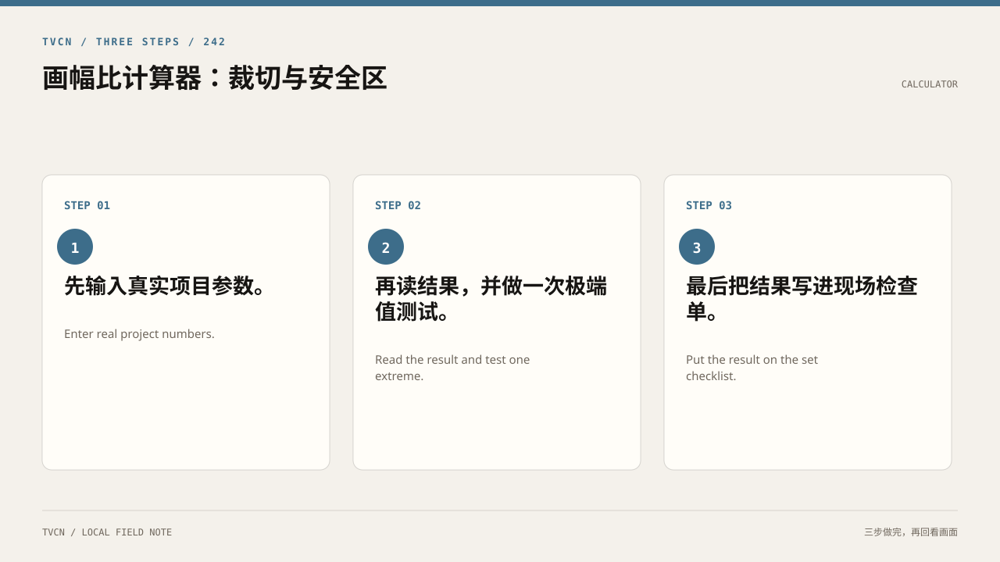

画幅比 = 宽 ÷ 高 。把 16:9 裁成 9:16 时，能保留的宽度 = 原高 × 9 ÷ 16；例如 3840×2160 裁成 9:16，保留 1215×2160，左右各丢约 1312 像素。

<!-- DIAGRAM_START -->
<h2>图解</h2>
<figure>
  
  <figcaption>看“4K 16:9 裁 9:16 只剩约…”和“先确认像素够不够”两处，判断这个参数能不能对应到一个具体的拍摄问题。</figcaption>
</figure>
<!-- DIAGRAM_END -->
<section><h2 id="section-1">公式与安全区</h2>
画幅比 = <strong>宽 ÷ 高</strong>。把 16:9 裁成 9:16 时，能保留的宽度 = 原高 × 9 ÷ 16；例如 3840×2160 裁成 9:16，保留 1215×2160，左右各丢约 1312 像素。
<h2 id="section-2">三种常见转换</h2><ul><li>16:9 → 1:1：保留 2160×2160，左右各丢 840 像素。</li><li>16:9 → 4:5：保留 1728×2160，左右各丢 1056 像素。</li><li>9:16 竖屏拍时，把主体放在中间 1080 宽的安全区，不要贴边。</li></ul><h2 id="section-3">边界</h2>
裁切不是重新构图；重要动作和字幕要放在安全区内。不同平台还会再裁一次，交付前用平台预览核对。
</section><section><h2 id="section-4">现场</h2>
4K 16:9 裁 9:16 只剩约 1215×2160，先确认像素够；安全区按平台重画。
</section><section><h2 id="section-5">怎么做</h2><ol><li>4K 16:9 裁 9:16 只剩约 1215×2160。</li><li>先确认像素够不够。</li><li>安全区按平台重画。</li></ol></section><section><h2 id="section-6">别踩</h2>
别把横屏直接裁成竖屏；有效像素掉一半，特写会糊。
</section><section class="calc-widget" data-calculator="aspect-calculator">
<h2 id="section-7">比例裁切计算器</h2>

按目标比例从原图内最大裁切，输出保留像素与裁切比例。

<label class="calc-field">原片宽（px）<input type="number" inputmode="decimal" data-calc="width" data-default="3840" value="3840" step="1" min="1"></label><label class="calc-field">原片高（px）<input type="number" inputmode="decimal" data-calc="height" data-default="2160" value="2160" step="1" min="1"></label><label class="calc-field">目标比例<select data-calc="ratio" data-default="9:16"><option value="1:1">1:1 方图</option><option value="4:5">4:5 竖版</option><option value="9:16" selected>9:16 全屏</option><option value="16:9">16:9 横版</option><option value="2.35:1">2.35:1 宽银幕</option></select></label>

<strong data-out="result">裁切 —</strong>先保主体，再裁边；不要从中间硬切。

<button type="button" data-reset>恢复默认</button>

比较原片与目标比例：偏宽则裁宽，偏窄则裁高；保留另一边的全部像素。

<noscript>
JavaScript 关闭时按公式手算；3840×2160 转 9:16 保留 1215×2160。
</noscript>
</section><section><h2>替代</h2>
如果“4K 16:9 裁 9:16 只剩约…”不是你的主问题，先用“先确认像素够不够”对应的基础做法；两项都成立再考虑升级。
</section><section><h2>60 秒自测</h2>
用现有器材按“4K 16:9 裁 9:16 只剩约…”做一次 60 秒测试，记下一个数字；数字没有变化，就不要加预算。
</section>
<h2>验收</h2><ul><li>裁切后的有效像素有数字，约 1215×2160。</li><li>像素满足交付要求，不靠放大补。</li><li>安全区按竖屏平台重新画过，不是沿用横屏。</li></ul>
