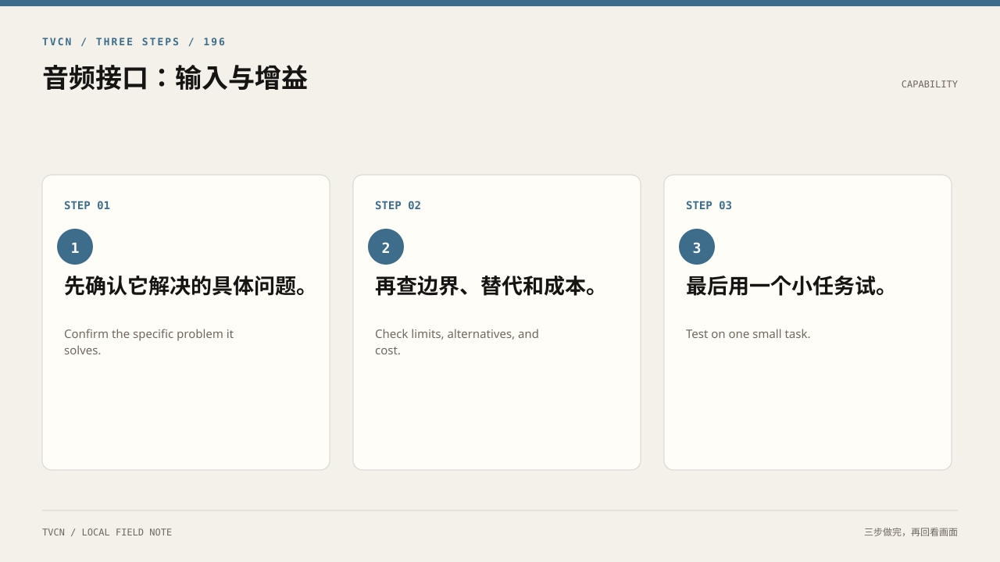

只需一支领夹进相机时，接口盒是多余环节；先解决麦距和增益。不要用设备数量替代录音基本功。

<!-- DIAGRAM_START -->
<h2>图解</h2>
<figure>
  
  <figcaption>看“接一支动圈麦，增益开到 70%”和“录 30 秒静音，听底噪”两处，判断这个参数能不能对应到一个具体的拍摄问题。</figcaption>
</figure>
<!-- DIAGRAM_END -->
<section><h2 id="section-1">选型先看什么</h2><ul><li><strong>输入与增益：</strong>确认话放增益是否够推你的麦，底噪在最大增益下是否可接受。</li><li><strong>通道与监听：</strong>需要几路独立输入、是否有直接监听和耳机输出；直播还要看回传。</li><li><strong>连接与供电：</strong>USB 总线供电是否稳定，是否需要独立电源；长线会不会引入噪声。</li></ul><h2 id="section-2">什么时候不要用</h2></section><section><h2 id="section-3">现场</h2>
接一支动圈麦，增益开到 70%，录 30 秒静音；听底噪，再看最大增益是否够。
</section><section><h2 id="section-4">怎么做</h2><ol><li>接一支动圈麦，增益开到 70%。</li><li>录 30 秒静音，听底噪。</li><li>再看最大增益是否够录小声对白。</li></ol></section><section><h2 id="section-5">别踩</h2>
别只看接口数量；增益不够，小声对白推上去全是底噪。
</section>
<h2>验收</h2><ul><li>动圈麦在 70% 增益下录了 30 秒静音。</li><li>底噪水平能被描述，不是只说“还行”。</li><li>最大增益能录清小声对白，且底噪可接受。</li></ul>

> 意图分工：本页负责「音频接口：输入与增益」的可执行细节；同集群先读 <a href="https://tools.tvcn.org/article/lav-hidden/">领夹藏麦：衣领、头发、胶带</a> 建立总判断，再回到本页。

<!-- INTENT_SCOPE -->

<!-- SOURCES_START -->
## 参考与延伸阅读

- [S23] [SMPTE 标准入口](https://www.smpte.org/standards) — 2026-11-26 访问。用于核对首段“音频接口先看输入数量、增益范围和底噪；接口再贵，增益不够也录不了小声。”中的术语与公开背景（时间码、色彩、影院与信号链标准的机构入口）；不替代现场测试。
- [S31] [ARRI Cine Systems](https://www.arri.com/en/cine-systems) — 2026-11-26 访问。用于核对首段“音频接口先看输入数量、增益范围和底噪；接口再贵，增益不够也录不了小声。”中的术语与公开背景（摄影机、镜头与灯光的技术资料入口）；不替代现场测试。
- [S29] [YouTube 上传规格](https://support.google.com/youtube/answer/1722171) — 2026-11-26 访问。用于核对首段“音频接口先看输入数量、增益范围和底噪；接口再贵，增益不够也录不了小声。”中的术语与公开背景（分辨率、码率、帧率与音频编码建议）；不替代现场测试。
- [S30] [DaVinci Resolve 产品与文档](https://www.blackmagicdesign.com/products/davinciresolve) — 2026-11-26 访问。用于核对首段“音频接口先看输入数量、增益范围和底噪；接口再贵，增益不够也录不了小声。”中的术语与公开背景（剪辑、调色、Fusion 与交付的官方产品入口）；不替代现场测试。
- [S70] [FFmpeg：文档](https://ffmpeg.org/documentation.html) — 2026-11-26 访问。用于核对首段“音频接口先看输入数量、增益范围和底噪；接口再贵，增益不够也录不了小声。”中的术语与公开背景（编解码、封装与滤镜文档）；不替代现场测试。
<!-- SOURCES_END -->

