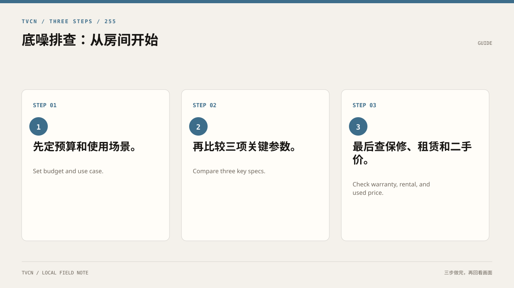

底噪排查从房间开始：关空调、关灯、换插座、换线；最后才怪麦克风。

<!-- DIAGRAM_START -->
<h2>图解</h2>
<figure>
  
  <figcaption>把三步按顺序做完，再回看画面或文件。</figcaption>
</figure>
<!-- DIAGRAM_END -->
<h2>现场</h2>

关空调、灯、风扇，换插座，换线；用手机录一段对比，确认源头。

<h2>怎么做</h2>

底噪从房间开始：关空调、换插座、换线；最后才怪麦克风。
<ol><li>关空调、冰箱和灯，录三十秒静音。</li><li>换插座、换线，把增益放在录音机。</li><li>让人物靠近麦，另录环境声做底。</li></ol>
<h2>别踩</h2>

别一上来买新麦；噪声可能来自电源或房间。

<h2>验收</h2>
<ul><li>关空调、冰箱和灯，录过三十秒静音。</li><li>换过插座和线，增益放在录音机。</li><li>人物靠近麦，另有一条环境声。</li></ul>
