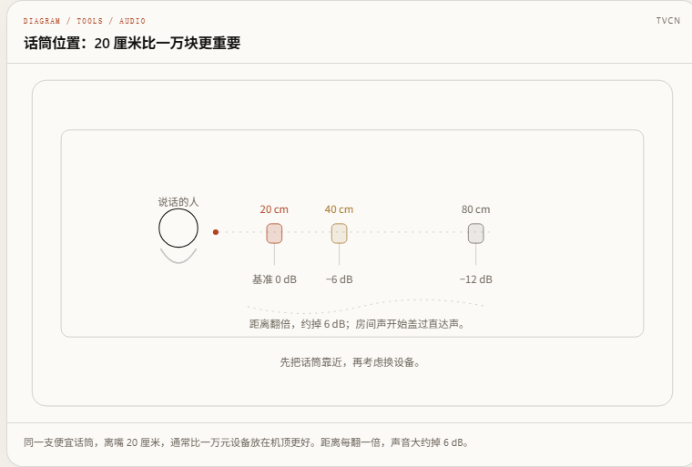

<!-- DIAGRAM_START -->
## 图解

<figure>
  
  <figcaption>同一支便宜话筒，离嘴 20 厘米，通常比一万元设备放在机顶更好。距离每翻一倍，声音大约掉 6 dB。</figcaption>
</figure>
<!-- DIAGRAM_END -->

同一支便宜话筒，放在离嘴 20 厘米的位置，通常比一万元设备放在机顶更好。

## 距离

话筒离嘴越近，直达声越强，房间回声越弱。领夹麦 15–20 厘米，枪麦在画外 40–60 厘米，不要放在机顶。

机顶麦的问题是距离远，收进来的是房间，不是人。它适合留环境声，不适合做主对白。

## 指向

枪麦要指向嘴，不要指向胸口。领夹麦要避开衣领摩擦和头发；用防风罩，不要用胶带直接粘在皮肤上。

录之前戴耳机听 30 秒。只听电平表不够，底噪、空调、冰箱、远处交通都要用耳朵确认。

## 备份

重要对白至少两套记录：领夹 + 枪麦，或录音机 + 相机。32-bit float 能救回一部分爆音，但不能救回没录到的声音。

每个场景录 30 秒干净环境声，拍一张场记。后期最缺的往往不是设备，是那段没人录的安静。

## 3 条验收

- 主对白不是机顶麦录的。
- 话筒距离和指向有明确理由。
- 重要场景有第二套录音或至少 30 秒环境声。

<!-- DEEP_DIVE_START -->
## 深读

<strong>约 7 分钟。</strong> 收音位置比麦克风贵不贵更重要；位置错，贵麦也只能收到房间。

### 领夹麦的位置

领夹麦放在胸口中线、距下巴一掌左右；太靠上会喷麦，太靠下会收进衣服摩擦。别在衣领外侧，风一吹就响。

藏麦要避开围巾、拉链、项链；用胶带固定在内侧，留一点缓冲。拍前让对方转头、抬手、坐下，听有没有摩擦。

### 举杆的距离

杆头在人物头顶前方、画框外，距嘴约四十到六十厘米；越近越干，越远越像房间。不要举在头顶正上方，会收到天花板反射。

两个人对话，杆跟着说话的人走；不要为了不动把杆放中间，中间往往两边都收不好。

### 先录三十秒测试

开机前录三十秒：让人说三句、转身、坐下、走两步；回放听摩擦、喷麦、房间声、空调声。问题在现场改，不要留给后期。

同时录一段房间底噪，十秒就够；后期对白和底噪分开，剪辑时才能接得顺。

### 五分钟练习：三个位置对比

同一句话录三次：领夹在胸口、领夹在衣领外、杆在头顶前；每次回放，写下“干/闷/摩擦/房间大”。

三次里选最干的一条，记住位置；下次先按这个位置摆，再做微调。

### 什么时候算收清楚

戴耳机听，三句里没有喷麦、没有衣服摩擦、没有空调、没有突然的爆音；房间底噪有但稳定；人物转身时声音不掉。四项都过，才算收清楚。

有一项没过，不要用降噪硬救；先改位置，再录一条。

### 再听一遍转身

让人物左右转头各一次，戴耳机听领夹麦有没有摩擦、声音有没有忽大忽小；转身时掉声音，说明麦的位置或衣服在挡。现场多转两次，比后期修十次有用。

### 收音位置，十项检查
<ul><li>领夹在胸口中线</li><li>距下巴约一掌</li><li>不在衣领外侧</li><li>避开围巾拉链项链</li><li>胶带固定留缓冲</li><li>杆在头顶前方画框外</li><li>距嘴四十到六十厘米</li><li>两人对话杆跟说话人</li><li>开机前录三十秒测试</li><li>录十秒房间底噪</li></ul>
收音的第一笔预算不是买麦，是把麦放到离嘴更近的地方。

<!-- DEEP_DIVE_END -->
<!-- SOURCES_START -->
<h2>参考与延伸阅读</h2>

经验来源：编辑部现场手册与购买检查表；实测来源：短测与公开规格核对，不是实验室跑分；参考来源：以下厂商与标准链接。

<ul><li>[S23] SMPTE 标准入口</li><li>[S25] ITU-R BT.709</li><li>[S26] ITU-R BT.2020</li><li>[S29] YouTube 上传规格</li><li>[S38] 国家税务总局</li></ul>

<a href="../../SOURCES.md">完整链接与用途见 SOURCES.md</a>

<!-- SOURCES_END -->
