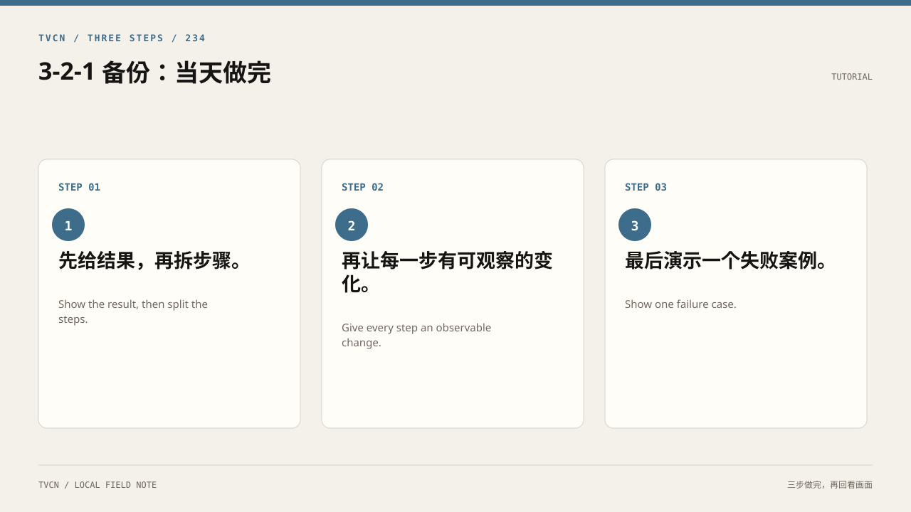

3-2-1 不是“上传云就完事”。拍摄当天至少做三份：卡/机身一份、现场硬盘一份、另一块可离线硬盘或云一份；其中一份不在同一栋楼。

<!-- DIAGRAM_START -->
<h2>图解</h2>
<figure>
  
  <figcaption>看“当天拷卡到 SSD”和“再拷到另一块硬盘”两处，判断这个参数能不能对应到一个具体的拍摄问题。</figcaption>
</figure>
<!-- DIAGRAM_END -->
<section><h2 id="section-1">三份、两种介质、一份异地，当天做完</h2>
每份都要能读：随机抽一个文件回放，核对文件名和时长；只看到“拷贝完成”不算备份。
<h2 id="section-2">边界</h2>
RAID 不是备份，同步盘也不是备份。误删会同步删除，勒索软件会加密整组。至少保留一份离线、只读或版本化的副本。
</section><section><h2 id="section-3">现场</h2>
当天拷卡到 SSD，再拷到另一块硬盘，最后传 NAS 或云；三份完成再格式化卡。
</section><section><h2 id="section-4">怎么做</h2><ol><li>当天拷卡到 SSD。</li><li>再拷到另一块硬盘。</li><li>最后传 NAS 或云，三份完成再格式化卡。</li></ol></section><section><h2 id="section-5">别踩</h2>
别把“明天再备份”当计划；卡一丢，三份都来不及。
</section><figure class="article-audio"><audio controls preload="none" src="../../assets/audio/zh/tool-backup-3-2-1.zh.mp3"></audio><figcaption>20 秒语音演示：一个检查点和最常见的失败。文字稿与步骤在正文里。</figcaption></figure><section><h2>判断</h2>
这一页的判断只看三条可观察的验收，不靠口号：
<ul><li><strong>1.</strong> 当天完成三份拷贝，文件数一致。</li><li><strong>2.</strong> 使用两种介质，其中一份在异地或云端。</li><li><strong>3.</strong> 卡格式化发生在三份确认之后。</li></ul></section><section><h2>失败</h2>
下面任一条出现，先停，不要靠后期补：
<ul><li><strong>1.</strong> 只做到“当天完成三份拷贝，文件数一致”的形式，换一个机位或场景就重现不了。</li><li><strong>2.</strong> 把“使用两种介质，其中一份在异地或云端”留到后期或口头解释，现场没有留下能复查的记录。</li><li><strong>3.</strong> 别把“明天再备份”当计划；卡一丢，三份都来不及。</li></ul></section><section><h2>延伸</h2>
<strong>10 分钟练习：</strong>用现有器材做 60 秒测试，只测“当天拷卡到 SSD”；记下两个数字：一个是你需要的，一个是器材实际给出的。
</section>
<h2>验收</h2><ul><li>当天完成三份拷贝，文件数一致。</li><li>使用两种介质，其中一份在异地或云端。</li><li>卡格式化发生在三份确认之后。</li></ul>

<!-- DEEP_DIVE_START -->
## 深读

<strong>约 5 分钟。</strong> 备份不是把文件拖进另一块盘，是确保明天还能打开、还能导出。

### 当天备份流程

拷卡、校验、改名、两份媒介、一份离开机器。文件名统一“日期_项目_机位_卡号”；不要用“final”。拷完抽三个文件打开，不要只看进度条。

当天不做，等于明天从零开始。剪辑前先确认两份都在，再格式化卡。

### 恢复演练

每月随机抽一个项目，从备份盘打开工程、找到原始素材、导出一分钟。记录花了多久、缺了什么。没有演练过的备份，只是心理安慰。

把恢复步骤写成一页纸，放在项目盘根目录。半年后你会忘记密码、软件版本和那根转接线放在哪。

### 卡、盘、云的分工

卡是运输工具，不是仓库；工作盘是正在剪的那份；备份盘和异地副本才是保险。三样各干各的，不要互相替代。

云盘适合小文件和最终交付，不适合每天几百 GB 的原始素材。上传时间也是成本。

### 命名和文件夹

项目根目录只放四样：素材、工程、输出、文档。素材按日期_机位分，工程按版本分，输出按平台分。不要把所有东西堆在桌面。

禁止“final”“final2”“真的final”。用日期和版本号，三个月后还知道哪个是最后交付。

### 每次拷卡，照着这十步做
<ul><li>先确认卡上素材能正常回放</li><li>拷到第一块工作盘</li><li>用校验工具比对文件数量和解码</li><li>改名为日期_项目_机位_卡号</li><li>拷到第二块备份盘</li><li>让其中一份离开这台机器</li><li>随机打开三个文件确认能播</li><li>确认两份都在，再格式化卡</li><li>把恢复步骤写在项目盘根目录</li><li>每月抽一个项目做一次恢复演练</li></ul>
备份不是把文件拖过去，是确保明天还能打开、还能导出、还能交片。格式化卡之前，把两份备份各打开一次；能打开、能播放、能导出，才算备份完成。

<!-- DEEP_DIVE_END -->

> 意图分工：本页负责「3-2-1 备份：当天做完」的可执行细节；同集群先读 <a href="https://tools.tvcn.org/article/buy-storage/">购买项目存储：速度、容量与备份</a> 建立总判断，再回到本页。

<!-- INTENT_SCOPE -->

<!-- SOURCES_START -->
## 参考与延伸阅读

- [S70] [FFmpeg：文档](https://ffmpeg.org/documentation.html) — 2026-11-26 访问。用于核对「三份、两种介质、一份异地，当天做完」一节的术语/方法/规则（FFmpeg 编解码/封装文档，不是交付规范）；不核对其中由本页经验得出的数字、型号与现场结论，也不替代测试。
- [S29] [YouTube：上传编码建议](https://support.google.com/youtube/answer/1722171) — 2026-11-26 访问。用于核对「现场」一节的术语/方法/规则（YouTube 上传编码建议，不是创作标准）；不核对其中由本页经验得出的数字、型号与现场结论，也不替代测试。
- [S57] [Blackmagic：URSA Mini Pro 12K 规格](https://www.blackmagicdesign.com/products/blackmagicursaminipro/techspecs) — 2026-11-26 访问。用于核对「怎么做」一节的术语/方法/规则（URSA Mini Pro 12K 官方规格，不是独立测试）；不核对其中由本页经验得出的数字、型号与现场结论，也不替代测试。
<!-- SOURCES_END -->

