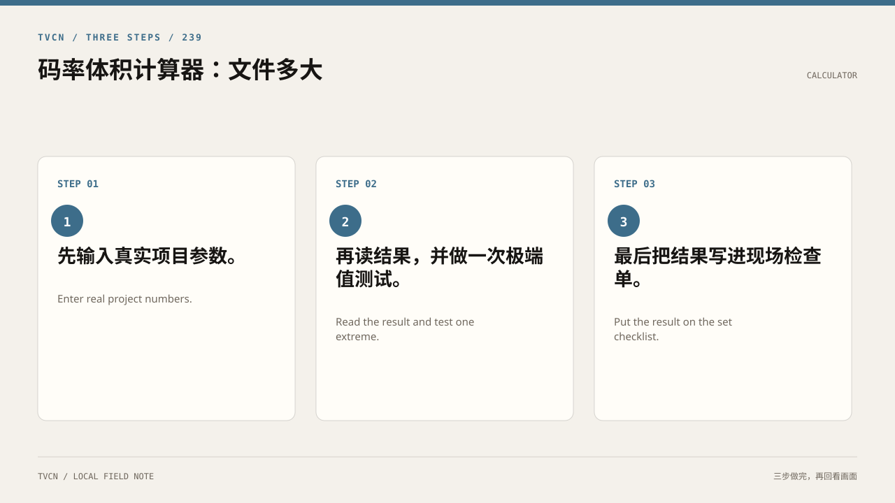

码率计算器按分钟和 Mbps 算文件体积；交付前先知道硬盘够不够。

<!-- DIAGRAM_START -->
<h2>图解</h2>
<figure>
  
  <figcaption>把三步按顺序做完，再回看画面或文件。</figcaption>
</figure>
<!-- DIAGRAM_END -->
<h2>现场</h2>

输入分钟和 Mbps，算 GB；加 20% 余量，再看卡和硬盘。

<h2>怎么做</h2>

码率计算器按分钟和 Mbps 算文件体积；交付前先知道硬盘够不够。
<ol><li>输入分钟和 Mbps。</li><li>算 GB，加 20% 余量。</li><li>再对照卡和硬盘剩余空间。</li></ol>
<h2>别踩</h2>

别用 Mbps 直接当 MB；单位差八倍，硬盘会算少。

<h2>验收</h2>
<ul><li>分钟和 Mbps 输入正确，单位换算成 GB。</li><li>结果加了 20% 余量。</li><li>与卡和硬盘剩余空间对照过，够用再交付。</li></ul>
