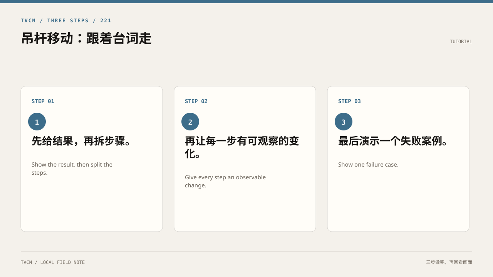

操作杆的人要提前知道演员下一步去哪：看排练、听指令、盯脚步。杆头保持在演员前上方 40–60 厘米，避免影子入画；换位时从画面外绕，不要从头顶横过去。

<!-- DIAGRAM_START -->
<h2>图解</h2>
<figure>
  
  <figcaption>看“让吊杆头跟着演员胸口”和“距离保持 40 到 60 厘米”两处，判断这个参数能不能对应到一个具体的拍摄问题。</figcaption>
</figure>
<!-- DIAGRAM_END -->
<section><h2 id="section-1">话筒杆跟着动作走，不横穿画面</h2>
每个镜头前录一句“杆位测试”，确认没有撞到灯或反光板。
<h2 id="section-2">边界</h2>
杆不是越近越好。太近会录到呼吸和衣服；太远会空。先保对白，再追求“看不见杆”。
<h2 id="section-3">吊杆跟着台词走，不跟着人走</h2>

吊杆的目标是让话筒保持在嘴的上方，不是追着演员跑。先排走位，标出每句台词的头部位置，再决定杆的移动路线。

<ol><li>杆头始终在画框外上方，离嘴 30–60cm；太远收不到，太近会入画。</li><li>移动用“跟台词不跟身体”：演员走动时，杆在两句之间换位，不在说话中间甩。</li><li>操作员戴耳机，监听爆音和风声；风大加防风毛套，不要靠后期降噪硬救。</li></ol>

验收：回放时听对白是否忽大忽小、是否有杆影；有，先改走位或杆位，不要先加压缩。
</section><section><h2 id="section-4">现场</h2>
让吊杆头跟着演员胸口，距离保持 40 到 60 厘米；演员转身时杆头留在画外上方。
</section><section><h2 id="section-5">怎么做</h2><ol><li>让吊杆头跟着演员胸口。</li><li>距离保持 40 到 60 厘米。</li><li>演员转身时，杆头留在画外上方。</li></ol></section><section><h2 id="section-6">别踩</h2>
别把杆头追着嘴；演员一转头，杆就进画。
</section><section><h2>判断</h2>
这一页的判断只看三条可观察的验收，不靠口号：
<ul><li><strong>1.</strong> 吊杆跟着胸口，不是追嘴。</li><li><strong>2.</strong> 距离保持在 40 到 60 厘米。</li><li><strong>3.</strong> 演员转身时杆头留在画外，没有穿帮。</li></ul></section><section><h2>失败</h2>
下面任一条出现，先停，不要靠后期补：
<ul><li><strong>1.</strong> 只做到“吊杆跟着胸口，不是追嘴”的形式，换一个机位或场景就重现不了。</li><li><strong>2.</strong> 把“距离保持在 40 到 60 厘米”留到后期或口头解释，现场没有留下能复查的记录。</li><li><strong>3.</strong> 别把杆头追着嘴；演员一转头，杆就进画。</li></ul></section><section><h2>延伸</h2>
<strong>10 分钟练习：</strong>用现有器材做 60 秒测试，只测“让吊杆头跟着演员胸口”；记下两个数字：一个是你需要的，一个是器材实际给出的。
</section>
<h2>验收</h2><ul><li>吊杆跟着胸口，不是追嘴。</li><li>距离保持在 40 到 60 厘米。</li><li>演员转身时杆头留在画外，没有穿帮。</li></ul>

<!-- SOURCES_START -->
## 参考与延伸阅读

- [S27] [ITU-R BS.1770：响度与真峰值测量](https://www.itu.int/rec/R-REC-BS.1770/en) — 2026-11-26 访问。用于核对「话筒杆跟着动作走，不横穿画面」一节的术语/方法/规则（BS.1770 响度测量方法，不是话筒选购）；不核对其中由本页经验得出的数字、型号与现场结论，也不替代测试。
- [S23] [SMPTE：标准入口](https://www.smpte.org/standards) — 2026-11-26 访问。用于核对「吊杆跟着台词走，不跟着人走」一节的术语/方法/规则（SMPTE 标准入口，不是具体机型参数）；不核对其中由本页经验得出的数字、型号与现场结论，也不替代测试。
<!-- SOURCES_END -->

