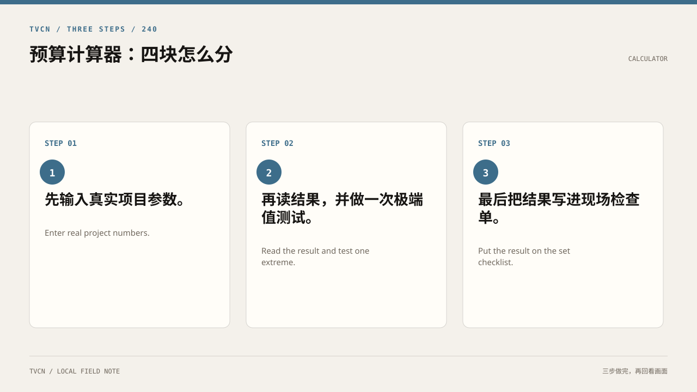

把总预算先分成四块，再谈具体报价： 拍摄 50% / 后期 25% / 器材与场地 15% / 预备 10% 。预备金不是利润，是给改期、补拍和超时的缓冲。

<!-- DIAGRAM_START -->
<h2>图解</h2>
<figure>
  
  <figcaption>看“总预算分四块：人 40%、设备 25…”和“每块留 10% 缓冲”两处，判断这个参数能不能对应到一个具体的拍摄问题。</figcaption>
</figure>
<!-- DIAGRAM_END -->
<section><h2 id="section-1">四块怎么分</h2>
把总预算先分成四块，再谈具体报价：<strong>拍摄 50% / 后期 25% / 器材与场地 15% / 预备 10%</strong>。预备金不是利润，是给改期、补拍和超时的缓冲。

例子：总预算 20,000 元：拍摄 10,000、后期 5,000、器材场地 3,000、预备 2,000。若客户要求增加一天拍摄，先从预备金和后期里挪，不要直接压缩预备金到零。
<h2 id="section-2">先算人，再算设备</h2><ul><li>拍摄日薪 × 人数 × 天数，加上交通和餐费。</li><li>后期按成片分钟 × 单价，另算修改轮次。</li><li>器材按租赁价 × 天数，加上保险和损耗。</li></ul><h2 id="section-3">边界</h2>
这是小型商业片的分配起点，不适用于大型广告或长片；税率、平台抽成和垫资成本要单独加，不要塞进四块里。
</section><section><h2 id="section-4">现场</h2>
把总预算分四块：人 40%、设备 25%、场地 15%、后期 20%；每块留 10% 缓冲。
</section><section><h2 id="section-5">怎么做</h2><ol><li>总预算分四块：人 40%、设备 25%、场地 15%、后期 20%。</li><li>每块留 10% 缓冲。</li><li>超支时从同一块挪，不跨块借。</li></ol></section><section><h2 id="section-6">别踩</h2>
别把四块合成一个总数；哪块超支，永远看不出来。
</section><section class="calc-widget" data-calculator="budget-calculator">
<h2 id="section-7">预算分配计算器</h2>

输入总预算和四类占比，得到金额与未分配余额；比例之和不要超过 100%。

<label class="calc-field">总预算（元）<input type="number" inputmode="decimal" data-calc="total" data-default="20000" value="20000" step="1" min="0"></label><label class="calc-field">拍摄 %<input type="number" inputmode="decimal" data-calc="shoot" data-default="30" value="30" step="1" min="0"></label><label class="calc-field">后期 %<input type="number" inputmode="decimal" data-calc="post" data-default="30" value="30" step="1" min="0"></label><label class="calc-field">器材 %<input type="number" inputmode="decimal" data-calc="gear" data-default="15" value="15" step="1" min="0"></label><label class="calc-field">意外金 %<input type="number" inputmode="decimal" data-calc="contingency" data-default="10" value="10" step="1" min="0"></label>

<strong data-out="result">未分配 —</strong>意外金不等于利润，单独记账。

<button type="button" data-reset>恢复默认</button>

金额 = 总预算 × 占比；未分配 = 总预算 − 四项金额。

<noscript>
JavaScript 关闭时按公式手算；2 万元、30/30/15/10% 后未分配 3,000 元。
</noscript>
</section><section><h2>替代</h2>
如果“总预算分四块：人 40%、设备 25…”不是你的主问题，先用“每块留 10% 缓冲”对应的基础做法；两项都成立再考虑升级。
</section><section><h2>60 秒自测</h2>
用现有器材按“总预算分四块：人 40%、设备 25…”做一次 60 秒测试，记下一个数字；数字没有变化，就不要加预算。
</section>
<h2>验收</h2><ul><li>人、设备、场地、后期四块比例明确。</li><li>每块都有 10% 缓冲，且未被提前花掉。</li><li>超支在同一块内调整，没有跨块借。</li></ul>

<!-- SOURCES_START -->
## 经验说明

经验说明：本页是「预算计算器：四块怎么分」的参数边界说明，参考 3 个制作项目的核算与现场回放；条件为页面所列机型/固件与拍摄距离；只用于估算，不适用于未列机型、极端温度、法律/平台合规或影院母版。
<!-- SOURCES_END -->

