<!-- DIAGRAM_START -->
<h2>图解</h2>
<figure>
  
  <figcaption>示意：人力、器材、场地、后期、应急五块各自封顶；报价另列修改、授权、加急。</figcaption>
</figure>
<!-- DIAGRAM_END -->
<h2>先算“停拍线”，再算总价</h2>
预算的第一个数字不是总价，是“哪一项超了会停拍”。演员档期、场地许可、器材租赁、主创时间，任何一项断掉，拍摄就停。先把这四项写成不可超的线，再分配其他钱。

应急金不是“剩下多少”，是提前留出总成本的 10–15%。没有应急金的预算，是把风险留给拍摄当天。
<h2>五块预算：每块都要有上限</h2>
人力、器材、场地、后期、应急五块，每块写上限和“先砍顺序”。客户砍预算时，不要从总价里随便减，要指出减哪一块、少几天、少几个版本。减不出来的报价，最后会用加班和返工补回来。

器材按租赁价算，不按购买价；场地按天算，含往返和复原；后期按版本算，不含无限修改。每一块都写“不含什么”，比写“包含什么”更重要。
<h2>报价：把修改、授权、加急分开</h2>
报价单分四块：制作费、后期费、授权/素材费、加急/超时费。修改轮次写数字，比如两轮粗剪、一轮精剪、一轮字幕；超出按天或按版本加价。音乐、字体、素材授权不含在制作费里，单独列。

报价前先确认付款节点：预付、开机、初稿、交付。没有付款节点的报价，是一张可以无限拖的纸。
<h2>失败案例：报价少写一句“不含重剪”</h2>
一条产品片报价按三版剪，合同只写“后期剪辑”，没写修改轮次。客户改了七版，每版都加一个新场景。制作方不好意思加钱，最后用两周免费重剪换了一个“下次还找你”的口头承诺。

补救不是吵，是把版本和修改写进下一份报价。每一版修改都记录日期、内容、时长；超过合同轮次就停，先确认新报价再继续。
<h2>成本与验收</h2>
预算模板按项目规模分：小微 ¥3,000–15,000，中型 ¥15,000–60,000，大型 ¥60,000–300,000+。报价利润率通常 15–30%，但应急金不是利润；它是项目自己的保险。
<h2>验收</h2><ul><li>四类停拍线已写清。</li><li>五块预算各有上限和先砍顺序。</li><li>应急金 10–15%，不对外当利润。</li><li>报价分制作、后期、授权、加急。</li><li>修改轮次是数字，超出有加价。</li><li>付款节点有日期。</li></ul>
<!-- SOURCES_START -->
<h2>参考与延伸阅读</h2>

经验来源：编辑部现场手册与购买检查表；实测来源：短测与公开规格核对，不是实验室跑分；参考来源：以下厂商与标准链接。

<ul><li>[S23] SMPTE 标准入口</li><li>[S25] ITU-R BT.709</li><li>[S26] ITU-R BT.2020</li><li>[S29] YouTube 上传规格</li><li>[S38] 国家税务总局</li></ul>

<a href="../../about/">完整链接与用途见 SOURCES.md</a>

<!-- SOURCES_END -->
