<!-- DIAGRAM_START -->
<h2>图解</h2>
<figure>
  
  <figcaption>示意：通道、32-bit、时码、供电、备份，五项决定现场能不能交。</figcaption>
</figure>
<!-- DIAGRAM_END -->
<h2>先判断：你缺的是哪一环</h2>
两人以内、室内为主，两通道足够；多机位/多人户外，至少四通道 + 时码。32 位浮点能救增益错误，但不能救麦克风贴错位置；别把它当万能。

<strong>适合：</strong>
<ul><li>双人/多人对话，需要独立增益</li><li>多机位，需要时码同步</li><li>户外不可控，需要 32-bit 安全</li></ul>
<strong>不适合：</strong>
<ul><li>单人口播，手机已够</li><li>只需要相机机头参考声</li><li>没有后期，要求直接出片</li></ul><h2>测试口径：可复现，不写假跑分</h2>
接两支麦，一轨正常、一轨故意低 20dB，再喊一句看 32-bit 能不能救。拔一张卡看是否继续录到另一张；最后把时码接到相机，拍 30 秒对一次。

<table class="data-table"><thead><tr><th>检查项</th><th>通过线</th><th>参考/记录</th></tr></thead><tbody><tr><td>通道</td><td>两路独立增益，互不影响</td><td>双人对话</td></tr><tr><td>32-bit</td><td>大声不削波，回放可恢复</td><td>低增益+喊话</td></tr><tr><td>时码</td><td>相机与录机 30 秒无漂移</td><td>时码线</td></tr><tr><td>供电</td><td>整日 8 小时可换电</td><td>电池仓</td></tr><tr><td>备份</td><td>拔卡不断录/安全轨</td><td>双卡测试</td></tr></tbody></table>
<h2>价格带：先看总拥有成本</h2>
不只看标价，还要看卡、电池、转接、云台、灯架、软件订阅和维修。以下按“能完成一类真实项目”的最低配置分档，不是入门玩具价。

<table class="data-table"><thead><tr><th>档位</th><th>参考价</th><th>包含</th><th>注意</th></tr></thead><tbody><tr><td>入门</td><td>1,500–4,000</td><td>2 通道 + 32-bit + 基础麦</td><td>时码/双卡常缺</td></tr><tr><td>主力</td><td>4,000–10,000</td><td>4 通道 + 时码 + 双卡 + 监看</td><td>无线与麦另算</td></tr><tr><td>进阶</td><td>10,000–30,000</td><td>8 通道、专业时码、冗余供电</td><td>重量与套件</td></tr></tbody></table>

价格为 2026 年 11 月中国大陆渠道参考，含税与否以实际报价为准；不构成购买建议。
<h2>替代与升级：别在错误的轴上加钱</h2><ul><li>相机 + 32-bit 小录机</li><li>租多通道录机</li><li>双系统 + 拍手同步</li></ul><h2>购买执行：带片子去，不带参数去</h2>
下单前按顺序做一遍；任何一步失败，都不要用“后期能修”说服自己。
<ol><li>接两支麦测独立增益</li><li>低增益+喊话测 32-bit</li><li>拔卡测连续录制</li><li>接相机测时码 30 秒</li><li>算电池与卡的总价</li></ol><h2>验收</h2><ul><li>至少两路独立增益。</li><li>32-bit 能救大声削波。</li><li>时码 30 秒无漂移。</li><li>拔卡不断录或有安全轨。</li><li>整日续航可换电。</li><li>有耳机监听。</li></ul>
<!-- SOURCES_START -->
<h2>参考与延伸阅读</h2>

经验来源：编辑部现场手册与购买检查表；实测来源：短测与公开规格核对，不是实验室跑分；参考来源：以下厂商与标准链接。

<ul><li>[S23] SMPTE 标准入口</li><li>[S25] ITU-R BT.709</li><li>[S26] ITU-R BT.2020</li><li>[S29] YouTube 上传规格</li><li>[S38] 国家税务总局</li></ul>

<a href="../../about/">完整链接与用途见 SOURCES.md</a>

<!-- SOURCES_END -->
