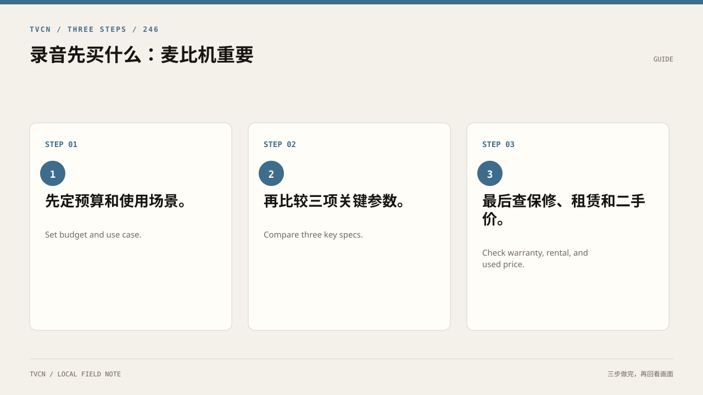

录音优先于机身：观众能忍画面普通，忍不了听不清。

<!-- DIAGRAM_START -->
<h2>图解</h2>
<figure>
  
  <figcaption>把三步按顺序做完，再回看画面或文件。</figcaption>
</figure>
<!-- DIAGRAM_END -->
<h2>现场</h2>

先买一支领夹或枪麦加录音机，预算放在麦和录机，不放在机身。

<h2>怎么做</h2>

录音优先于机身；观众能忍画面普通，忍不了听不清。
<ol><li>先买一支领夹或枪麦加录音机。</li><li>预算的一半给麦和录机，三成给灯，两成给机身配件。</li><li>拍一条室内和室外对比，确认对白干净。</li></ol>
<h2>别踩</h2>

别把钱全砸在机身；声音烂，画面再好也看不下去。

<h2>验收</h2>
<ul><li>先买了麦和录音机。</li><li>预算一半给声音，三成给灯，两成给配件。</li><li>室内外对比过，对白干净。</li></ul>
