<!-- DIAGRAM_START -->
<h2>图解</h2>
<figure>
  
  <figcaption>示意：容量、电压、通信、充电、胀包，五项决定电池能不能带出门。</figcaption>
</figure>
<!-- DIAGRAM_END -->
<h2>先判断：你缺的是哪一环</h2>
机身电池优先原厂或认证副厂；大容量 V-mount 要看电芯与 BMS，不只看 Wh。拍一天至少 2.5 倍预计耗电，极端温度要留余量。任何胀包、掉电、通信异常，立即停用。

<strong>适合：</strong>
<ul><li>整日拍摄，需要可靠供电</li><li>寒冷/高温环境</li><li>多机位，需要统一电池</li></ul>
<strong>不适合：</strong>
<ul><li>只拍短片段</li><li>无认证的超低价副厂</li><li>已经胀包的旧电池</li></ul><h2>测试口径：可复现，不写假跑分</h2>
满电装机身，连续录到自动关机，记录实际时长与标称差距；负载下看电压是否掉；机内看电量/温度是否正常；充电时摸温度，查是否胀包。

<table class="data-table"><thead><tr><th>检查项</th><th>通过线</th><th>参考/记录</th></tr></thead><tbody><tr><td>容量</td><td>实测达标称 80%</td><td>连续录制</td></tr><tr><td>电压</td><td>负载下不骤跌</td><td>录制中读</td></tr><tr><td>通信</td><td>电量/温度正常显示</td><td>机内</td></tr><tr><td>充电</td><td>认证充电器，时间正常</td><td>充电记录</td></tr><tr><td>胀包</td><td>无鼓包/漏液/异味</td><td>外观/手感</td></tr></tbody></table>
<h2>价格带：先看总拥有成本</h2>
不只看标价，还要看卡、电池、转接、云台、灯架、软件订阅和维修。以下按“能完成一类真实项目”的最低配置分档，不是入门玩具价。

<table class="data-table"><thead><tr><th>档位</th><th>参考价</th><th>包含</th><th>注意</th></tr></thead><tbody><tr><td>入门</td><td>150–400</td><td>认证副厂小电池</td><td>通信/寿命有限</td></tr><tr><td>主力</td><td>400–1,200</td><td>原厂/认证大容量</td><td>多块轮换</td></tr><tr><td>进阶</td><td>1,200–3,000</td><td>V-mount/专业 BMS</td><td>充电器与运输</td></tr></tbody></table>

价格为 2026 年 11 月中国大陆渠道参考，含税与否以实际报价为准；不构成购买建议。
<h2>替代与升级：别在错误的轴上加钱</h2><ul><li>租 V-mount 拍项目</li><li>假电池 + 市电</li><li>充电站 + 多块小电</li></ul><h2>购买执行：带片子去，不带参数去</h2>
下单前按顺序做一遍；任何一步失败，都不要用“后期能修”说服自己。
<ol><li>满电连续录制到关机</li><li>负载下读电压</li><li>机内看通信</li><li>充电摸温度/查胀包</li><li>算 2.5 倍日耗</li></ol><h2>验收</h2><ul><li>实测容量达标称 80%。</li><li>负载下电压不骤跌。</li><li>电量/温度可读。</li><li>充电不异常发热。</li><li>无胀包/漏液。</li><li>日耗 2.5 倍备电。</li></ul>
<!-- SOURCES_START -->
<h2>参考与延伸阅读</h2>

经验来源：编辑部现场手册与购买检查表；实测来源：短测与公开规格核对，不是实验室跑分；参考来源：以下厂商与标准链接。

<ul><li>[S23] SMPTE 标准入口</li><li>[S25] ITU-R BT.709</li><li>[S26] ITU-R BT.2020</li><li>[S29] YouTube 上传规格</li><li>[S38] 国家税务总局</li></ul>

<a href="../../SOURCES.md">完整链接与用途见 SOURCES.md</a>

<!-- SOURCES_END -->
