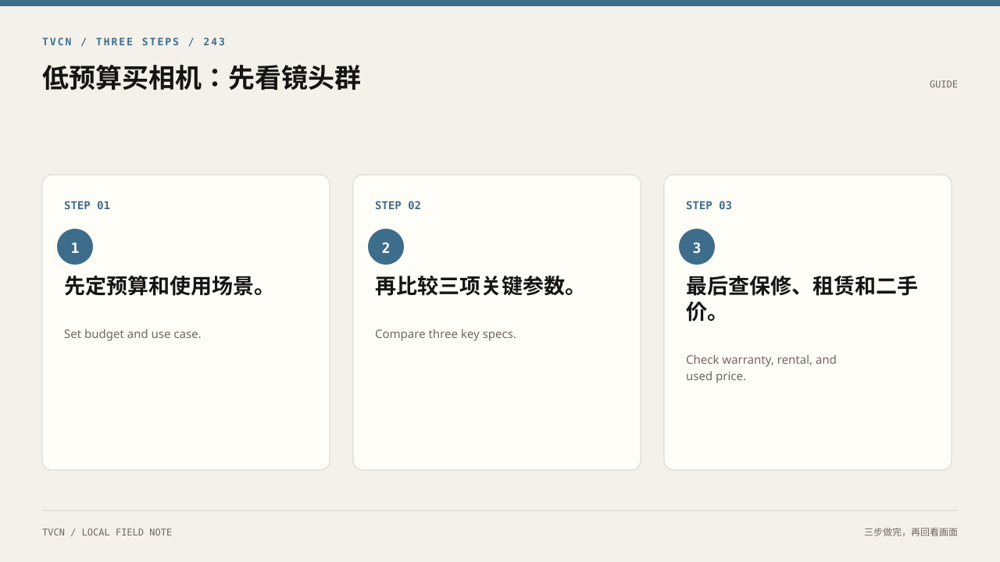

低预算买相机先看镜头群和二手价格，再看机身参数；机身会过时，镜头不会。

<!-- DIAGRAM_START -->
<h2>图解</h2>
<figure>
  
  <figcaption>把三步按顺序做完，再回看画面或文件。</figcaption>
</figure>
<!-- DIAGRAM_END -->
<h2>现场</h2>

先列三支镜头和二手价，再选机身；机身预算不超过镜头总预算的 1.5 倍。

<h2>怎么做</h2>

先把预算分成镜头、机身、卡和电池四块；镜头先买二手，机身留出两成给卡和电池。
<ol><li>列三支目标焦段和二手成交价，算出镜头总预算。</li><li>机身预算不超过镜头总预算的一点五倍。</li><li>余下的钱买两张卡、两块电池和一只包，别让配件拖后腿。</li></ol>
<h2>别踩</h2>

别先买最新机身；镜头群决定你能拍什么。

<h2>验收</h2>
<ul><li>镜头总预算先算过，按三支二手成交价。</li><li>机身预算不超过镜头总预算一点五倍。</li><li>两张卡、两块电池和包的钱留出来了。</li></ul>
