<!-- DIAGRAM_START -->
<h2>图解</h2>
<figure>
  
  <figcaption>示意：能拍不等于能交；五项里任何一项缺失，都会在后期变成额外成本。</figcaption>
</figure>
<!-- DIAGRAM_END -->
<h2>先判断：你缺的是哪一环</h2>
先看交付：客户要 RAW 吗？要 HDR 吗？要进多机位时码吗？三个都否，电影机大概率是过度配置。只要 Log、10-bit、可换镜头，一台高端视频机加外录已经够。电影机的优势是宽容度、时码、SDI、可维修的套件生态，不是“看起来专业”。

<strong>适合：</strong>
<ul><li>广告/短片，需要 RAW 或高宽容度</li><li>多机位，需要时码与 SDI</li><li>需要套件化、可维修的长期系统</li></ul>
<strong>不适合：</strong>
<ul><li>只拍活动/访谈，交付 Rec.709</li><li>单人移动拍摄，怕重</li><li>预算只够机身，没有套件钱</li></ul><h2>测试口径：可复现，不写假跑分</h2>
不要只看宽容度数字。带一张高光窗景、一张暗部人脸，用项目要用的编码各拍 30 秒，回放看高光是否可回收、暗部噪点是否可接受、套件是否平衡。

<table class="data-table"><thead><tr><th>检查项</th><th>通过线</th><th>参考/记录</th></tr></thead><tbody><tr><td>高光</td><td>窗外可回收 2 档，不出现硬切</td><td>Log/RAW 实拍</td></tr><tr><td>暗部</td><td>ISO 测试下肤色噪点可接受</td><td>双原生 ISO 对比</td></tr><tr><td>时码</td><td>输入/输出与录机一致</td><td>时码发生器</td></tr><tr><td>介质</td><td>项目编码持续写入不丢帧</td><td>满卡测试</td></tr><tr><td>套件</td><td>肩扛/手提 10 分钟不失衡</td><td>实际配重</td></tr></tbody></table>
<h2>价格带：先看总拥有成本</h2>
不只看标价，还要看卡、电池、转接、云台、灯架、软件订阅和维修。以下按“能完成一类真实项目”的最低配置分档，不是入门玩具价。

<table class="data-table"><thead><tr><th>档位</th><th>参考价</th><th>包含</th><th>注意</th></tr></thead><tbody><tr><td>入门</td><td>15,000–35,000</td><td>机身 + 1 卡 + 基础套件</td><td>监看/电量常被低估</td></tr><tr><td>主力</td><td>35,000–80,000</td><td>机身 + 双卡 + 监看 + 电池 + 提手</td><td>线材与底座另算</td></tr><tr><td>进阶</td><td>80,000–200,000</td><td>RAW 录机、时码、无线跟焦、专业套件</td><td>重量与团队成本上升</td></tr></tbody></table>

价格为 2026 年 11 月中国大陆渠道参考，含税与否以实际报价为准；不构成购买建议。
<h2>替代与升级：别在错误的轴上加钱</h2><ul><li>高端视频机 + 外录</li><li>上一代电影机二手</li><li>租机身，买镜头/套件</li></ul><h2>购买执行：带片子去，不带参数去</h2>
下单前按顺序做一遍；任何一步失败，都不要用“后期能修”说服自己。
<ol><li>按项目编码拍 30 秒并回放</li><li>把套件装好，称一次重量</li><li>确认卡价与持续写入</li><li>确认监看、供电、线材接口</li><li>查维修点与备机方案</li></ol><h2>验收</h2><ul><li>项目确实需要 RAW/时码/SDI 中的至少两项。</li><li>机身+套件+介质总价已算清。</li><li>高光与暗部有实拍回收测试。</li><li>时码与录机/多机位通过。</li><li>套件重量在可承受范围。</li><li>有维修点或备机方案。</li></ul>

> 意图分工：本页负责「购买电影机：别把“能拍”当成“能交”」的可执行细节；同集群先读 <a href="https://tools.tvcn.org/article/buy-camera-budget/">购买相机：先定预算，再定机身</a> 建立总判断，再回到本页。

<!-- INTENT_SCOPE -->

<!-- SOURCES_START -->
## 参考与延伸阅读

- [S23] [SMPTE 标准入口](https://www.smpte.org/standards) — 2026-11-26 访问。用于核对首段“电影机的价格不只在机身：卡、电池、监看、底座、提手、线材、调色和学习都要算。先确认项目真的需要 RAW、时码、SDI 和”中的术语与公开背景（时间码、色彩、影院与信号链标准的机构入口）；不替代现场测试。
- [S25] [ITU-R BT.709](https://www.itu.int/rec/R-REC-BT.709/en) — 2026-11-26 访问。用于核对首段“电影机的价格不只在机身：卡、电池、监看、底座、提手、线材、调色和学习都要算。先确认项目真的需要 RAW、时码、SDI 和”中的术语与公开背景（HD SDR 的色域、传递函数与观看条件）；不替代现场测试。
- [S26] [ITU-R BT.2020](https://www.itu.int/rec/R-REC-BT.2020/en) — 2026-11-26 访问。用于核对首段“电影机的价格不只在机身：卡、电池、监看、底座、提手、线材、调色和学习都要算。先确认项目真的需要 RAW、时码、SDI 和”中的术语与公开背景（UHD/HDR 的宽色域与参数定义）；不替代现场测试。
- [S29] [YouTube 上传规格](https://support.google.com/youtube/answer/1722171) — 2026-11-26 访问。用于核对首段“电影机的价格不只在机身：卡、电池、监看、底座、提手、线材、调色和学习都要算。先确认项目真的需要 RAW、时码、SDI 和”中的术语与公开背景（分辨率、码率、帧率与音频编码建议）；不替代现场测试。
- [S38] [国家税务总局：官方网站](https://www.chinatax.gov.cn/) — 2026-11-26 访问。用于核对首段“电影机的价格不只在机身：卡、电池、监看、底座、提手、线材、调色和学习都要算。先确认项目真的需要 RAW、时码、SDI 和”中的术语与公开背景（增值税、跨境服务与代扣代缴的官方政策入口）；不替代现场测试。
<!-- SOURCES_END -->

