<!-- DIAGRAM_START -->
<h2>图解</h2>
<figure>
  
  <figcaption>示意：承重、调平、轴锁、跟随、电池，五项决定它能不能稳定走完一个镜头。</figcaption>
</figure>
<!-- DIAGRAM_END -->
<h2>先判断：你缺的是哪一环</h2>
先确认你要拍的是“走路跟随”还是“固定机位运动镜头”。前者看跟随和轴锁，后者看承重和低角度。整机重量不要超过标称承重的 70%，否则调平余量和电机余量都不够。

<strong>适合：</strong>
<ul><li>单人走路跟随</li><li>产品/空间运动镜头</li><li>预算有限，先一台通用</li></ul>
<strong>不适合：</strong>
<ul><li>长焦/重型电影机</li><li>高速追车/极限运动</li><li>需要毫米级重复运动</li></ul><h2>测试口径：可复现，不写假跑分</h2>
装整机调平，三轴分别松手看是否漂；锁死轴看是否晃；快速转身看跟随是否滞后；连续开机录 30 分钟看电量与电机温度。

<table class="data-table"><thead><tr><th>检查项</th><th>通过线</th><th>参考/记录</th></tr></thead><tbody><tr><td>承重</td><td>整机不超过标称 70%</td><td>整机称重</td></tr><tr><td>调平</td><td>三轴松手 5 秒不漂</td><td>逐轴调平</td></tr><tr><td>轴锁</td><td>锁死无松动</td><td>手持轻推</td></tr><tr><td>跟随</td><td>快速转向不滞后/不抖</td><td>走动测试</td></tr><tr><td>电池</td><td>实测 4 小时以上</td><td>30 分钟记录</td></tr></tbody></table>
<h2>价格带：先看总拥有成本</h2>
不只看标价，还要看卡、电池、转接、云台、灯架、软件订阅和维修。以下按“能完成一类真实项目”的最低配置分档，不是入门玩具价。

<table class="data-table"><thead><tr><th>档位</th><th>参考价</th><th>包含</th><th>注意</th></tr></thead><tbody><tr><td>入门</td><td>800–2,000</td><td>手机/微单稳定器</td><td>承重与跟随有限</td></tr><tr><td>主力</td><td>2,000–5,000</td><td>微单/小型电影机稳定器</td><td>电池与配件</td></tr><tr><td>进阶</td><td>5,000–15,000</td><td>专业稳定器/远程跟焦</td><td>重量与团队</td></tr></tbody></table>

价格为 2026 年 11 月中国大陆渠道参考，含税与否以实际报价为准；不构成购买建议。
<h2>替代与升级：别在错误的轴上加钱</h2><ul><li>先租一台拍项目</li><li>三脚架 + 滑轨</li><li>二手上一代旗舰</li></ul><h2>购买执行：带片子去，不带参数去</h2>
下单前按顺序做一遍；任何一步失败，都不要用“后期能修”说服自己。
<ol><li>称整机重量</li><li>逐轴调平</li><li>锁轴轻推</li><li>快速转身测跟随</li><li>30 分钟电量/温度</li></ol><h2>验收</h2><ul><li>整机不超过标称 70%。</li><li>三轴松手不漂。</li><li>轴锁无松动。</li><li>快速转向不滞后。</li><li>实测 4 小时以上。</li><li>调平后电机不烫。</li></ul>
<!-- SOURCES_START -->
<h2>参考与延伸阅读</h2>

经验来源：编辑部现场手册与购买检查表；实测来源：短测与公开规格核对，不是实验室跑分；参考来源：以下厂商与标准链接。

<ul><li>[S23] SMPTE 标准入口</li><li>[S25] ITU-R BT.709</li><li>[S26] ITU-R BT.2020</li><li>[S29] YouTube 上传规格</li><li>[S38] 国家税务总局</li></ul>

<a href="../../about/">完整链接与用途见 SOURCES.md</a>

<!-- SOURCES_END -->
