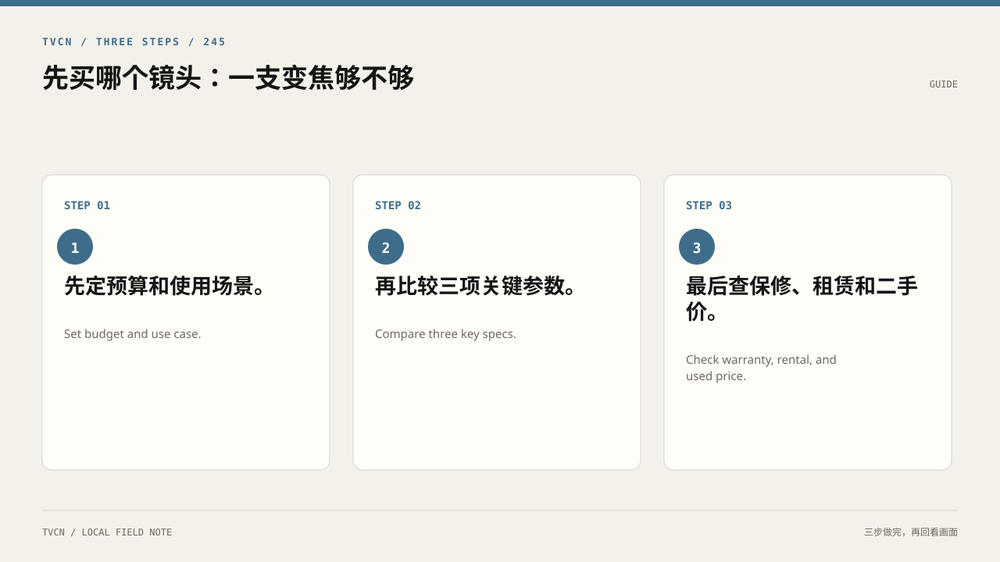

第一支镜头先问拍什么：采访用标准变焦，旅拍用轻便变焦，夜景用大光圈定焦。

<!-- DIAGRAM_START -->
<h2>图解</h2>
<figure>
  
  <figcaption>把三步按顺序做完，再回看画面或文件。</figcaption>
</figure>
<!-- DIAGRAM_END -->
<h2>现场</h2>

先借 24-70 和 35 各拍一天；统计你用得最多的焦段，再买。

<h2>怎么做</h2>

第一支镜头先问拍什么；借两支各拍一天，再决定。
<ol><li>统计最近三个月的拍摄类型：采访、旅拍、夜景、产品。</li><li>借 24-70 和 35 各拍一天，记录最常用的焦段。</li><li>选覆盖你八成场景的那支，别追齐全焦段。</li></ol>
<h2>别踩</h2>

别一次买三支便宜定焦；换来换去会错过动作。

<h2>验收</h2>
<ul><li>统计了最近三个月的拍摄类型。</li><li>借 24-70 和 35 各拍一天，记录了常用焦段。</li><li>选的镜头覆盖八成场景。</li></ul>
