<!-- DIAGRAM_START -->
<h2>图解</h2>
<figure>
  
  <figcaption>示意：齐焦、呼吸、伺服、重量、滤镜，五项决定它能否在真实拍摄中省时间。</figcaption>
</figure>
<!-- DIAGRAM_END -->
<h2>先判断：你缺的是哪一环</h2>
变焦适合活动、婚礼、纪录片、单人移动拍摄；不适合追求极致浅景深或最低重量的项目。先确定你最常拍的焦段范围：24-70 覆盖大多数，70-200 适合舞台/活动，18-35 适合空间。不要买一支 18-300 当全部。

<strong>适合：</strong>
<ul><li>活动/婚礼，不能换镜</li><li>单人移动，追求效率</li><li>纪录片，需要快速构图</li></ul>
<strong>不适合：</strong>
<ul><li>追求最大光圈浅景深</li><li>长时间手持，怕重</li><li>需要微距/极近对焦</li></ul><h2>测试口径：可复现，不写假跑分</h2>
在长焦端对焦，然后拉到广角，看焦点是否还在；再近距推拉一次，看构图是否明显缩放；最后录一段变焦，听伺服噪声。

<table class="data-table"><thead><tr><th>检查项</th><th>通过线</th><th>参考/记录</th></tr></thead><tbody><tr><td>齐焦</td><td>长焦对焦后拉广，焦点仍在</td><td>现场推拉</td></tr><tr><td>呼吸</td><td>近距推拉构图不明显缩放</td><td>1 米测试</td></tr><tr><td>伺服</td><td>速度可调，录音无咔哒</td><td>机头麦测试</td></tr><tr><td>重量</td><td>手持 5 分钟不抖</td><td>上机称重</td></tr><tr><td>滤镜</td><td>77/82mm 与现有通用</td><td>口径与转接</td></tr></tbody></table>
<h2>价格带：先看总拥有成本</h2>
不只看标价，还要看卡、电池、转接、云台、灯架、软件订阅和维修。以下按“能完成一类真实项目”的最低配置分档，不是入门玩具价。

<table class="data-table"><thead><tr><th>档位</th><th>参考价</th><th>包含</th><th>注意</th></tr></thead><tbody><tr><td>入门</td><td>2,000–6,000</td><td>24-70/28-75 F2.8 国产/二手</td><td>齐焦与呼吸需实测</td></tr><tr><td>主力</td><td>6,000–15,000</td><td>原厂 24-70 F2.8 / 70-200 F4</td><td>重量与伺服</td></tr><tr><td>进阶</td><td>15,000–40,000</td><td>70-200 F2.8 / 电影变焦</td><td>套件与跟焦</td></tr></tbody></table>

价格为 2026 年 11 月中国大陆渠道参考，含税与否以实际报价为准；不构成购买建议。
<h2>替代与升级：别在错误的轴上加钱</h2><ul><li>两支定焦替代一支变焦</li><li>租 70-200 拍活动</li><li>先用套机变焦练手</li></ul><h2>购买执行：带片子去，不带参数去</h2>
下单前按顺序做一遍；任何一步失败，都不要用“后期能修”说服自己。
<ol><li>列最常拍的三类场景</li><li>长焦对焦再拉广</li><li>近距推拉看呼吸</li><li>录伺服噪声</li><li>上机称重 5 分钟</li></ol><h2>验收</h2><ul><li>焦段覆盖主要场景。</li><li>齐焦通过。</li><li>呼吸可接受。</li><li>伺服不吵。</li><li>重量能手持 5 分钟。</li><li>滤镜口径可复用。</li></ul>

> 意图分工：本页负责「购买变焦：齐焦、呼吸与伺服」的可执行细节；同集群先读 <a href="https://tools.tvcn.org/article/buy-lens-first/">先买镜头：焦段、光圈与呼吸</a> 建立总判断，再回到本页。

<!-- INTENT_SCOPE -->

<!-- SOURCES_START -->
## 参考与延伸阅读

- [S31] [ARRI：电影系统](https://www.arri.com/en/cine-systems) — 2026-11-26 访问。用于核对「先判断：你缺的是哪一环」一节的术语/方法/规则（ARRI 摄影机、镜头与灯光资料，不是通用拍摄教程）；不核对其中由本页经验得出的数字、型号与现场结论，也不替代测试。
- [S52] [ARRI：ALEXA 35](https://www.arri.com/en/camera-systems/cameras/legacy-camera-systems/alexa-35) — 2026-11-26 访问。用于核对「测试口径：可复现，不写假跑分」一节的术语/方法/规则（ALEXA 35 官方规格，不是独立测试）；不核对其中由本页经验得出的数字、型号与现场结论，也不替代测试。
- [S53] [Sony：FX6](https://pro.sony/ue_US/products/handheld-camcorders/ilme-fx6v) — 2026-11-26 访问。用于核对「价格带：先看总拥有成本」一节的术语/方法/规则（FX6 官方规格，不是独立测试）；不核对其中由本页经验得出的数字、型号与现场结论，也不替代测试。
<!-- SOURCES_END -->

