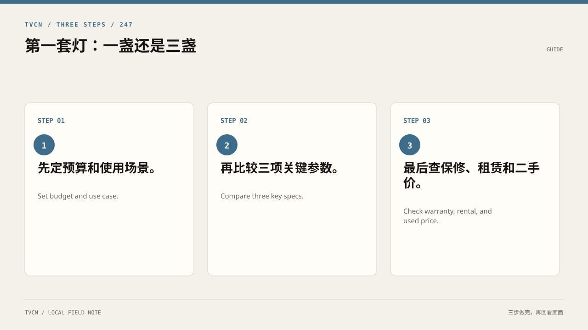

<!-- DIAGRAM_START -->
<h2>图解</h2>
<figure>
  
  <figcaption>示意：显色、输出、色温、噪声、控光，五项决定灯能不能上脸。</figcaption>
</figure>
<!-- DIAGRAM_END -->
<h2>先判断：你缺的是哪一环</h2>
先买一盏能柔的大面积灯 + 一块反光板/柔光布，再买第二盏。第一盏灯要能调功率、色温稳定、风扇不吵。预算有限时，先解决“人脸有方向、有柔度”，不要先买彩色灯。

<strong>适合：</strong>
<ul><li>访谈/口播，单人或双人</li><li>室内产品，需要可控光比</li><li>小团队，能快速布置</li></ul>
<strong>不适合：</strong>
<ul><li>大场景活动，需要高输出</li><li>户外强日光，需要大功率</li><li>需要复杂色彩效果</li></ul><h2>测试口径：可复现，不写假跑分</h2>
把灯加上柔光箱，打在模特/自己脸上，拍一张正常肤色、一张暗部、一张高光。再录 30 秒同期声，听风扇。最后两盏灯同色温打同一面墙，看是否一致。

<table class="data-table"><thead><tr><th>检查项</th><th>通过线</th><th>参考/记录</th></tr></thead><tbody><tr><td>显色</td><td>肤色自然，不偏绿/品</td><td>人脸 4K 回放</td></tr><tr><td>输出</td><td>柔光后 ISO 800 可用</td><td>测光表/波形</td></tr><tr><td>色温</td><td>两灯同场景无跳色</td><td>双灯对比</td></tr><tr><td>噪声</td><td>1 米录音无风扇声</td><td>30 秒同期</td></tr><tr><td>控光</td><td>能做出 2:1–4:1 光比</td><td>柔光/旗板</td></tr></tbody></table>
<h2>价格带：先看总拥有成本</h2>
不只看标价，还要看卡、电池、转接、云台、灯架、软件订阅和维修。以下按“能完成一类真实项目”的最低配置分档，不是入门玩具价。

<table class="data-table"><thead><tr><th>档位</th><th>参考价</th><th>包含</th><th>注意</th></tr></thead><tbody><tr><td>入门</td><td>1,000–3,000</td><td>一盏 COB + 柔光箱 + 灯架</td><td>输出与色温有限</td></tr><tr><td>主力</td><td>3,000–8,000</td><td>两盏 COB + 柔光/格栅 + 反光板</td><td>电池与控光另算</td></tr><tr><td>进阶</td><td>8,000–20,000</td><td>三灯、RGB、专业控光、无线控</td><td>重量与供电</td></tr></tbody></table>

价格为 2026 年 11 月中国大陆渠道参考，含税与否以实际报价为准；不构成购买建议。
<h2>替代与升级：别在错误的轴上加钱</h2><ul><li>一盏灯 + 反光板</li><li>租两盏 COB</li><li>先用窗光 + 柔光布</li></ul><h2>购买执行：带片子去，不带参数去</h2>
下单前按顺序做一遍；任何一步失败，都不要用“后期能修”说服自己。
<ol><li>带柔光箱打脸拍 4K</li><li>测柔光后 ISO 800</li><li>双灯同色温对比</li><li>1 米录风扇声</li><li>做一次 2:1/4:1 光比</li></ol><h2>验收</h2><ul><li>第一盏灯能柔、能调功率。</li><li>肤色不偏绿/偏品。</li><li>柔光后 ISO 800 可用。</li><li>两灯色温一致。</li><li>1 米录音无风扇声。</li><li>有柔光/旗板做光比。</li></ul>
<!-- SOURCES_START -->
<h2>参考与延伸阅读</h2>

经验来源：编辑部现场手册与购买检查表；实测来源：短测与公开规格核对，不是实验室跑分；参考来源：以下厂商与标准链接。

<ul><li>[S23] SMPTE 标准入口</li><li>[S25] ITU-R BT.709</li><li>[S26] ITU-R BT.2020</li><li>[S29] YouTube 上传规格</li><li>[S38] 国家税务总局</li></ul>

<a href="../../SOURCES.md">完整链接与用途见 SOURCES.md</a>

<!-- SOURCES_END -->
