<!-- DIAGRAM_START -->
<h2>图解</h2>
<figure>
  
  <figcaption>示意：频闪、色温、输出、供电、控制，五项决定灯在现场是否可控。</figcaption>
</figure>
<!-- DIAGRAM_END -->
<h2>先判断：你缺的是哪一环</h2>
先确认拍摄地点的电网频率和相机快门。LED 频闪不是“坏了”，是刷新和快门不匹配。可调色温的灯要测调光过程中是否偏色；电池灯要测满功率续航，不要只看低功率标称。

<strong>适合：</strong>
<ul><li>室内访谈/产品，需要可调光</li><li>小团队，电池供电</li><li>需要无线/DMX 控制</li></ul>
<strong>不适合：</strong>
<ul><li>大场景高输出，需钨丝/HMI</li><li>极端低温/高温户外</li><li>只买最便宜，无控光配件</li></ul><h2>测试口径：可复现，不写假跑分</h2>
在 1/50、1/60、1/125 快门下各拍 10 秒，回放看横纹；把两盏灯调到同一色温，再各降 50% 亮度，看是否偏色；最后用电池满功率录 30 分钟，记录掉电。

<table class="data-table"><thead><tr><th>检查项</th><th>通过线</th><th>参考/记录</th></tr></thead><tbody><tr><td>频闪</td><td>1/50–1/125 无横纹</td><td>10 秒/档</td></tr><tr><td>色温</td><td>调光 100%→50% 不偏色</td><td>双灯对比</td></tr><tr><td>输出</td><td>柔光后 ISO 800 可用</td><td>测光表</td></tr><tr><td>供电</td><td>满功率 30 分钟掉电可接受</td><td>电池记录</td></tr><tr><td>控制</td><td>DMX/无线无延迟</td><td>现场调光</td></tr></tbody></table>
<h2>价格带：先看总拥有成本</h2>
不只看标价，还要看卡、电池、转接、云台、灯架、软件订阅和维修。以下按“能完成一类真实项目”的最低配置分档，不是入门玩具价。

<table class="data-table"><thead><tr><th>档位</th><th>参考价</th><th>包含</th><th>注意</th></tr></thead><tbody><tr><td>入门</td><td>800–2,500</td><td>一盏小 COB/面板 + 柔光</td><td>频闪与色温需测</td></tr><tr><td>主力</td><td>2,500–8,000</td><td>两盏可调色温 + 电池 + 控光</td><td>DMX 另算</td></tr><tr><td>进阶</td><td>8,000–25,000</td><td>高输出、RGB、DMX、专业控光</td><td>重量与配电</td></tr></tbody></table>

价格为 2026 年 11 月中国大陆渠道参考，含税与否以实际报价为准；不构成购买建议。
<h2>替代与升级：别在错误的轴上加钱</h2><ul><li>钨丝 + 柔光</li><li>租高输出 LED</li><li>反光板 + 现有灯</li></ul><h2>购买执行：带片子去，不带参数去</h2>
下单前按顺序做一遍；任何一步失败，都不要用“后期能修”说服自己。
<ol><li>1/50–1/125 测频闪</li><li>双灯同色温调光</li><li>满功率电池 30 分钟</li><li>测 DMX/无线延迟</li><li>算控光配件总价</li></ol><h2>验收</h2><ul><li>常见快门无频闪。</li><li>调光不偏色。</li><li>柔光后输出够用。</li><li>满功率续航可查。</li><li>DMX/无线可控。</li><li>控光配件齐全。</li></ul>

> 意图分工：本页负责「购买 LED 灯：亮度、频闪与供电」的可执行细节；同集群先读 <a href="https://tools.tvcn.org/article/buy-light-kit/">购买灯光套装：先买柔，再买亮</a> 建立总判断，再回到本页。

<!-- INTENT_SCOPE -->

<!-- SOURCES_START -->
## 参考与延伸阅读

- [S31] [ARRI：电影系统](https://www.arri.com/en/cine-systems) — 2026-11-26 访问。用于核对「先判断：你缺的是哪一环」一节的术语/方法/规则（ARRI 摄影机、镜头与灯光资料，不是通用拍摄教程）；不核对其中由本页经验得出的数字、型号与现场结论，也不替代测试。
- [S23] [SMPTE：标准入口](https://www.smpte.org/standards) — 2026-11-26 访问。用于核对「测试口径：可复现，不写假跑分」一节的术语/方法/规则（SMPTE 标准入口，不是具体机型参数）；不核对其中由本页经验得出的数字、型号与现场结论，也不替代测试。
<!-- SOURCES_END -->

