<!-- DIAGRAM_START -->
<h2>图解</h2>
<figure>
  
  <figcaption>示意：峰值、黑位、色域、色调映射、校准，五项决定 HDR 调色是否可信。</figcaption>
</figure>
<!-- DIAGRAM_END -->
<h2>先判断：你缺的是哪一环</h2>
先确认你要做的是 HDR 交付还是只看 HDR 参考。只看参考，一台校准过的 SDR 屏 + 转换 LUT 也能工作；要做 HDR 母版，峰值、黑位、色域、色调映射都要过。不要用电视代替专业监看，电视的锐化和动态对比会骗你。

<strong>适合：</strong>
<ul><li>HDR 母版/调色</li><li>平台 HDR 交付 QC</li><li>需要 PQ/HLG 参考</li></ul>
<strong>不适合：</strong>
<ul><li>只做 SDR 交付</li><li>预算低于 1 万，先做 SDR</li><li>只看片不调色</li></ul><h2>测试口径：可复现，不写假跑分</h2>
带一段含窗外、霓虹、暗场的 HDR 测试片，接信号发生器确认 PQ/HLG；看暗场是否发灰、高光是否直接切白；再用色卡看 P3 覆盖。

<table class="data-table"><thead><tr><th>检查项</th><th>通过线</th><th>参考/记录</th></tr></thead><tbody><tr><td>峰值</td><td>窗外/霓虹有层次，不切白</td><td>HDR 测试片</td></tr><tr><td>黑位</td><td>暗场黑得下去，不发灰</td><td>黑场片段</td></tr><tr><td>色域</td><td>P3 色卡无明显偏差</td><td>色卡</td></tr><tr><td>色调映射</td><td>PQ/HLG 切换正确</td><td>信号发生器</td></tr><tr><td>校准</td><td>3D LUT/自动校准可查</td><td>校准报告</td></tr></tbody></table>
<h2>价格带：先看总拥有成本</h2>
不只看标价，还要看卡、电池、转接、云台、灯架、软件订阅和维修。以下按“能完成一类真实项目”的最低配置分档，不是入门玩具价。

<table class="data-table"><thead><tr><th>档位</th><th>参考价</th><th>包含</th><th>注意</th></tr></thead><tbody><tr><td>入门</td><td>5,000–12,000</td><td>高亮 SDR/入门 HDR</td><td>HDR 校准有限</td></tr><tr><td>主力</td><td>12,000–35,000</td><td>HDR 监看、P3、3D LUT</td><td>校准设备另算</td></tr><tr><td>进阶</td><td>35,000–100,000</td><td>专业 HDR 母版监看</td><td>环境与校准成本</td></tr></tbody></table>

价格为 2026 年 11 月中国大陆渠道参考，含税与否以实际报价为准；不构成购买建议。
<h2>替代与升级：别在错误的轴上加钱</h2><ul><li>校准 SDR + 转换 LUT</li><li>租 HDR 调色棚</li><li>先做 SDR 母版</li></ul><h2>购买执行：带片子去，不带参数去</h2>
下单前按顺序做一遍；任何一步失败，都不要用“后期能修”说服自己。
<ol><li>带 HDR 测试片</li><li>信号发生器测 PQ/HLG</li><li>看暗场黑位</li><li>色卡测 P3</li><li>查校准报告/LUT</li></ol><h2>验收</h2><ul><li>高光有层次，不切白。</li><li>暗场不发灰。</li><li>P3 色域可接受。</li><li>PQ/HLG 切换正确。</li><li>有 3D LUT/校准报告。</li><li>环境光可控。</li></ul>

<!-- DEEP_DIVE_START -->
## 深读

<strong>约 7 分钟。</strong> 这一节不重复前面的做法，只补三个东西：两种条件、一个反例、一个可复用模型；读完能判断什么时候换做法。

### 条件 A：SDR 为主

如果项目 90% 是 SDR，买 HDR 监视器不是第一优先。SDR 需要的是准确的黑位、稳定的白点和可靠的波形；一台 1000 尼特的 HDR 监视器如果 SDR 模式偏色，反而更糟。先看 SDR 预设能不能校准。

SDR 监看还要看“环境光”：亮房间会逼你把亮度调高，黑位就飘。买监视器之前先决定遮光/环境亮度；不控制环境，再贵的监视器也只能靠猜。

### 条件 B：HDR 交付

HDR 交付要先问“给谁看”：平台要求 PQ 还是 HLG、峰值多少、是否要求 Dolby Vision。监视器必须能显示目标峰值，并且有可靠的色调映射；只看“1000 尼特”不够，要看它在 100 尼特、400 尼特、1000 尼特是否都能正确映射。

HDR 监看还要看“暗部”：HDR 不是只亮，黑位和近黑层次更重要。买之前带一段自己项目的暗部素材去试，不要用卖场的演示片；演示片都是高光。暗部一糊，HDR 就只剩亮。

### 反例：只看峰值亮度

一台监视器标称 1600 尼特，买回来发现 100 尼特以下全是黑的，暗部没有层次；HDR 高光很亮，但人物的脸在暗处糊成一块。参数赢了，画面输了。

修法不是再买一台更亮的，而是带素材试“暗部—中间—高光”三段；每段都能看见层次，才叫 HDR 监看。峰值只是上限，不是能力。

### 可复用模型

<strong>交付目标 → 峰值 → 色调映射 → 暗部 → 环境。</strong> 先定交付，再定峰值，再试映射，再看暗部，最后控制环境。五步都在，HDR 监视器才不是参数摆件。

买之前做一次“三段测试”：同一段素材，分别在 100/400/1000 尼特看暗部、肤色、高光；三段都能接受，才付钱。

<!-- DEEP_DIVE_END -->

<!-- SOURCES_START -->
## 参考与延伸阅读

- [S24] [ACESCentral：ACES 色彩规范](https://acescentral.com/) — 2026-11-26 访问。用于核对「先判断：你缺的是哪一环」一节的术语/方法/规则（ACES 色彩规范，不是调色教程）；不核对其中由本页经验得出的数字、型号与现场结论，也不替代测试。
- [S26] [ITU-R BT.2020](https://www.itu.int/rec/R-REC-BT.2020/en) — 2026-11-26 访问。用于核对「测试口径：可复现，不写假跑分」一节的术语/方法/规则（BT.2020 超高清参数，不是现场曝光建议）；不核对其中由本页经验得出的数字、型号与现场结论，也不替代测试。
<!-- SOURCES_END -->

