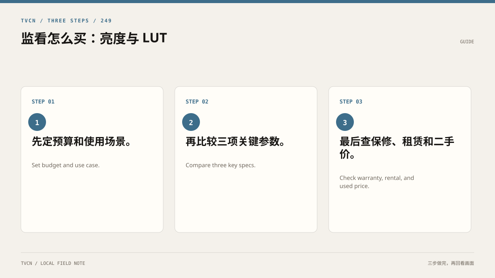

<!-- DIAGRAM_START -->
<h2>图解</h2>
<figure>
  
  <figcaption>示意：亮度、色域、LUT、延迟、接口，五项决定现场能不能信它。</figcaption>
</figure>
<!-- DIAGRAM_END -->
<h2>先判断：你缺的是哪一环</h2>
室内监看 500 nit 够；户外必须 1000 nit 以上或加遮光罩。只看参数不够，带相机去店里，接上自己的 Log 素材，加载一个 LUT，拍移动物体看延迟。

<strong>适合：</strong>
<ul><li>外景/高光环境，需要高亮</li><li>调色/多机位，需要 LUT 与校准</li><li>跟焦，需要低延迟</li></ul>
<strong>不适合：</strong>
<ul><li>室内固定机位，机头屏够用</li><li>只用来给客户看，不需要校准</li><li>预算极低，先买灯/麦</li></ul><h2>测试口径：可复现，不写假跑分</h2>
把监视器带到窗边/户外，看 1000 nit 是否还能看清暗部；接相机加载项目 LUT，对比机头屏；拍一个横向移动物体，看画面是否拖尾。

<table class="data-table"><thead><tr><th>检查项</th><th>通过线</th><th>参考/记录</th></tr></thead><tbody><tr><td>亮度</td><td>户外日光下暗部可见</td><td>窗边/户外</td></tr><tr><td>色域</td><td>Rec.709 色卡无明显偏色</td><td>校准后色卡</td></tr><tr><td>LUT</td><td>3D LUT 加载正确</td><td>Log 素材</td></tr><tr><td>延迟</td><td>移动物体无明显滞后</td><td>横移/手挥</td></tr><tr><td>接口</td><td>SDI/HDMI 与锁定供电</td><td>现场接线</td></tr></tbody></table>
<h2>价格带：先看总拥有成本</h2>
不只看标价，还要看卡、电池、转接、云台、灯架、软件订阅和维修。以下按“能完成一类真实项目”的最低配置分档，不是入门玩具价。

<table class="data-table"><thead><tr><th>档位</th><th>参考价</th><th>包含</th><th>注意</th></tr></thead><tbody><tr><td>入门</td><td>1,000–3,000</td><td>5–7 寸、500 nit、HDMI</td><td>户外与校准有限</td></tr><tr><td>主力</td><td>3,000–8,000</td><td>7 寸、1000 nit、SDI、LUT</td><td>电池/遮光罩另算</td></tr><tr><td>进阶</td><td>8,000–25,000</td><td>高亮、广色域、专业校准</td><td>套件与供电</td></tr></tbody></table>

价格为 2026 年 11 月中国大陆渠道参考，含税与否以实际报价为准；不构成购买建议。
<h2>替代与升级：别在错误的轴上加钱</h2><ul><li>机头屏 + 遮光罩</li><li>租高亮监视器</li><li>先买录机带监看</li></ul><h2>购买执行：带片子去，不带参数去</h2>
下单前按顺序做一遍；任何一步失败，都不要用“后期能修”说服自己。
<ol><li>带相机和 Log 素材</li><li>窗边看 1000 nit</li><li>加载 3D LUT 对比</li><li>拍移动物体看延迟</li><li>确认 SDI/供电接口</li></ol><h2>验收</h2><ul><li>户外能看清暗部。</li><li>Rec.709 可校准。</li><li>3D LUT 加载正确。</li><li>对焦无明显延迟。</li><li>SDI/HDMI 与供电锁定。</li><li>电池/遮光罩算进总价。</li></ul>

<!-- SOURCES_START -->
## 参考与延伸阅读

- [S23] [SMPTE 标准入口](https://www.smpte.org/standards) — 2026-11-26 访问。用于核对首段“监视器不是“外接大屏”。现场要亮到看得见、色彩要能校准、延迟要能对焦；三项任何一项不够，都还不如机头屏。”中的术语与公开背景（时间码、色彩、影院与信号链标准的机构入口）；不替代现场测试。
- [S25] [ITU-R BT.709](https://www.itu.int/rec/R-REC-BT.709/en) — 2026-11-26 访问。用于核对首段“监视器不是“外接大屏”。现场要亮到看得见、色彩要能校准、延迟要能对焦；三项任何一项不够，都还不如机头屏。”中的术语与公开背景（HD SDR 的色域、传递函数与观看条件）；不替代现场测试。
- [S26] [ITU-R BT.2020](https://www.itu.int/rec/R-REC-BT.2020/en) — 2026-11-26 访问。用于核对首段“监视器不是“外接大屏”。现场要亮到看得见、色彩要能校准、延迟要能对焦；三项任何一项不够，都还不如机头屏。”中的术语与公开背景（UHD/HDR 的宽色域与参数定义）；不替代现场测试。
- [S29] [YouTube 上传规格](https://support.google.com/youtube/answer/1722171) — 2026-11-26 访问。用于核对首段“监视器不是“外接大屏”。现场要亮到看得见、色彩要能校准、延迟要能对焦；三项任何一项不够，都还不如机头屏。”中的术语与公开背景（分辨率、码率、帧率与音频编码建议）；不替代现场测试。
- [S38] [国家税务总局：官方网站](https://www.chinatax.gov.cn/) — 2026-11-26 访问。用于核对首段“监视器不是“外接大屏”。现场要亮到看得见、色彩要能校准、延迟要能对焦；三项任何一项不够，都还不如机头屏。”中的术语与公开背景（增值税、跨境服务与代扣代缴的官方政策入口）；不替代现场测试。
<!-- SOURCES_END -->

