<!-- DIAGRAM_START -->
<h2>图解</h2>
<figure>
  
  <figcaption>示意：吞吐、重建、RAID、噪声、供电，五项决定它能不能在工作室长期工作。</figcaption>
</figure>
<!-- DIAGRAM_END -->
<h2>先判断：你缺的是哪一环</h2>
先算并发：几个人同时剪 4K？10GbE 是底线，1GbE 只能做归档。RAID 5 适合 4 盘以上但重建慢，RAID 6 更稳；RAID 不是备份，必须再有一份异地/离线。硬盘噪声和散热要按工作室环境算。

<strong>适合：</strong>
<ul><li>多机位/多编辑协作</li><li>长期项目归档</li><li>需要集中备份</li></ul>
<strong>不适合：</strong>
<ul><li>单机位轻量</li><li>把 RAID 当唯一备份</li><li>没有 UPS/运维</li></ul><h2>测试口径：可复现，不写假跑分</h2>
用 10GbE 拷 100GB 大文件，记录持续速度；拔一块盘看重建时间与性能下降；在工作室 1 米处听噪声；断电一次看 UPS 是否撑住。

<table class="data-table"><thead><tr><th>检查项</th><th>通过线</th><th>参考/记录</th></tr></thead><tbody><tr><td>吞吐</td><td>10GbE 持续 500MB/s+</td><td>100GB 拷贝</td></tr><tr><td>重建</td><td>重建时间可接受，期间可工作</td><td>拔盘测试</td></tr><tr><td>RAID</td><td>RAID5/6 + 热备</td><td>配置检查</td></tr><tr><td>噪声</td><td>1 米不影响录音/工作</td><td>实测</td></tr><tr><td>供电</td><td>UPS 撑过短断电</td><td>断电测试</td></tr></tbody></table>
<h2>价格带：先看总拥有成本</h2>
不只看标价，还要看卡、电池、转接、云台、灯架、软件订阅和维修。以下按“能完成一类真实项目”的最低配置分档，不是入门玩具价。

<table class="data-table"><thead><tr><th>档位</th><th>参考价</th><th>包含</th><th>注意</th></tr></thead><tbody><tr><td>入门</td><td>3,000–8,000</td><td>2 盘位 NAS + 2×8TB</td><td>吞吐/冗余有限</td></tr><tr><td>主力</td><td>8,000–20,000</td><td>4–6 盘位 + 10GbE + RAID5</td><td>硬盘另算</td></tr><tr><td>进阶</td><td>20,000–60,000</td><td>8+ 盘位、RAID6、UPS、异地</td><td>运维/电费</td></tr></tbody></table>

价格为 2026 年 11 月中国大陆渠道参考，含税与否以实际报价为准；不构成购买建议。
<h2>替代与升级：别在错误的轴上加钱</h2><ul><li>DAS + 双备份</li><li>云备份 + 本地盘</li><li>租后期存储</li></ul><h2>购买执行：带片子去，不带参数去</h2>
下单前按顺序做一遍；任何一步失败，都不要用“后期能修”说服自己。
<ol><li>算并发编辑人数</li><li>10GbE 拷 100GB</li><li>拔盘测重建</li><li>1 米听噪声</li><li>断电测 UPS</li></ol><h2>验收</h2><ul><li>10GbE 持续 500MB/s+。</li><li>重建期间可工作。</li><li>RAID5/6 + 热备。</li><li>1 米噪声可接受。</li><li>UPS 撑过短断电。</li><li>另有异地/离线备份。</li></ul>

> 意图分工：本页负责「购买 NAS/RAID：吞吐、重建与噪声」的可执行细节；同集群先读 <a href="https://tools.tvcn.org/article/buy-storage/">购买项目存储：速度、容量与备份</a> 建立总判断，再回到本页。

<!-- INTENT_SCOPE -->

<!-- SOURCES_START -->
## 参考与延伸阅读

- [S70] [FFmpeg：文档](https://ffmpeg.org/documentation.html) — 2026-11-26 访问。用于核对「先判断：你缺的是哪一环」一节的术语/方法/规则（FFmpeg 编解码/封装文档，不是交付规范）；不核对其中由本页经验得出的数字、型号与现场结论，也不替代测试。
- [S29] [YouTube：上传编码建议](https://support.google.com/youtube/answer/1722171) — 2026-11-26 访问。用于核对「测试口径：可复现，不写假跑分」一节的术语/方法/规则（YouTube 上传编码建议，不是创作标准）；不核对其中由本页经验得出的数字、型号与现场结论，也不替代测试。
- [S57] [Blackmagic：URSA Mini Pro 12K 规格](https://www.blackmagicdesign.com/products/blackmagicursaminipro/techspecs) — 2026-11-26 访问。用于核对「价格带：先看总拥有成本」一节的术语/方法/规则（URSA Mini Pro 12K 官方规格，不是独立测试）；不核对其中由本页经验得出的数字、型号与现场结论，也不替代测试。
<!-- SOURCES_END -->

