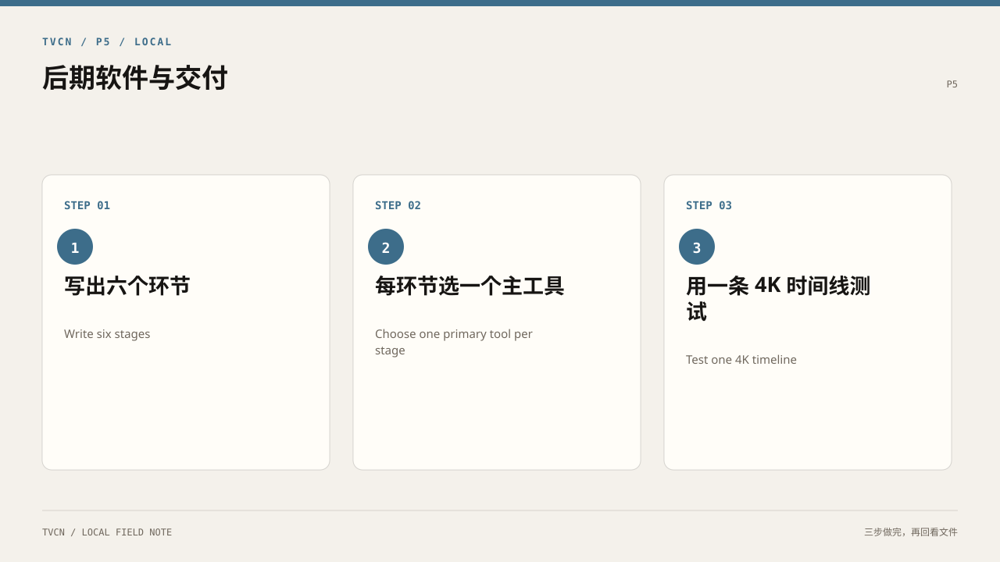

先别记结论：后期软件与交付：先定流程，再买工具 这一页只回答一个现场问题——条件成立时怎么做，条件不成立时在哪一步停下。读完后拿自己的素材复述一次，能复述才算读懂。

<!-- DIAGRAM_START -->
<h2>图解</h2>
<figure>
  
  <figcaption>流程、工具和交付顺序的图解，不是软件广告。</figcaption>
</figure>
<!-- DIAGRAM_END -->
<h2>先定流程：六个环节，不是六个软件</h2>

后期不是“装一堆软件”。一条片子从素材到交付，固定六个环节：备份与转码、代理剪辑、精剪、调色、声音、编码交付。每个环节只需要一个主工具，其他工具是补位。先写流程，再买订阅。
<ol><li>素材：相机卡 → 双备份 → 校验 checksum。</li><li>代理：生成同帧率、同时间码的轻量文件，原素材不动。</li><li>剪辑：时间线只放代理，所有决定在第 1 周完成。</li><li>调色：回到原素材，先还原色彩，再做风格。</li><li>声音：对白、音乐、环境分轨，先对白后音乐。</li><li>交付：按平台出 H.264；归档出 ProRes/原素材。</li></ol>
<h2>决策树：先定项目，再定工具</h2>

访谈、短剧、广告、纪录片对工具的要求不同。访谈要稳、要能长时间跑；短剧要多人协作和版本管理；广告要调色与合成；纪录片要处理大量素材和代理。不要因为某个软件便宜就改流程。

<table class="data-table"><thead><tr><th>项目</th><th>先看什么</th><th>可以不看</th><th>预算带</th></tr></thead><tbody><tr><td>访谈/口播</td><td>稳定、音频同步、导出快</td><td>复杂合成</td><td>低</td></tr><tr><td>短剧/系列</td><td>多人协作、版本、代理</td><td>单机极致调色</td><td>中</td></tr><tr><td>广告/产品</td><td>调色、合成、交付规格</td><td>长片剪辑</td><td>中高</td></tr><tr><td>纪录片</td><td>素材管理、代理、搜索</td><td>实时特效</td><td>中</td></tr></tbody></table>

<h2>八项对比：订阅之前先算总成本</h2>

<table class="data-table"><thead><tr><th>环节</th><th>要看</th><th>适用</th><th>不适合</th></tr></thead><tbody><tr><td>剪辑 NLE</td><td>时间线稳定性、代理、协作</td><td>长片/系列</td><td>只做单条短视频</td></tr><tr><td>调色</td><td>节点、色彩管理、跟踪</td><td>广告/剧情</td><td>直出会议</td></tr><tr><td>声音</td><td>多轨、自动化、降噪</td><td>访谈/短剧</td><td>纯音乐剪辑</td></tr><tr><td>编码</td><td>H.264/ProRes、队列、硬件加速</td><td>批量交付</td><td>单条导出</td></tr><tr><td>审片</td><td>逐帧批注、版本对比</td><td>客户项目</td><td>个人练习</td></tr><tr><td>素材管理</td><td>代理、标签、搜索</td><td>纪录片/系列</td><td>单次拍摄</td></tr><tr><td>协作</td><td>锁版、评论、权限</td><td>多人团队</td><td>单人工作</td></tr><tr><td>总成本</td><td>订阅+插件+存储+学习时间</td><td>任何项目</td><td>只看月费</td></tr></tbody></table>

<h2>购买顺序：不要一次买齐</h2>

先买剪辑，能完成一条 5 分钟片子；再买调色，等客户开始要求风格；再买声音，等对白需要修；最后买编码/审片，等交付量上来。插件只买你每周都会用的，不买“看起来很强”的。
<ol><li>第 1 个月：一个 NLE + 一个编码工具。</li><li>第 2 个月：按项目加调色或声音。</li><li>第 3 个月：有客户再审片/协作。</li><li>每季度删掉一个不用的订阅。</li></ol>
<h2>测试口径：用同一条 4K 时间线</h2>

用同一条 4K 10-bit 时间线，测四件事：50% 速度回放、代理切换、调色节点、导出时间。记录机器、显卡、软件版本、缓存设置。没有做的：实验室跑分、跨平台大规模对比。

<h2>继续读：后期与交付中枢</h2>
<ul><li><a href="/article/nle-compare/">剪辑软件怎么选：项目先定</a></li><li><a href="/article/davinci-node/">达芬奇节点：节点不是滤镜</a></li><li><a href="/article/color-management/">色彩管理：把 LUT 放在正确的位置</a></li><li><a href="/article/export-h264/">H.264 导出：码率与兼容</a></li><li><a href="/article/export-prores/">ProRes 导出：归档与交付</a></li><li><a href="/article/audio-noise-fix/">底噪排查：从房间开始</a></li><li><a href="/article/delivery-specs/">交付：别在最后导错文件</a></li><li><a href="/article/proxy-create/">代理生成：剪辑不卡</a></li><li><a href="/article/buy-storage/">购买项目存储：速度、容量与备份</a></li><li><a href="/article/model-comparison/">模型对比：按镜头类型测</a></li></ul>
<h2>核验与价格日期</h2>

核验日期：2026-11-23。软件价格与订阅规则以厂商页面为准；本页只做流程与短时测试，不写跑分。

<!-- P5_EXTRA_START -->
<h2>补：失败案例</h2>

工具堆叠不等于流程。下面五种情况，买更多软件只会让断点更多。

<table class="data-table"><thead><tr><th>失败做法</th><th>后果</th><th>替换动作</th></tr></thead><tbody><tr><td>先买调色，不学剪辑</td><td>时间线讲不清，调色救不了</td><td>先完成一条 5 分钟片子</td></tr><tr><td>订阅十个工具，流程仍断</td><td>每个环节都会一点，交付仍卡</td><td>每环节只留一个主工具</td></tr><tr><td>用代理剪，回批丢失</td><td>最终回到原素材对不上</td><td>代理和原始文件同命名/同时间码</td></tr><tr><td>导出前才看交付规格</td><td>平台拒收或二次压缩</td><td>开机前写交付规格</td></tr><tr><td>审片靠微信压缩视频</td><td>客户看不到细节，反馈失焦</td><td>用逐帧批注/原片审看</td></tr></tbody></table>

<h2>交付验收：六件事</h2>
<ol><li>时间线只引用代理，原始文件不动。</li><li>调色前完成色彩变换，不靠 LUT 掩盖。</li><li>对白 solo 能听懂，音乐不盖词。</li><li>H.264 与 ProRes 各出一条，规格正确。</li><li>归档含工程、原素材、输出、字幕。</li><li>客户审片有版本号和截止时间。</li></ol>
六件事缺一件，交付就会在最后一小时返工。

<!-- P5_EXTRA2_START -->
<h2>补：工具选择表</h2>

不要按“功能最多”选，按“你每周都要做的动作”选。

<table class="data-table"><thead><tr><th>动作</th><th>优先看</th><th>可以后买</th></tr></thead><tbody><tr><td>粗剪/精剪</td><td>时间线稳定、代理、快捷键</td><td>协作/审片</td></tr><tr><td>调色</td><td>色彩管理、节点、缓存</td><td>胶片颗粒插件</td></tr><tr><td>声音</td><td>多轨、自动化、降噪</td><td>环绕声</td></tr><tr><td>编码</td><td>H.264/ProRes、队列、硬件加速</td><td>云渲染</td></tr><tr><td>审片</td><td>逐帧批注、版本对比</td><td>品牌门户</td></tr></tbody></table>

<h2>补：交付失败案例</h2>

后期最常见的翻车不是软件不会用，是最后一步没按规格交付。

<table class="data-table"><thead><tr><th>失败做法</th><th>后果</th><th>替换动作</th></tr></thead><tbody><tr><td>只出 ProRes 给平台</td><td>文件过大被拒/二次压缩</td><td>另出 H.264</td></tr><tr><td>音频采样率不对</td><td>平台无声/音调不对</td><td>统一 48kHz</td></tr><tr><td>归档只存输出</td><td>半年后无法改片</td><td>存工程+原素材+字幕</td></tr></tbody></table>

<!-- P5_EXTRA3_START -->
<h2>最后一句：流程比软件重要</h2>

软件只是把决定执行得更快。流程不清，换更贵的软件只会把错误做得更精致。先用一条 5 分钟片子跑通六个环节，再谈订阅、插件和协作。每季度删掉一个不用的工具，把时间留给剪辑、声音和交付。

<!-- P5_EXTRA4_START -->
<h2>边界：订阅不是能力</h2>

订阅只买到工具，不买到判断。剪辑点、色彩管理、声音层次和交付规格仍然要一条片子一条片子地练；工具越多，越需要一条固定的流程。

<!-- SOURCES_START -->
## 参考与延伸阅读

- [S34] [Adobe：Premiere Pro 官方指南](https://helpx.adobe.com/premiere-pro/user-guide.html) — 2026-11-26 访问。用于核对「测试口径：用同一条 4K 时间线」一节的术语/方法/规则（Premiere Pro 官方指南，不是工作流优劣结论）；不核对其中由本页经验得出的数字、型号与现场结论，也不替代测试。
- [S60] [Apple：Final Cut Pro 官方指南](https://support.apple.com/guide/final-cut-pro/welcome/mac) — 2026-11-26 访问。用于核对「先定流程：六个环节，不是六个软件」一节的术语/方法/规则（Final Cut Pro 官方指南，不是工作流优劣结论）；不核对其中由本页经验得出的数字、型号与现场结论，也不替代测试。
- [S35] [Avid：资源中心](https://www.avid.com/resource-center) — 2026-11-26 访问。用于核对「决策树：先定项目，再定工具」一节的术语/方法/规则（Avid 资源中心，不是独立评测）；不核对其中由本页经验得出的数字、型号与现场结论，也不替代测试。
<!-- SOURCES_END -->

