<!-- DIAGRAM_START -->
<h2>图解</h2>
<figure>
  
  <figcaption>示意：VPG、持续写入、容量、发热、恢复，五项决定一张卡能不能上项目。</figcaption>
</figure>
<!-- DIAGRAM_END -->
<h2>先判断：你缺的是哪一环</h2>
先查相机说明书要求的最低卡等级和码率，不要用“能拍 8K”当唯一标准。CFexpress Type B 适合高码率，SD UHS-II 适合 4K 10-bit 但持续写入参差；V90 比 V60 稳，但先确认相机能吃到。

<strong>适合：</strong>
<ul><li>高码率 4K/6K/8K</li><li>多机位/长录制</li><li>需要快速拷回</li></ul>
<strong>不适合：</strong>
<ul><li>只拍 1080p 轻量</li><li>相机只支持 UHS-I</li><li>把一张卡当唯一备份</li></ul><h2>测试口径：可复现，不写假跑分</h2>
用项目最高码率录满一张卡，回放看是否丢帧/报错；连续录 30 分钟摸卡温；再拷回 100GB 计时。不要用短片段判断，发热问题通常在 20 分钟后出现。

<table class="data-table"><thead><tr><th>检查项</th><th>通过线</th><th>参考/记录</th></tr></thead><tbody><tr><td>VPG</td><td>达到相机要求的最低等级</td><td>说明书/卡标</td></tr><tr><td>持续写入</td><td>满卡录制不丢帧</td><td>最高码率</td></tr><tr><td>容量</td><td>单机位 1–2 小时</td><td>码率/卡量</td></tr><tr><td>发热</td><td>30 分钟不报警/不烫手</td><td>连续录制</td></tr><tr><td>恢复</td><td>有恢复服务/保修</td><td>序列/发票</td></tr></tbody></table>
<h2>价格带：先看总拥有成本</h2>
不只看标价，还要看卡、电池、转接、云台、灯架、软件订阅和维修。以下按“能完成一类真实项目”的最低配置分档，不是入门玩具价。

<table class="data-table"><thead><tr><th>档位</th><th>参考价</th><th>包含</th><th>注意</th></tr></thead><tbody><tr><td>入门</td><td>300–800</td><td>128GB V60/V90 SD</td><td>高码率可能不够</td></tr><tr><td>主力</td><td>800–2,500</td><td>256–512GB CFexpress B / V90</td><td>读卡器另算</td></tr><tr><td>进阶</td><td>2,500–6,000</td><td>1TB CFexpress/专业卡</td><td>相机兼容性</td></tr></tbody></table>

价格为 2026 年 11 月中国大陆渠道参考，含税与否以实际报价为准；不构成购买建议。
<h2>替代与升级：别在错误的轴上加钱</h2><ul><li>两张 128GB 轮换</li><li>租高速卡拍高码率</li><li>外录 SSD 替代部分卡</li></ul><h2>购买执行：带片子去，不带参数去</h2>
下单前按顺序做一遍；任何一步失败，都不要用“后期能修”说服自己。
<ol><li>查相机最低卡等级</li><li>最高码率录满卡</li><li>连续 30 分钟摸温度</li><li>100GB 拷回计时</li><li>确认读卡器与保修</li></ol><h2>验收</h2><ul><li>卡达到相机最低等级。</li><li>满卡录制不丢帧。</li><li>容量覆盖单机位 1–2 小时。</li><li>30 分钟不发热报警。</li><li>至少两张轮换。</li><li>有恢复/保修。</li></ul>
<!-- SOURCES_START -->
<h2>参考与延伸阅读</h2>

经验来源：编辑部现场手册与购买检查表；实测来源：短测与公开规格核对，不是实验室跑分；参考来源：以下厂商与标准链接。

<ul><li>[S23] SMPTE 标准入口</li><li>[S25] ITU-R BT.709</li><li>[S26] ITU-R BT.2020</li><li>[S29] YouTube 上传规格</li><li>[S38] 国家税务总局</li></ul>

<a href="../../SOURCES.md">完整链接与用途见 SOURCES.md</a>

<!-- SOURCES_END -->
