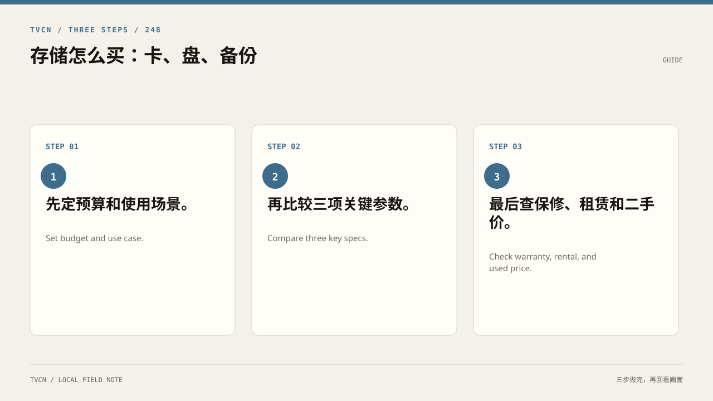

存储分三层买：卡负责拍、SSD 负责剪、硬盘负责备；别用一块盘干三件事。

<!-- DIAGRAM_START -->
<h2>图解</h2>
<figure>
  
  <figcaption>把三步按顺序做完，再回看画面或文件。</figcaption>
</figure>
<!-- DIAGRAM_END -->
<h2>现场</h2>

卡买 V90 SD 或 CFexpress，SSD 买 TLC 带 DRAM，备份买两块不同品牌硬盘。

<h2>怎么做</h2>

存储分三层：卡负责拍、SSD 负责剪、硬盘负责备；别用一块盘干三件事。
<ol><li>卡买 V90 SD 或 CFexpress，按最高码率算时长。</li><li>SSD 买 TLC 带 DRAM，容量至少是素材量的两倍。</li><li>备份买两块不同品牌硬盘，一块放异地。</li></ol>
<h2>别踩</h2>

别用一张卡拍完直接剪；卡会坏，素材会丢。

<h2>验收</h2>
<ul><li>V90 或 CFexpress 卡按最高码率算过时长。</li><li>TLC 带 DRAM 的 SSD，容量至少是素材两倍。</li><li>两块不同品牌硬盘，一块放在异地。</li></ul>
