<!-- DIAGRAM_START -->
<h2>图解</h2>
<figure>
  
  <figcaption>示意：漂移、同步、电池、接口、元数据，五项决定后期能不能一键对齐。</figcaption>
</figure>
<!-- DIAGRAM_END -->
<h2>先判断：你缺的是哪一环</h2>
单机位、现场能拍手，时码器不是必需。多机位、多天、无法拍手、需要音频自动对齐时，才值得买。先确认相机/录机支持时码输入还是只能输出；只有输出的一侧需要额外同步策略。

<strong>适合：</strong>
<ul><li>多机位/多天拍摄</li><li>无法拍手/自动对齐</li><li>音频独立录制</li></ul>
<strong>不适合：</strong>
<ul><li>单机位可拍手</li><li>相机无时码接口</li><li>后期不做多机位</li></ul><h2>测试口径：可复现，不写假跑分</h2>
三台设备同时开机，跑 8 小时（或至少 2 小时）后比对时码；中途换电池，看是否保持；把时码写入音频文件，导入后期看是否自动识别。

<table class="data-table"><thead><tr><th>检查项</th><th>通过线</th><th>参考/记录</th></tr></thead><tbody><tr><td>漂移</td><td>8 小时 &lt;1 帧</td><td>长测比对</td></tr><tr><td>同步</td><td>三机同码，无偏移</td><td>三机测试</td></tr><tr><td>电池</td><td>换电不断码</td><td>中途换电</td></tr><tr><td>接口</td><td>相机/录机可接</td><td>现场接线</td></tr><tr><td>元数据</td><td>后期可读取</td><td>导入测试</td></tr></tbody></table>
<h2>价格带：先看总拥有成本</h2>
不只看标价，还要看卡、电池、转接、云台、灯架、软件订阅和维修。以下按“能完成一类真实项目”的最低配置分档，不是入门玩具价。

<table class="data-table"><thead><tr><th>档位</th><th>参考价</th><th>包含</th><th>注意</th></tr></thead><tbody><tr><td>入门</td><td>300–800</td><td>单台基础时码器</td><td>漂移/接口有限</td></tr><tr><td>主力</td><td>800–2,000</td><td>双台/三台套装 + 线材</td><td>电池与支架</td></tr><tr><td>进阶</td><td>2,000–6,000</td><td>多机同步、专业时码</td><td>频率/元数据</td></tr></tbody></table>

价格为 2026 年 11 月中国大陆渠道参考，含税与否以实际报价为准；不构成购买建议。
<h2>替代与升级：别在错误的轴上加钱</h2><ul><li>拍手 + 后期手动同步</li><li>录机内置时码</li><li>租时码套装</li></ul><h2>购买执行：带片子去，不带参数去</h2>
下单前按顺序做一遍；任何一步失败，都不要用“后期能修”说服自己。
<ol><li>确认相机时码接口</li><li>三机跑 2–8 小时</li><li>中途换电</li><li>导入后期读元数据</li><li>算线材/支架</li></ol><h2>验收</h2><ul><li>8 小时漂移 &lt;1 帧。</li><li>三机同码无偏移。</li><li>换电不断码。</li><li>相机/录机可接。</li><li>后期能读元数据。</li><li>线材/支架齐全。</li></ul>
<!-- SOURCES_START -->
<h2>参考与延伸阅读</h2>

经验来源：编辑部现场手册与购买检查表；实测来源：短测与公开规格核对，不是实验室跑分；参考来源：以下厂商与标准链接。

<ul><li>[S23] SMPTE 标准入口</li></ul>

<a href="../../about/">完整链接与用途见 SOURCES.md</a>

<!-- SOURCES_END -->
