<!-- DIAGRAM_START -->
<h2>图解</h2>
<figure>
  
  <figcaption>示意：阻尼、平衡、俯仰范围、接口、重量，五项决定摇移是否顺。</figcaption>
</figure>
<!-- DIAGRAM_END -->
<h2>先判断：你缺的是哪一环</h2>
先按机器重量选云台级别：3kg 以内 75mm 够，5kg 以上看 100mm。液压云台的“动态平衡”比标称承重重要；低机位、俯拍、长焦都要求不同的平衡档。

<strong>适合：</strong>
<ul><li>视频摇移/俯仰</li><li>长焦/体育/舞台</li><li>需要低机位俯拍</li></ul>
<strong>不适合：</strong>
<ul><li>只拍照片/球台够用</li><li>极轻旅行套装</li><li>需要电子控制/远程</li></ul><h2>测试口径：可复现，不写假跑分</h2>
装上整机，调好平衡，松手看是否点头；从最慢到最快摇一次，感受阻尼是否连续；再俯到最低、仰到最高，看是否撞限位。

<table class="data-table"><thead><tr><th>检查项</th><th>通过线</th><th>参考/记录</th></tr></thead><tbody><tr><td>阻尼</td><td>全程连续，无突然变松/紧</td><td>慢快摇移</td></tr><tr><td>平衡</td><td>松手 3 秒内不点头</td><td>重心调平</td></tr><tr><td>俯仰</td><td>-70°~+90° 可用</td><td>低/高机位</td></tr><tr><td>接口</td><td>75/100mm 与脚架匹配</td><td>安装</td></tr><tr><td>重量</td><td>整机可单人携带</td><td>称重</td></tr></tbody></table>
<h2>价格带：先看总拥有成本</h2>
不只看标价，还要看卡、电池、转接、云台、灯架、软件订阅和维修。以下按“能完成一类真实项目”的最低配置分档，不是入门玩具价。

<table class="data-table"><thead><tr><th>档位</th><th>参考价</th><th>包含</th><th>注意</th></tr></thead><tbody><tr><td>入门</td><td>500–1,500</td><td>75mm 液压云台</td><td>平衡档有限</td></tr><tr><td>主力</td><td>1,500–4,000</td><td>75/100mm、连续阻尼</td><td>脚架另算</td></tr><tr><td>进阶</td><td>4,000–12,000</td><td>100mm 专业液压、长焦平衡</td><td>重量与携带</td></tr></tbody></table>

价格为 2026 年 11 月中国大陆渠道参考，含税与否以实际报价为准；不构成购买建议。
<h2>替代与升级：别在错误的轴上加钱</h2><ul><li>球台 + 液压小云台</li><li>租 100mm 云台</li><li>二手曼富图 504/502</li></ul><h2>购买执行：带片子去，不带参数去</h2>
下单前按顺序做一遍；任何一步失败，都不要用“后期能修”说服自己。
<ol><li>装整机调平衡</li><li>松手看点头</li><li>慢快摇移测阻尼</li><li>俯仰到极限</li><li>确认脚架接口</li></ol><h2>验收</h2><ul><li>松手 3 秒内不点头。</li><li>阻尼全程连续。</li><li>俯仰范围覆盖低/高机位。</li><li>接口与脚架匹配。</li><li>整机可单人携带。</li><li>长焦摇移不抖。</li></ul>
<!-- SOURCES_START -->
<h2>参考与延伸阅读</h2>

经验来源：编辑部现场手册与购买检查表；实测来源：短测与公开规格核对，不是实验室跑分；参考来源：以下厂商与标准链接。

<ul><li>[S23] SMPTE 标准入口</li><li>[S25] ITU-R BT.709</li><li>[S26] ITU-R BT.2020</li><li>[S29] YouTube 上传规格</li><li>[S38] 国家税务总局</li></ul>

<a href="../../SOURCES.md">完整链接与用途见 SOURCES.md</a>

<!-- SOURCES_END -->
