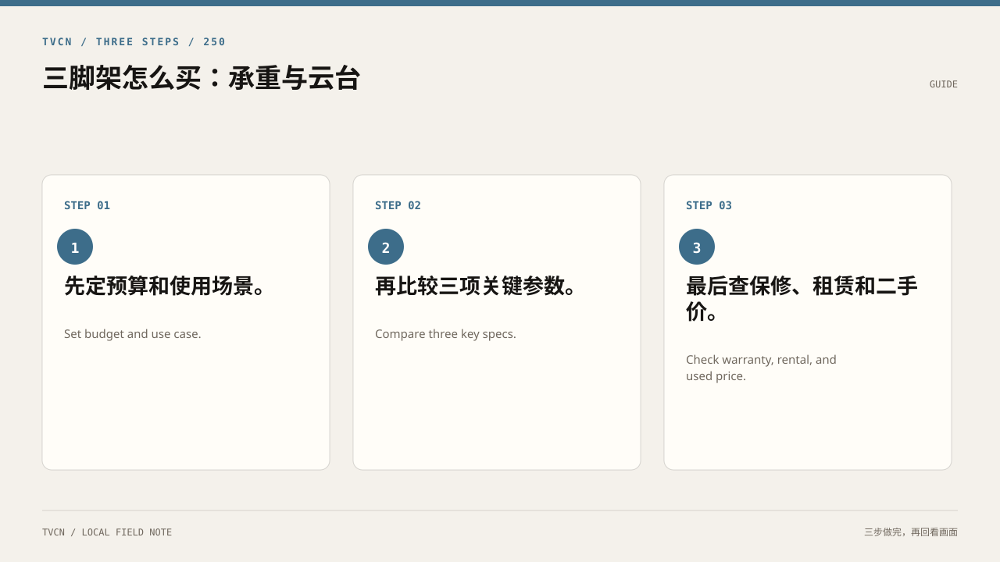

<!-- DIAGRAM_START -->
<h2>图解</h2>
<figure>
  
  <figcaption>示意：承重、扭转、腿刚度、云台漂移、高度，五项决定它能不能稳住你的机器。</figcaption>
</figure>
<!-- DIAGRAM_END -->
<h2>先判断：你缺的是哪一环</h2>
先称你的真实配置：机身 + 镜头 + 监看 + 电池 + 云台。三脚架承重至少是它的 2 倍，但更重要的是脚管直径和锁紧结构。拍视频优先“不升中轴”的高度，拍照片才看收纳长度。

<strong>适合：</strong>
<ul><li>访谈/固定机位</li><li>长焦/延时</li><li>户外有风，需要稳定</li></ul>
<strong>不适合：</strong>
<ul><li>频繁移动/旅行</li><li>只拍手持</li><li>超低机位微距</li></ul><h2>测试口径：可复现，不写假跑分</h2>
装上你的最重配置，升到眼平，锁死云台。轻推机器看回弹；用最长焦拍 2 秒曝光；再拍 30 秒延时看云台是否下垂。

<table class="data-table"><thead><tr><th>检查项</th><th>通过线</th><th>参考/记录</th></tr></thead><tbody><tr><td>承重</td><td>真实重量 2 倍以上</td><td>整机称重</td></tr><tr><td>扭转</td><td>轻推后无持续晃动</td><td>手推回弹</td></tr><tr><td>腿刚度</td><td>最长焦 2 秒曝光锐利</td><td>长焦实拍</td></tr><tr><td>云台漂移</td><td>锁紧 30 秒不下垂</td><td>延时</td></tr><tr><td>高度</td><td>不升中轴到眼平</td><td>现场站位</td></tr></tbody></table>
<h2>价格带：先看总拥有成本</h2>
不只看标价，还要看卡、电池、转接、云台、灯架、软件订阅和维修。以下按“能完成一类真实项目”的最低配置分档，不是入门玩具价。

<table class="data-table"><thead><tr><th>档位</th><th>参考价</th><th>包含</th><th>注意</th></tr></thead><tbody><tr><td>入门</td><td>300–1,000</td><td>铝合金三脚架 + 球台</td><td>长焦/风下有限</td></tr><tr><td>主力</td><td>1,000–3,000</td><td>碳纤维/铝合金 + 液压云台</td><td>云台另算</td></tr><tr><td>进阶</td><td>3,000–10,000</td><td>高刚度碳纤维 + 专业液压</td><td>重量与携带</td></tr></tbody></table>

价格为 2026 年 11 月中国大陆渠道参考，含税与否以实际报价为准；不构成购买建议。
<h2>替代与升级：别在错误的轴上加钱</h2><ul><li>买二手曼富图/捷信</li><li>先买独脚架</li><li>租重型脚架拍长焦</li></ul><h2>购买执行：带片子去，不带参数去</h2>
下单前按顺序做一遍；任何一步失败，都不要用“后期能修”说服自己。
<ol><li>称整机真实重量</li><li>眼平不升中轴</li><li>长焦 2 秒曝光</li><li>30 秒延时看漂移</li><li>检查锁紧与脚钉</li></ol><h2>验收</h2><ul><li>承重至少 2 倍真实重量。</li><li>眼平不升中轴。</li><li>长焦 2 秒曝光锐利。</li><li>30 秒延时不下垂。</li><li>脚管锁紧无松动。</li><li>重量可接受。</li></ul>
<!-- SOURCES_START -->
<h2>参考与延伸阅读</h2>

经验来源：编辑部现场手册与购买检查表；实测来源：短测与公开规格核对，不是实验室跑分；参考来源：以下厂商与标准链接。

<ul><li>[S23] SMPTE 标准入口</li><li>[S25] ITU-R BT.709</li><li>[S26] ITU-R BT.2020</li><li>[S29] YouTube 上传规格</li><li>[S38] 国家税务总局</li></ul>

<a href="../../SOURCES.md">完整链接与用途见 SOURCES.md</a>

<!-- SOURCES_END -->
