<!-- DIAGRAM_START -->
<h2>图解</h2>
<figure>
  
  <figcaption>示意：距离、断点、延迟、电池、干扰，五项决定现场能不能一直有声。</figcaption>
</figure>
<!-- DIAGRAM_END -->
<h2>先判断：你缺的是哪一环</h2>
先看场景：室内访谈 2.4GHz 够；商场/演唱会/多套同场，优先 UHF 或带自动跳频的数字系统。不要买“最便宜的双套”，断点会让整条片子重拍。领夹麦本身也要测衣服摩擦和风噪。

<strong>适合：</strong>
<ul><li>访谈/口播/活动</li><li>单人/双人移动</li><li>需要无束缚收音</li></ul>
<strong>不适合：</strong>
<ul><li>多套同场高密度</li><li>强干扰/长距离</li><li>需要广播级冗余</li></ul><h2>测试口径：可复现，不写假跑分</h2>
在真实场地走动：转身、用手挡、走到人群后、贴近金属。每段录 30 秒，回放听断点/底噪；再拍手测延迟；两套同开测串频。

<table class="data-table"><thead><tr><th>检查项</th><th>通过线</th><th>参考/记录</th></tr></thead><tbody><tr><td>距离</td><td>真实场地全程不断</td><td>走动测试</td></tr><tr><td>断点</td><td>遮挡/转身不断</td><td>商场/人群</td></tr><tr><td>延迟</td><td>拍手口型偏差可接受</td><td>拍手回放</td></tr><tr><td>电池</td><td>覆盖 8 小时拍摄日</td><td>续航记录</td></tr><tr><td>干扰</td><td>双套同场不串频</td><td>双套测试</td></tr></tbody></table>
<h2>价格带：先看总拥有成本</h2>
不只看标价，还要看卡、电池、转接、云台、灯架、软件订阅和维修。以下按“能完成一类真实项目”的最低配置分档，不是入门玩具价。

<table class="data-table"><thead><tr><th>档位</th><th>参考价</th><th>包含</th><th>注意</th></tr></thead><tbody><tr><td>入门</td><td>800–2,000</td><td>2.4GHz 双套</td><td>商场/多套易断</td></tr><tr><td>主力</td><td>2,000–6,000</td><td>数字/UHF 双套 + 备份麦</td><td>电池与配件</td></tr><tr><td>进阶</td><td>6,000–20,000</td><td>专业无线、多套、时码</td><td>频率协调</td></tr></tbody></table>

价格为 2026 年 11 月中国大陆渠道参考，含税与否以实际报价为准；不构成购买建议。
<h2>替代与升级：别在错误的轴上加钱</h2><ul><li>有线领夹 + 录机</li><li>租专业无线</li><li>枪麦 + 录机</li></ul><h2>购买执行：带片子去，不带参数去</h2>
下单前按顺序做一遍；任何一步失败，都不要用“后期能修”说服自己。
<ol><li>真实场地走动测试</li><li>遮挡/转身测断点</li><li>拍手测延迟</li><li>双套同开测串频</li><li>算电池与备份麦</li></ol><h2>验收</h2><ul><li>真实场地全程不断。</li><li>遮挡/转身不断。</li><li>口型延迟可接受。</li><li>电池覆盖 8 小时。</li><li>双套同场不串。</li><li>领夹无衣服摩擦/风噪。</li></ul>
<!-- SOURCES_START -->
<h2>参考与延伸阅读</h2>

经验来源：编辑部现场手册与购买检查表；实测来源：短测与公开规格核对，不是实验室跑分；参考来源：以下厂商与标准链接。

<ul><li>[S23] SMPTE 标准入口</li><li>[S25] ITU-R BT.709</li><li>[S26] ITU-R BT.2020</li><li>[S29] YouTube 上传规格</li><li>[S38] 国家税务总局</li></ul>

<a href="../../SOURCES.md">完整链接与用途见 SOURCES.md</a>

<!-- SOURCES_END -->
