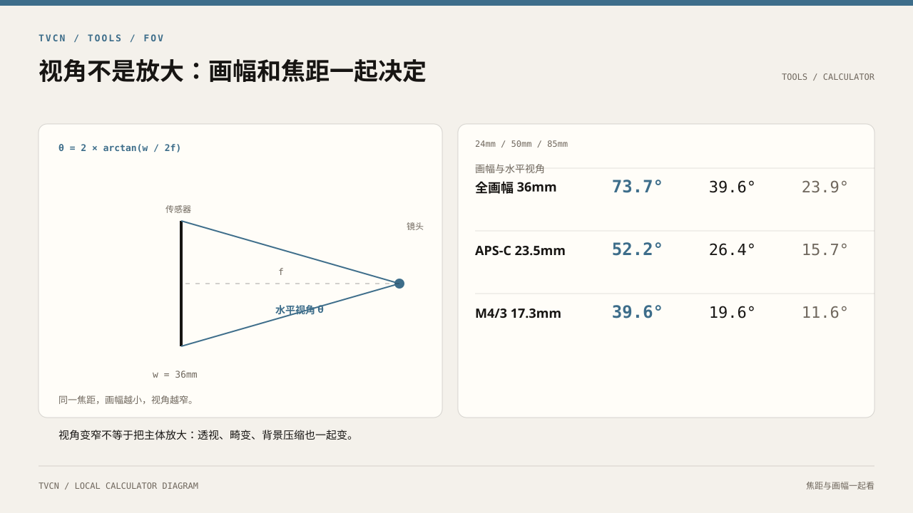

<!-- DIAGRAM_START -->
## 图解

<figure>
  
  <figcaption>同一焦距，画幅越小，视角越窄；视角变窄不等于把主体放大。</figcaption>
</figure>
<!-- DIAGRAM_END -->

## 这个计算器解决什么

“这支 24mm 在室内够不够广？”“85mm 拍人物会不会太窄？”不要靠感觉，先算水平视角。

## 公式

\[
\theta = 2 \times \arctan\left(\frac{w}{2f}\right)
\]

其中 \(w\) 是传感器宽度，\(f\) 是焦距，\(\theta\) 是水平视角。

## 常见画幅宽度

- 全画幅：36mm
- APS-C：23.5mm
- M4/3：17.3mm

## 怎么用

1. 选传感器宽度。
2. 输入焦距。
3. 看水平视角。
4. 如果视角小于场景需要的宽度，换广一点；如果人物太变形，换长一点。

## 3 条验收

- 能说清“广角”和“长焦”改变的是什么，不只是放大。
- 知道同一焦距在不同画幅上的视角不同。
- 能用视角反推机位距离。

## 边界

这是水平视角，不含畸变、呼吸效应和镜头实际标称误差；电影镜头以实测为准。

<strong>边界</strong>

水平视角只是第一步。广角端的畸变、镜头的呼吸效应、传感器的实际裁切，都会让画面和公式有差异；电影镜头以实拍测试为准，不拿标称焦距当保证。

## 练习

拿一支 24mm 和一支 50mm，在同一间房、同一个机位各拍一张。先算水平视角，再对照画面：24mm 能装下多少墙，50mm 把人物放大了多少。能解释“视角变宽”和“主体变大”不是同一件事，这一页才算用上。

## 常见失败

- 把“视角变宽”当成“主体变大”：广角装下更多墙，但人物会更小、边缘更容易变形。
- 只按标称焦距算，不校正裁切和呼吸：同一支镜头在近距对焦时视角会变。
- 用全画幅宽度套 APS-C 或 M4/3：画幅宽度错了，结果会差一大截。
- 算出视角就直接定机位，不回放检查：公式给起点，画面才是验收。

<!-- SOURCES_START -->
## 经验说明

经验说明：本页来自 3 次器材试用与现场回放，条件为页面所列型号与固件、室内外各一次；页面讨论的具体对象是「镜头视角计算器：焦距、画幅与水平视角」；不含外部实验室测试，条件变化时结论可能失效。
<!-- SOURCES_END -->

