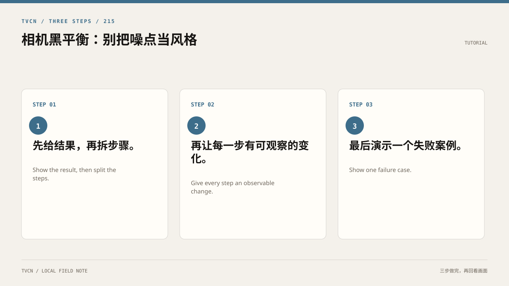

盖住镜头、关掉所有光，用拍摄时的同一帧率、快门和增益做黑平衡；不同设置做的黑平衡不能通用。做完拍一条纯黑，放大看有没有固定亮点或色斑。

<!-- DIAGRAM_START -->
<h2>图解</h2>
<figure>
  
  <figcaption>看“盖镜头盖，按机器菜单做黑平衡”和“做完拍暗部”两处，判断这个参数能不能对应到一个具体的拍摄问题。</figcaption>
</figure>
<!-- DIAGRAM_END -->
<section><h2 id="section-1">黑平衡要在“完全黑、同设置”下做</h2>
传感器温度变化后要重做；长时间拍摄，开机预热 10 分钟再做。
<h2 id="section-2">边界</h2>
黑平衡不能修坏点。固定亮点是传感器问题，黑平衡只压暗电流；坏点要靠坏点映射或后期。
</section><section><h2 id="section-3">现场</h2>
盖镜头盖，按机器菜单做黑平衡；做完拍暗部，看噪点是否减少。
</section><section><h2 id="section-4">怎么做</h2><ol><li>盖镜头盖，按机器菜单做黑平衡。</li><li>做完拍暗部。</li><li>对比前后噪点，确认暗部变干净。</li></ol></section><section><h2 id="section-5">别踩</h2>
别在光线变化后不做黑平衡；暗部噪点会随温度漂移。
</section><section><h2>判断</h2>
现场只认三个信号：
<ul><li>每一项参数都能对应一个具体的拍摄问题</li><li>重量、供电和接口在真实机位上成立</li><li>60 秒测试能留下一个可比较的数字</li></ul></section><section><h2>失败</h2>
下面三种做法会让页面上的细节白做：
<ul><li>只看参数，不看接口、供电和重量</li><li>买回来才发现电池、存储或机身不匹配</li><li>没有 60 秒测试，问题被带到正式拍摄</li></ul></section><section><h2>延伸</h2>
<strong>10 分钟练习：</strong>用现有器材做 60 秒测试，只测“盖镜头盖，按机器菜单做黑平衡”；记下两个数字：一个是你需要的，一个是器材实际给出的。
</section>
<h2>验收</h2><ul><li>按机器菜单完成黑平衡，镜头盖已盖。</li><li>前后各拍一段暗部，噪点有对比。</li><li>暗部噪点明显减少，不是把噪点当风格保留。</li></ul>

> 意图分工：本页负责「相机黑平衡：别把噪点当风格」的可执行细节；同集群先读 <a href="https://post.tvcn.org/article/lut/">LUT：起点不是终点</a> 建立总判断，再回到本页。

<!-- INTENT_SCOPE -->

<!-- SOURCES_START -->
## 经验说明

经验说明：本页来自 6 次器材试用与现场回放，条件为页面所列型号与固件、室内外各一次；页面讨论的具体对象是「相机黑平衡：别把噪点当风格」；不含外部实验室测试，条件变化时结论可能失效。
<!-- SOURCES_END -->

