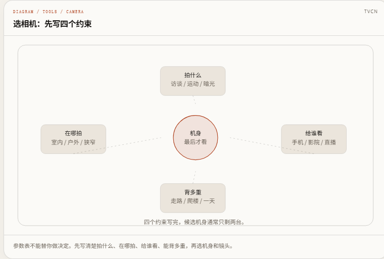

<!-- DIAGRAM_START -->
## 图解

<figure>
  
  <figcaption>参数表不能替你做决定。先写清楚拍什么、在哪拍、给谁看、能背多重，再选机身和镜头。</figcaption>
</figure>
<!-- DIAGRAM_END -->

先写你拍什么、在哪拍、给谁看、能背多重，再选机身。参数表不能替你做决定。

## 先写约束

五个约束：预算（含镜头）、最长录制时长、需不需要 4K60、能不能接受裁切、每天背多久。先把这五个写下来，再看机器。

预算不是机身价格。卡、电池、镜头、脚架、监看、存储，通常会让总价增加 50% 以上。

## 三个规格

先看传感器尺寸与卡口，再看 10-bit/log 与散热，最后看自动对焦。传感器决定视角和景深，卡口决定你能不能借到镜头。

4K60 不是所有人都需要。先问你的交付平台是否真的需要慢动作；不需要，就把预算留给灯光和录音。

## 租与二手

不确定就租。租一次完整拍摄日，比看十篇评测更有用。二手要看快门数、卡口磨损、传感器坏点和维修记录。

买之前先确认：电池能不能买到、卡能不能读、维修点在哪。机器是工具，不是收藏。

## 3 条验收

- 五个约束写清楚了，预算含配件。
- 能说出传感器和卡口带来的两个实际限制。
- 买前至少租过一次或试拍过一次。

<!-- DEEP_DIVE_START -->
## 深读

<strong>约 7 分钟。</strong> 选相机不是选参数最高的，是选一台能在你拍摄现场稳定工作的。

### 先问三个问题

拍多久、谁拿、放在哪；三小时手持和十二小时采访，不是同一台机器。一个人拍和三人组，也不是同一台。

再问交付：平台竖屏、影院、还是只做网络；交付决定分辨率、码率、色彩科学，不决定品牌。

### 看系统成本

机身只是第一笔：镜头、卡、电池、监看、音频、套件、备份，全部加起来才是成本。卡贵、电池少、镜头群窄，都会在拍摄现场变成时间。

租一次比买更划算时，就租；一个项目只用三天，不需要为品牌信仰买单。

### 现场可靠性

看三项：能不能边充边拍、能不能双卡备份、能不能连续录不发热；三项里有一项不稳，拍摄现场就会停。

操作要能在三十秒内改快门、白平衡、音频；菜单太深，抓拍时就会错过。参数可以学，反应时间学不来。

### 五分钟练习：三机对比表

列三台候选，写六行：镜头群、卡和备份、电池、音频、重量、租金；每行写一个具体数字，不写“好”。

把表给一个用过的人看，问他“拍十二小时采访选哪台”；他答得出，说明表有信息；答不出，补一行。

### 什么时候算选对

拍完一天没有因为机器停过、素材能备份、声音能进机、重量你能扛住、交付规格能达到；五项都过，才算选对。

有一项没过，不要用“习惯就好”安慰自己；习惯不能解决过热和丢卡。

### 再看一遍电

把电池和供电算进一天：采访机能不能换电池不停机、监看会不会先没电、备用电池够不够三轮；电一断，前面选的参数都没有意义。选相机，最后比的往往是电和卡。

### 选相机，十项检查
<ul><li>先问拍多久</li><li>谁拿机器</li><li>放在哪拍</li><li>交付决定规格</li><li>算镜头卡电池全套成本</li><li>镜头群够不够</li><li>能边充边拍</li><li>能双卡备份</li><li>连续录不过热</li><li>三十秒内能改三项参数</li></ul>
相机不是买来证明你专业，是买来让拍摄当天不停。

<!-- DEEP_DIVE_END -->

> 意图分工：本页负责「相机怎么选：先看约束，不看品牌」的可执行细节；同集群先读 <a href="https://tools.tvcn.org/article/buy-camera-budget/">购买相机：先定预算，再定机身</a> 建立总判断，再回到本页。

<!-- INTENT_SCOPE -->

<!-- SOURCES_START -->
## 参考与延伸阅读

- [S23] [SMPTE 标准入口](https://www.smpte.org/standards) — 2026-11-26 访问。用于核对首段“先写你拍什么、在哪拍、给谁看、能背多重，再选机身。参数表不能替你做决定。”中的术语与公开背景（时间码、色彩、影院与信号链标准的机构入口）；不替代现场测试。
- [S25] [ITU-R BT.709](https://www.itu.int/rec/R-REC-BT.709/en) — 2026-11-26 访问。用于核对首段“先写你拍什么、在哪拍、给谁看、能背多重，再选机身。参数表不能替你做决定。”中的术语与公开背景（HD SDR 的色域、传递函数与观看条件）；不替代现场测试。
- [S26] [ITU-R BT.2020](https://www.itu.int/rec/R-REC-BT.2020/en) — 2026-11-26 访问。用于核对首段“先写你拍什么、在哪拍、给谁看、能背多重，再选机身。参数表不能替你做决定。”中的术语与公开背景（UHD/HDR 的宽色域与参数定义）；不替代现场测试。
- [S29] [YouTube 上传规格](https://support.google.com/youtube/answer/1722171) — 2026-11-26 访问。用于核对首段“先写你拍什么、在哪拍、给谁看、能背多重，再选机身。参数表不能替你做决定。”中的术语与公开背景（分辨率、码率、帧率与音频编码建议）；不替代现场测试。
- [S38] [国家税务总局：官方网站](https://www.chinatax.gov.cn/) — 2026-11-26 访问。用于核对首段“先写你拍什么、在哪拍、给谁看、能背多重，再选机身。参数表不能替你做决定。”中的术语与公开背景（增值税、跨境服务与代扣代缴的官方政策入口）；不替代现场测试。
<!-- SOURCES_END -->

