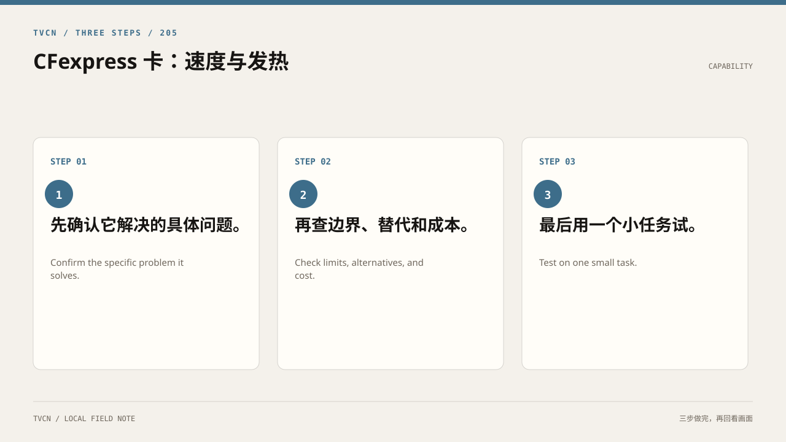

CFexpress 卡先看持续写入和发热，不看峰值；拍长条时，热降速比容量更致命。

<!-- DIAGRAM_START -->
<h2>图解</h2>
<figure>
  
  <figcaption>把三步按顺序做完，再回看画面或文件。</figcaption>
</figure>
<!-- DIAGRAM_END -->
<h2>现场</h2>

录 10 分钟最高码率，摸卡温度；再拷贝到 SSD，测持续写入是否掉速。

<h2>怎么做</h2>

CFexpress 卡先看持续写入和发热，不看峰值；拍长条时，热降速比容量更致命。
<ol><li>录 10 分钟最高码率，摸卡温度。</li><li>拷到 SSD，测持续写入是否掉速。</li><li>掉速就换卡或降码率。</li></ol>
<h2>别踩</h2>

别只看峰值写入；十分钟后热降速，长条就会断。

<h2>验收</h2>
<ul><li>最高码率连录 10 分钟没有中断，卡温有记录。</li><li>拷到 SSD 的持续写入曲线没有明显掉速。</li><li>掉速时有换卡或降码率的处理方案。</li></ul>
