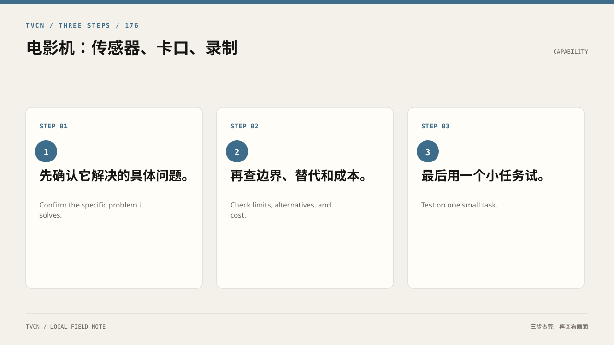

电影机先看传感器、卡口和录制格式；名字和外形不决定它能不能拍你的项目。

<!-- DIAGRAM_START -->
<h2>图解</h2>
<figure>
  
  <figcaption>把三步按顺序做完，再回看画面或文件。</figcaption>
</figure>
<!-- DIAGRAM_END -->
<h2>现场</h2>

带自己的 PL 或 EF 镜头和卡，录 5 分钟 4K 60p；摸卡口温度，回放看果冻和暗部噪点。

<h2>怎么做</h2>

电影机先看传感器、卡口和录制格式；名字和外形不决定它能不能拍你的项目。
<ol><li>带自己的 PL 或 EF 镜头和卡，录 5 分钟 4K 60p。</li><li>摸卡口温度，回放看果冻和暗部噪点。</li><li>三项都过再谈租赁价。</li></ol>
<h2>别踩</h2>

别只看机身参数表；卡口温度、果冻和暗部噪点要在你自己的素材里看。

<h2>验收</h2>
<ul><li>用自己的镜头和卡录了 5 分钟 4K 60p，文件能回放。</li><li>卡口温度有记录，没有烫到不能换镜。</li><li>回放能指出果冻程度和暗部噪点水平，不是只看样片。</li></ul>
