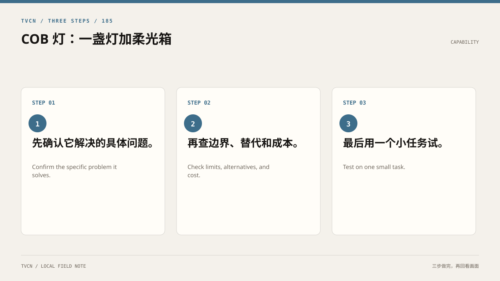

COB 灯是裸光源，必须配柔光箱或灯笼；裸着照人脸，影子会硬得没法看。

<!-- DIAGRAM_START -->
<h2>图解</h2>
<figure>
  
  <figcaption>把三步按顺序做完，再回看画面或文件。</figcaption>
</figure>
<!-- DIAGRAM_END -->
<h2>现场</h2>

装 90 厘米柔光箱，灯距人脸 1 米，功率 50%；看影子边缘，如果还硬，加柔光布或靠近。

<h2>怎么做</h2>

COB 灯是裸光源，必须配柔光箱或灯笼；裸着照人脸，影子会硬得没法看。
<ol><li>装 90 厘米柔光箱，灯距人脸 1 米，功率 50%。</li><li>看影子边缘。</li><li>如果还硬，加柔光布或把灯靠近。</li></ol>
<h2>别踩</h2>

别把 COB 裸灯对着人脸；省了柔光箱，影子会硬到没法修。

<h2>验收</h2>
<ul><li>COB 装了柔光箱，没有裸灯直打。</li><li>1 米、50% 下影子边缘有样张可看。</li><li>影子仍硬时有加柔光布或靠近的对照。</li></ul>
