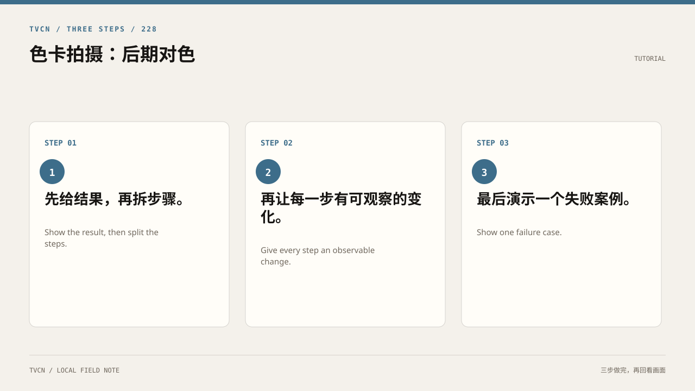

色卡在场景光下拍一张，后期才有基准；开机后补拍，光已经变了。

<!-- DIAGRAM_START -->
<h2>图解</h2>
<figure>
  
  <figcaption>把三步按顺序做完，再回看画面或文件。</figcaption>
</figure>
<!-- DIAGRAM_END -->
<h2>现场</h2>

开机先拍色卡，充满画面三分之一；后期用色卡匹配，别凭记忆调。

<h2>怎么做</h2>

色卡在场景光下拍一张，后期才有基准；开机后补拍，光已经变了。
<ol><li>开机先拍色卡。</li><li>色卡充满画面三分之一。</li><li>后期用色卡匹配，别凭记忆调。</li></ol>
<h2>别踩</h2>

别在收工前补拍色卡；那时的光和开机时不一样。

<h2>验收</h2>
<ul><li>色卡在开机时、场景光下拍摄。</li><li>色卡占画面约三分之一，色块没有反光。</li><li>后期匹配用了色卡，没有凭记忆调色。</li></ul>
