<!-- DIAGRAM_START -->
<h2>图解</h2>
<figure>
  
  <figcaption>示意：三张纸各有一个负责人；通告单不是通知，是当天唯一版本。</figcaption>
</figure>
<!-- DIAGRAM_END -->
<h2>通告单：一张纸决定当天</h2>
通告单最少写：集合时间、地址、联系人、停车、吃饭、最近医院、天气备用、每个岗位的到场时间。不要只写“全体 8 点”，摄影、灯光、化妆需要不同到场时间，写在一起只会让所有人等。

通告单提前 24 小时发；变更提前 1 小时发新版，并在群里明确“以新版为准”。口头变更不算，现场只认最新版。
<h2>角色与责任：每个风险都要有人</h2>
把风险列成表：电、火、高处、交通、天气、未成年人、动物、设备损坏。每一项写一个负责人和一个备选。负责人不是“大家”，是能拍板停拍的那个人。

关键岗位也要有备选：摄影、录音、灯光、制片。没有备选的岗位，就是单点故障；一个人生病，整个项目停。
<h2>签到、沟通与变更</h2>
签到不是形式，是确认谁在现场、谁有保险、谁可以上车。签到表写姓名、岗位、电话、到场时间、保险状态。临时加入的人，先签到再进现场。

变更走一张小表：谁提出、改什么、影响哪些镜头、谁批准。不要在现场喊“顺便拍一个”，顺便拍的东西通常没有灯光、没有声音、也没有授权。
<h2>收工：备份、清场、报告</h2>
收工前做三件事：素材备份确认、场地恢复、设备清点。备份不是“明天再弄”，当天必须有两份。场地恢复包括道具归位、垃圾清走、钥匙归还；设备清点要对着租赁单。

收工报告写：拍了哪些场、没拍到什么、明天补什么、谁受伤/损坏/超时。报告发给制片和导演，不发给全组；全组只需要知道明天的通告。
<h2>失败案例：通告写“全体 8 点”</h2>
一次六人小队拍咖啡馆，通告写全体 8 点。摄影 8 点到，灯还没架；化妆 8 点到，演员还没到；演员 8:30 到，场地 9 点才开门。所有人互相等，第一个镜头 10:40 才拍。当天计划 12 个镜头，实际拍了 7 个。

补救不是加班，是重排通告：摄影 7:30、灯光 7:30、化妆 8:30、演员 9:00、开机 9:30。通告的价值不是“通知”，是让每个人的等待时间最少。
<h2>成本与验收</h2>
剧组管理成本通常含在制片费里：小微项目 ¥1,000–3,000/天，中型 ¥3,000–8,000/天，大型 ¥8,000–20,000/天。省掉制片的结果，通常是拍摄日多花一倍。
<h2>验收</h2><ul><li>通告单提前 24 小时，含地址/联系人/医院/天气备用。</li><li>每个风险有名字和备选。</li><li>关键岗位有备份。</li><li>签到表含保险状态。</li><li>变更表写影响镜头和批准人。</li><li>收工当天有两份备份和清点报告。</li></ul>

<section><h2>边界</h2>
本页只解决「剧组管理：通告、签到、收工与责任」这一个问题；不替代 达芬奇节点：节点不是滤镜、AI 工具链：生成、配音、渲染、构图：先让观众知道看哪里。如果现场问题属于后者，先读对应页，不要在本页继续加参数。
</section>
<!-- SOURCES_START -->
## 参考与延伸阅读

- [S41] [美国编剧工会：合同与署名资源](https://www.wga.org/) — 2026-11-26 访问。用于核对「通告单：一张纸决定当天」一节的术语/方法/规则（WGA 合同与署名资源，不是中国劳动法）；不核对其中由本页经验得出的数字、型号与现场结论，也不替代测试。
- [S22] [全国人大：《民法典》](http://www.npc.gov.cn/npc/c2/c30834/202006/t20200602_306457.html) — 2026-11-26 访问。用于核对「角色与责任：每个风险都要有人」一节的术语/方法/规则（《民法典》条文，不是行业惯例）；不核对其中由本页经验得出的数字、型号与现场结论，也不替代测试。
<!-- SOURCES_END -->

