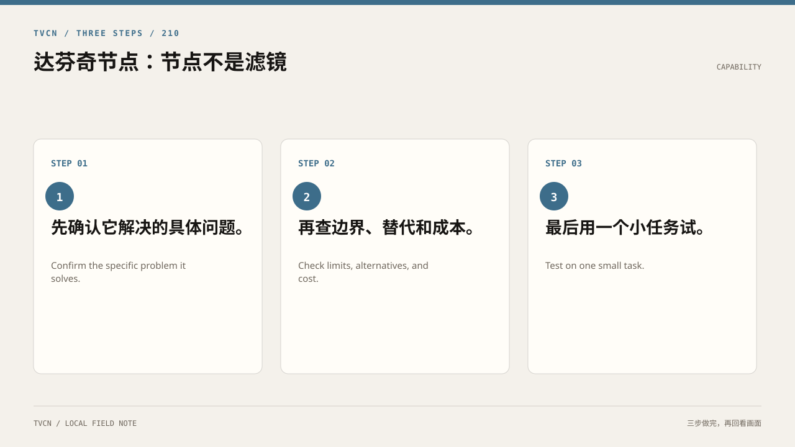

节点不是滤镜叠叠乐；每个节点只做一件事，关掉它就能看出它干了什么。

<!-- DIAGRAM_START -->
<h2>图解</h2>
<figure>
  
  <figcaption>把三步按顺序做完，再回看画面或文件。</figcaption>
</figure>
<!-- DIAGRAM_END -->
<h2>现场</h2>

建 5 个节点：曝光、白平衡、对比、风格、输出；每个节点关掉看变化，别叠 20 个。

<h2>怎么做</h2>

节点不是滤镜叠叠乐；每个节点只做一件事，关掉它就能看出它干了什么。
<ol><li>建 5 个节点：曝光、白平衡、对比、风格、输出。</li><li>每个节点关掉看变化。</li><li>别叠 20 个，找不到问题来自哪。</li></ol>
<h2>别踩</h2>

别叠二十个节点；出问题时，你不知道该关哪一个。

<h2>验收</h2>
<ul><li>五个节点各自只做一件事，命名清楚。</li><li>逐个关闭时能看到对应变化。</li><li>没有超过十个节点，问题能定位到单个节点。</li></ul>
