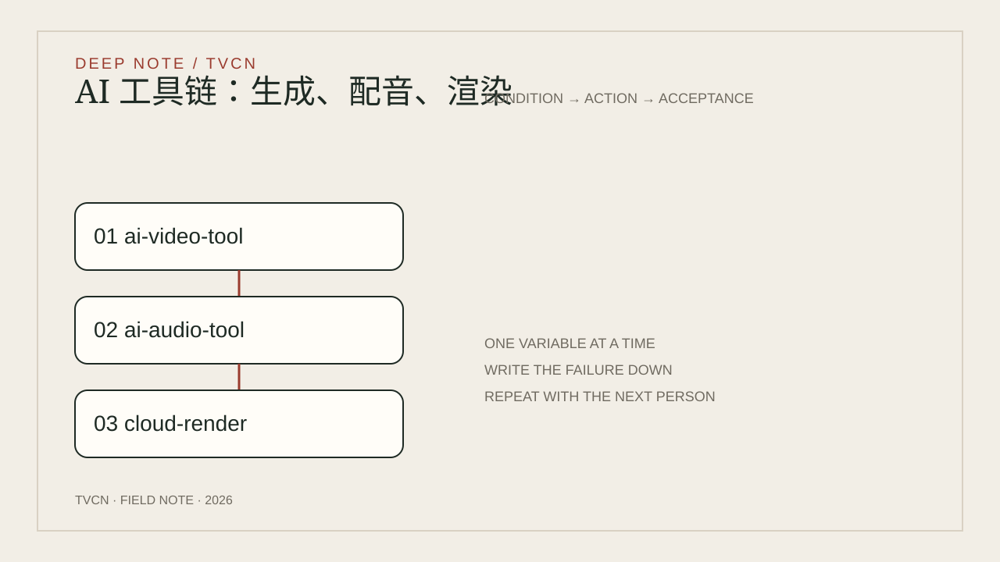

AI 工具不是一键出片；生成、配音、渲染和人工复核必须排成一条可追溯的链。 单看《AI 视频工具：先看可控性》只能解决一个局部；把《AI 视频工具：先看可控性》《AI 音频工具：授权与音质》《云渲染：成本与传输》接成一条链，才会暴露“条件没写、变量太多、结果无法复现”的真问题。

<!-- DEEP_DIVE_START -->
<!-- DIAGRAM_START -->
<h2>图解</h2>
<figure>
  
  <figcaption>看“AI 视频工具：先看可控性”和“AI 音频工具：授权与音质”两处，先定条件，再看失败能不能被记录下来。</figcaption>
</figure>
<!-- DIAGRAM_END -->

<section><h2 id="section-1">问题</h2>
这一页的问题不是“方法不够多”，而是三个环节各自成立、合起来却不成立：条件没写、变量太多、结果不能复现。

本页按“先定条件—再做判断—只改一个变量—留下证据”的顺序；每一步都能被下一个人复述，才算完成。
</section>
<section><h2 id="section-2">判断</h2><ul><li>《AI 视频工具：先看可控性》的第一道门槛：同一条提示下角色在三个镜头里保持一致</li><li>《AI 音频工具：授权与音质》的第二道门槛：镜头运动和时长能被具体参数控制</li><li>《云渲染：成本与传输》的第三道门槛：失败案例有保存，知道边界在哪里</li></ul>
三条里有一条不成立，就先回到对应单页；不要用整条链掩盖一个没解决的单点。
</section>
<section><h2 id="section-3">做法</h2><ol><li>先写条件：把《AI 视频工具：先看可控性》里“用同一条提示测三样：角色是否一致、镜头是否可控、时长是否够”落到一张三行表：素材、环境、验收。</li><li>再做一次最小动作：只按《AI 视频工具：先看可控性》的步骤做 30 秒，不加入第二页的方法。</li><li>把《AI 音频工具：授权与音质》的步骤接上：三项都过再付费。</li><li>用《云渲染：成本与传输》做对照：把失败案例一起存下来。</li><li>每改一次只动一个变量；其他条件写进记录，不靠记忆。</li><li>把失败也拍下来：失败版本和成功版本并排，才知道哪一步不能省。</li><li>让下一个人按记录复现一次；他做不出来，说明记录还不够。</li></ol></section>
<section><h2 id="section-4">现场案例</h2>
可复现实验（不是客户案例）：拿 30 秒素材，先按《AI 视频工具：先看可控性》的“同一条提示下角色在三个镜头里保持一致”做 A 版；再按《AI 音频工具：授权与音质》的“镜头运动和时长能被具体参数控制”做 B 版；两版只允许一个变量不同。把两版并排看，记录《云渲染：成本与传输》里最先崩的是哪一项：条件、动作还是验收。如果一次就成功，说明变量还不够多，再加一个现实限制重做。
</section>
<section><h2 id="section-5">失败表</h2>
<table class="data-table"><thead><tr><th>现象</th><th>原因</th><th>替换动作</th></tr></thead><tbody><tr><td>别被样片骗；样片只展示成功，不展示角色漂移</td><td>条件没写清</td><td>回到第一页重写三行表</td></tr><tr><td>别只听音色像不像；授权只限个人使用，商用一样不能用</td><td>条件没写清</td><td>回到第一页重写三行表</td></tr><tr><td>别只看每帧单价；上传 10 GB 的时间可能比渲染还长</td><td>条件没写清</td><td>回到第一页重写三行表</td></tr></tbody></table>
</section>
<section><h2 id="section-6">验收</h2><ul><li>同一条提示下角色在三个镜头里保持一致。</li><li>镜头运动和时长能被具体参数控制。</li><li>失败案例有保存，知道边界在哪里。</li><li>30 秒台词里齿音、断句、尾音有评估。</li><li>商用授权和克隆范围有书面条款。</li><li>输出能用于当前项目，不需要额外授权。</li><li>10 GB 上传时间有实测数字。</li><li>100 帧本地与云端成本有对比。</li><li>上传时间与渲染时间比较过，结论明确。</li><li>把 AI 视频工具：先看可控性 的条件写成一行，能复述给下一个人。</li></ul></section>
<section><h2 id="section-7">替代方案</h2><ul><li>只处理《AI 视频工具：先看可控性》里的单点问题：回到<a href="https://tools.tvcn.org/article/ai-video-tool/">《AI 视频工具：先看可控性》</a>，不要用整条链。</li><li>只比较两个动作：看<a href="https://tools.tvcn.org/article/ai-audio-tool/">《AI 音频工具：授权与音质》</a>，先不改第三页。</li><li>只做验收：看<a href="https://tools.tvcn.org/article/cloud-render/">《云渲染：成本与传输》</a>，把判断表拿去做自测。</li></ul></section>

<!-- SOURCES_START -->
## 参考与延伸阅读

- [S19] [GAN 原始论文（2014）](https://arxiv.org/abs/1406.2661) — 2026-11-26 访问。用于核对「问题」一节的术语/方法/规则（GAN 原始论文，不是产品评测）；不核对其中由本页经验得出的数字、型号与现场结论，也不替代测试。
- [S20] [DDPM 原始论文（2020）](https://arxiv.org/abs/2006.11239) — 2026-11-26 访问。用于核对「判断」一节的术语/方法/规则（DDPM 原始论文，不是产品评测）；不核对其中由本页经验得出的数字、型号与现场结论，也不替代测试。
<!-- SOURCES_END -->

