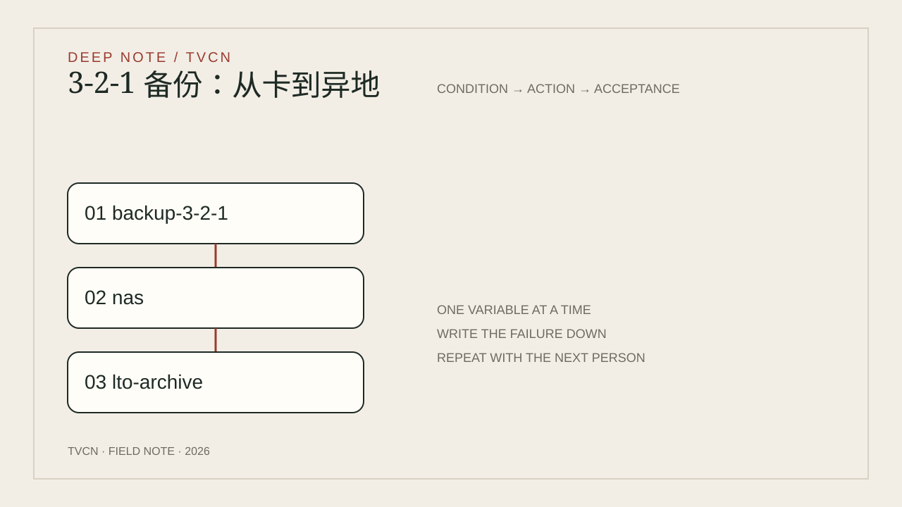

备份不是复制一份；三份、两种介质、一份异地，才算把素材从现场带回来。 单看《3-2-1 备份：当天做完》只能解决一个局部；把《3-2-1 备份：当天做完》《NAS：团队共享》《LTO 归档：长期冷备》接成一条链，才会暴露“条件没写、变量太多、结果无法复现”的真问题。

<!-- DEEP_DIVE_START -->
<!-- DIAGRAM_START -->
<h2>图解</h2>
<figure>
  
  <figcaption>看“3-2-1 备份：当天做完”和“NAS：团队共享”两处，先定条件，再看失败能不能被记录下来。</figcaption>
</figure>
<!-- DIAGRAM_END -->

<section><h2 id="section-1">问题</h2>
这一页的问题不是“方法不够多”，而是三个环节各自成立、合起来却不成立：条件没写、变量太多、结果不能复现。

本页按“先定条件—再做判断—只改一个变量—留下证据”的顺序；每一步都能被下一个人复述，才算完成。
</section>
<section><h2 id="section-2">判断</h2><ul><li>《3-2-1 备份：当天做完》的第一道门槛：当天完成三份拷贝，文件数一致</li><li>《NAS：团队共享》的第二道门槛：使用两种介质，其中一份在异地或云端</li><li>《LTO 归档：长期冷备》的第三道门槛：卡格式化发生在三份确认之后</li></ul>
三条里有一条不成立，就先回到对应单页；不要用整条链掩盖一个没解决的单点。
</section>
<section><h2 id="section-3">做法</h2><ol><li>先写条件：把《3-2-1 备份：当天做完》里“当天拷卡到 SSD”落到一张三行表：素材、环境、验收。</li><li>再做一次最小动作：只按《3-2-1 备份：当天做完》的步骤做 30 秒，不加入第二页的方法。</li><li>把《NAS：团队共享》的步骤接上：再拷到另一块硬盘。</li><li>用《LTO 归档：长期冷备》做对照：最后传 NAS 或云，三份完成再格式化卡。</li><li>每改一次只动一个变量；其他条件写进记录，不靠记忆。</li><li>把失败也拍下来：失败版本和成功版本并排，才知道哪一步不能省。</li><li>让下一个人按记录复现一次；他做不出来，说明记录还不够。</li></ol></section>
<section><h2 id="section-4">现场案例</h2>
可复现实验（不是客户案例）：拿 30 秒素材，先按《3-2-1 备份：当天做完》的“当天完成三份拷贝，文件数一致”做 A 版；再按《NAS：团队共享》的“使用两种介质，其中一份在异地或云端”做 B 版；两版只允许一个变量不同。把两版并排看，记录《LTO 归档：长期冷备》里最先崩的是哪一项：条件、动作还是验收。如果一次就成功，说明变量还不够多，再加一个现实限制重做。
</section>
<section><h2 id="section-5">失败表</h2>
<table class="data-table"><thead><tr><th>现象</th><th>原因</th><th>替换动作</th></tr></thead><tbody><tr><td>别把“明天再备份”当计划；卡一丢，三份都来不及</td><td>条件没写清</td><td>回到第一页重写三行表</td></tr><tr><td>别给全组读写权限；两个人同时改一个文件，版本就没了</td><td>条件没写清</td><td>回到第一页重写三行表</td></tr><tr><td>别把 LTO 当剪辑盘；恢复 1 TB 要几小时，今天剪不完</td><td>条件没写清</td><td>回到第一页重写三行表</td></tr></tbody></table>
</section>
<section><h2 id="section-6">验收</h2><ul><li>当天完成三份拷贝，文件数一致。</li><li>使用两种介质，其中一份在异地或云端。</li><li>卡格式化发生在三份确认之后。</li><li>先确认卡上素材能正常回放</li><li>拷到第一块工作盘</li><li>用校验工具比对文件数量和解码</li><li>改名为日期_项目_机位_卡号</li><li>拷到第二块备份盘</li><li>用户组和只读权限已配置，不是全员可写。</li><li>回收站开启，删除的文件能找回。</li></ul></section>
<section><h2 id="section-7">替代方案</h2><ul><li>只处理《3-2-1 备份：当天做完》里的单点问题：回到<a href="https://tools.tvcn.org/article/backup-3-2-1/">《3-2-1 备份：当天做完》</a>，不要用整条链。</li><li>只比较两个动作：看<a href="https://tools.tvcn.org/article/nas/">《NAS：团队共享》</a>，先不改第三页。</li><li>只做验收：看<a href="https://tools.tvcn.org/article/lto-archive/">《LTO 归档：长期冷备》</a>，把判断表拿去做自测。</li></ul></section>

<!-- SOURCES_START -->
## 参考与延伸阅读

- [S70] [FFmpeg：文档](https://ffmpeg.org/documentation.html) — 2026-11-26 访问。用于核对「问题」一节的术语/方法/规则（FFmpeg 编解码/封装文档，不是交付规范）；不核对其中由本页经验得出的数字、型号与现场结论，也不替代测试。
- [S29] [YouTube：上传编码建议](https://support.google.com/youtube/answer/1722171) — 2026-11-26 访问。用于核对「判断」一节的术语/方法/规则（YouTube 上传编码建议，不是创作标准）；不核对其中由本页经验得出的数字、型号与现场结论，也不替代测试。
- [S57] [Blackmagic：URSA Mini Pro 12K 规格](https://www.blackmagicdesign.com/products/blackmagicursaminipro/techspecs) — 2026-11-26 访问。用于核对「做法」一节的术语/方法/规则（URSA Mini Pro 12K 官方规格，不是独立测试）；不核对其中由本页经验得出的数字、型号与现场结论，也不替代测试。
<!-- SOURCES_END -->

