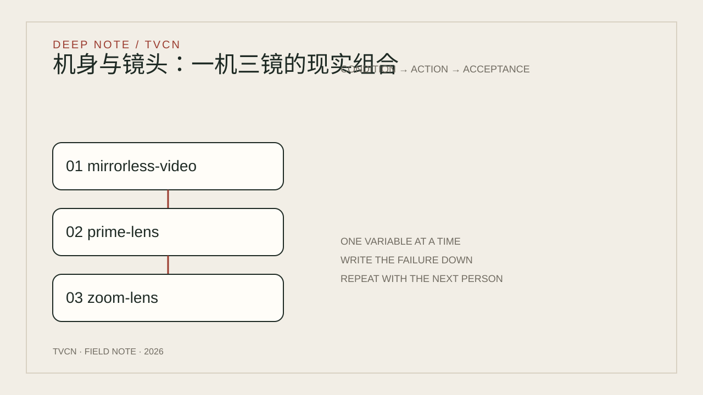

机身决定下限，镜头决定你能拍到什么；一机三镜比一机十镜更容易拍完。 单看《微单拍视频：过热、果冻、裁切》只能解决一个局部；把《微单拍视频：过热、果冻、裁切》《定焦镜头：先走动，再变焦》《变焦镜头：方便与画质》接成一条链，才会暴露“条件没写、变量太多、结果无法复现”的真问题。

<!-- DEEP_DIVE_START -->
<!-- DIAGRAM_START -->
<h2>图解</h2>
<figure>
  
  <figcaption>看“微单拍视频：过热、果冻、裁切”和“定焦镜头：先走动，再变焦”两处，先定条件，再看失败能不能被记录下来。</figcaption>
</figure>
<!-- DIAGRAM_END -->

<section><h2 id="section-1">问题</h2>
这一页的问题不是“方法不够多”，而是三个环节各自成立、合起来却不成立：条件没写、变量太多、结果不能复现。

本页按“先定条件—再做判断—只改一个变量—留下证据”的顺序；每一步都能被下一个人复述，才算完成。
</section>
<section><h2 id="section-2">判断</h2><ul><li>《微单拍视频：过热、果冻、裁切》的第一道门槛：连续 30 分钟 4K 25p 有温度记录或警告记录</li><li>《定焦镜头：先走动，再变焦》的第二道门槛：横摇栏杆时果冻程度可见并被描述</li><li>《变焦镜头：方便与画质》的第三道门槛：4K 60p 的视角裁切有前后对比</li></ul>
三条里有一条不成立，就先回到对应单页；不要用整条链掩盖一个没解决的单点。
</section>
<section><h2 id="section-3">做法</h2><ol><li>先写条件：把《微单拍视频：过热、果冻、裁切》里“连续录 30 分钟 4K 25p，看过热警告”落到一张三行表：素材、环境、验收。</li><li>再做一次最小动作：只按《微单拍视频：过热、果冻、裁切》的步骤做 30 秒，不加入第二页的方法。</li><li>把《定焦镜头：先走动，再变焦》的步骤接上：横摇栏杆看果冻。</li><li>用《变焦镜头：方便与画质》做对照：切 4K 60p，看视角是否变窄。</li><li>每改一次只动一个变量；其他条件写进记录，不靠记忆。</li><li>把失败也拍下来：失败版本和成功版本并排，才知道哪一步不能省。</li><li>让下一个人按记录复现一次；他做不出来，说明记录还不够。</li></ol></section>
<section><h2 id="section-4">现场案例</h2>
可复现实验（不是客户案例）：拿 30 秒素材，先按《微单拍视频：过热、果冻、裁切》的“连续 30 分钟 4K 25p 有温度记录或警告记录”做 A 版；再按《定焦镜头：先走动，再变焦》的“横摇栏杆时果冻程度可见并被描述”做 B 版；两版只允许一个变量不同。把两版并排看，记录《变焦镜头：方便与画质》里最先崩的是哪一项：条件、动作还是验收。如果一次就成功，说明变量还不够多，再加一个现实限制重做。
</section>
<section><h2 id="section-5">失败表</h2>
<table class="data-table"><thead><tr><th>现象</th><th>原因</th><th>替换动作</th></tr></thead><tbody><tr><td>别只拍三分钟测试；过热通常在第 20 分钟才出现</td><td>条件没写清</td><td>回到第一页重写三行表</td></tr><tr><td>别用脚架代替走位；定焦的价值就是让你换位置</td><td>条件没写清</td><td>回到第一页重写三行表</td></tr><tr><td>别只看中心锐度；边缘和逆光才是变焦最容易露馅的地方</td><td>条件没写清</td><td>回到第一页重写三行表</td></tr></tbody></table>
</section>
<section><h2 id="section-6">验收</h2><ul><li>连续 30 分钟 4K 25p 有温度记录或警告记录。</li><li>横摇栏杆时果冻程度可见并被描述。</li><li>4K 60p 的视角裁切有前后对比。</li><li>同一个人有至少三个走位版本，焦段没变。</li><li>能说出前后 2 米带来的背景和透视变化。</li><li>买 24 或 50 的决定来自走位经验，不是评测视频。</li><li>全开光圈拍了逆光窗和栏杆，边缘表现有记录。</li><li>畸变和呼吸能被指出，不是只说“画质好”。</li><li>重量称过，并说清它替你省了哪一步。</li><li>把 微单拍视频：过热、果冻、裁切 的条件写成一行，能复述给下一个人。</li></ul></section>
<section><h2 id="section-7">替代方案</h2><ul><li>只处理《微单拍视频：过热、果冻、裁切》里的单点问题：回到<a href="https://tools.tvcn.org/article/mirrorless-video/">《微单拍视频：过热、果冻、裁切》</a>，不要用整条链。</li><li>只比较两个动作：看<a href="https://tools.tvcn.org/article/prime-lens/">《定焦镜头：先走动，再变焦》</a>，先不改第三页。</li><li>只做验收：看<a href="https://tools.tvcn.org/article/zoom-lens/">《变焦镜头：方便与画质》</a>，把判断表拿去做自测。</li></ul></section>

<!-- SOURCES_START -->
## 参考与延伸阅读

- [S31] [ARRI：电影系统](https://www.arri.com/en/cine-systems) — 2026-11-26 访问。用于核对「问题」一节的术语/方法/规则（ARRI 摄影机、镜头与灯光资料，不是通用拍摄教程）；不核对其中由本页经验得出的数字、型号与现场结论，也不替代测试。
- [S52] [ARRI：ALEXA 35](https://www.arri.com/en/camera-systems/cameras/legacy-camera-systems/alexa-35) — 2026-11-26 访问。用于核对「判断」一节的术语/方法/规则（ALEXA 35 官方规格，不是独立测试）；不核对其中由本页经验得出的数字、型号与现场结论，也不替代测试。
- [S53] [Sony：FX6](https://pro.sony/ue_US/products/handheld-camcorders/ilme-fx6v) — 2026-11-26 访问。用于核对「做法」一节的术语/方法/规则（FX6 官方规格，不是独立测试）；不核对其中由本页经验得出的数字、型号与现场结论，也不替代测试。
<!-- SOURCES_END -->

