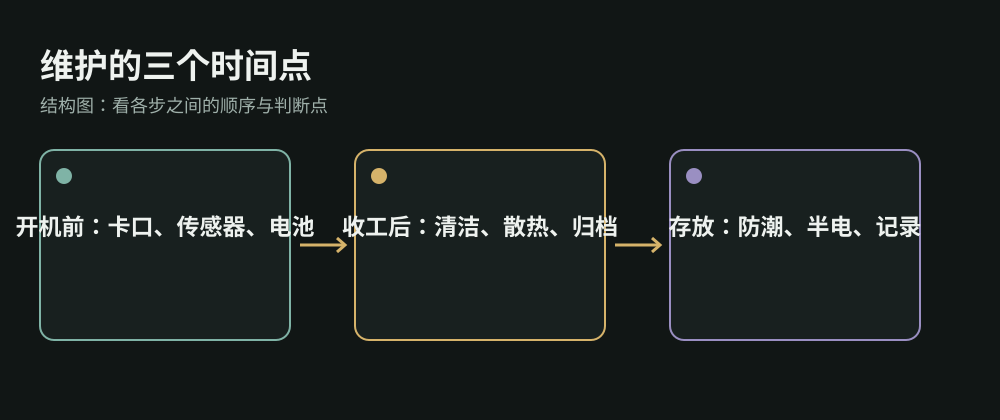

相机在开机时突然报错，通常不是那一刻坏的。卡口松了几个月、传感器沾了灰、电池长期满电、海边拍完没有擦盐雾，问题一直在，只是开机才发现。维护不是维修，是让故障提前出现。

<!-- DIAGRAM_START -->
<h2 id="diagram">图解</h2>
<figure class="diagram">
  
  <figcaption>看“开机前、收工后、存放”三个时间点；只在坏了才处理，维护就变成了维修。</figcaption>
</figure>
<!-- DIAGRAM_END -->

<section><h2 id="section-1">现场</h2>
一台用了三年的机身，拍前发现卡口有轻微晃动，传感器右上角有一个固定灰点，电池显示 100% 但一开机就掉到 40%。团队用衣角擦了镜头，换了一块电池，继续拍。三个月后卡口彻底松，维修报价接近半台二手价。
</section>
<section><h2 id="section-2">判断</h2><ul><li><strong>卡口与镜头座：</strong>镜头装上后有没有上下晃动；有晃动，先停拍，不要用胶带缠。</li><li><strong>传感器：</strong>对白墙拍一张 f/16 的静态图，看固定灰点；灰点不随镜头移动，就是传感器。</li><li><strong>电池：</strong>满电开机掉 20% 以上，或两块电池电压差明显，说明电池老化。</li><li><strong>固件与存储：</strong>固件版本、卡的健康状态、录制是否掉帧；不要等现场才发现卡报错。</li></ul></section>
<section><h2 id="section-3">怎么做</h2><ol><li>开机前 10 项：卡口、传感器灰、镜头前后组、电池电压、存储卡余量、固件、录制测试、时间码、散热口、背带扣。</li><li>收工后 3 件事：吹传感器与镜头、擦机身盐雾/雨水、让机身散热 10 分钟再装包。</li><li>电池存放保持 40–60%，不要长期 100%；每三个月做一次完整充放，记录健康度。</li><li>存放环境放防潮箱，湿度 40–50%；镜头和机身分开，卡口盖盖好，不要用塑料袋闷。</li><li>建一张维护记录：日期、项目、发现的问题、处理方式、下一次检查；跟着机身走，不跟着人走。</li></ol></section>
<section><h2 id="section-4">失败</h2><ul><li><strong>用衣角擦镜头：</strong>纤维和沙粒在镜片上划出细痕，越擦越糊。</li><li><strong>电池长期满电：</strong>满电存放加速老化，现场掉电比预期快。</li><li><strong>海边拍完不清洁：</strong>盐雾留在卡口和螺丝上，几周后开始腐蚀。</li></ul></section>
<section><h2 id="section-5">边界</h2>
这套维护适合数码机身、镜头、电池和存储卡；不替代厂家维修，也不适用于胶片机、老式机械相机。传感器清洁如果你没有把握，不要自己上手；一块传感器比一次清洁贵得多。进水、摔过的机身直接送修，不要开机测试。
</section>
<section><h2 id="section-6">验收</h2><ul><li>开机前 10 项能在一张纸上勾完，不超过 5 分钟。</li><li>传感器灰点测试有记录，且知道上次清洁日期。</li><li>电池存放电压在 40–60%，健康度有记录。</li><li>机身、镜头、卡各有唯一编号，维护记录能对上。</li></ul></section>
<!-- DEEP_DIVE_START -->
## 深读

<strong>约 8 分钟。</strong> 下面把同一套判断放进两个不同条件，再看一个反例和一个可复用模型；不是重复前文，而是决定什么时候该换做法。

### 条件 A：租赁机身

租赁机身的维护重点是“交接证据”。取机时拍一段 30 秒视频：机身外观、卡口、传感器白墙、每个按键、录制测试、附件清单；不要只拍照片。还机前用同一套顺序再拍一次，对比有没有新划痕、新灰点、新报错。视频带时间，比口头描述有用。

租赁机不要在现场做深度清洁，尤其不要自己擦传感器；出问题先联系租赁方，留下记录。租期短的拍摄，宁可多花 10 分钟做交接，也不要还机时被扣押金。

### 条件 B：自购机身

自购机身的维护重点是“寿命账”。记录快门数、录制时长、电池循环、清洁次数；每半年算一次维修/折旧比。如果一年维修费超过二手残值的 20%，考虑换机，不要继续投入。

自购机可以建立备件包：一块同型号电池、一张备用卡、一个卡口盖、一支清洁棒。备件不是囤货，是让一次故障不打断拍摄。备件也要记录，别到现场才发现备用电池也老了。

### 反例：只擦镜头，不查卡口

画面有一角永远模糊，团队反复擦镜头、换镜头，问题还在。最后发现是卡口螺丝松了，镜头和传感器不平行。擦了三天镜头，没有一次检查卡口。

修法是把检查顺序倒过来：先查卡口和传感器，再查镜头。卡口晃动用肉眼就能看见，传感器灰点用白墙 f/16 就能看见；镜头问题反而最少。先查最便宜、最容易被忽略的地方。

### 可复用模型

<strong>检查 → 清洁 → 存放 → 记录。</strong> 检查让故障提前出现；清洁让故障不累积；存放让器材不在等待中坏；记录让下一次检查有依据。四步都不需要高深技术，需要的是每次都做。

把维护写成一张 5 分钟的卡片，贴在器材箱内侧；每次开机前照着做，不靠记忆。卡片比经验可靠，尤其在你赶时间的时候。

<!-- DEEP_DIVE_END -->
<!-- SOURCES_START -->
## 参考与延伸阅读

- [S32] [Sony 专业影像支持：Sony 专业影像支持](https://pro.sony/ue_US/support) — 2026-11-26 访问。用于核对“判断”一节的术语、方法或规则；不核对本页由经验得出的数字、型号与现场结论，也不替代测试或合同。
- [S33] [Canon 支持：Canon 支持](https://www.usa.canon.com/support) — 2026-11-26 访问。用于核对“边界”一节的术语、方法或规则；不核对本页由经验得出的数字、型号与现场结论，也不替代测试或合同。
<!-- SOURCES_END -->
