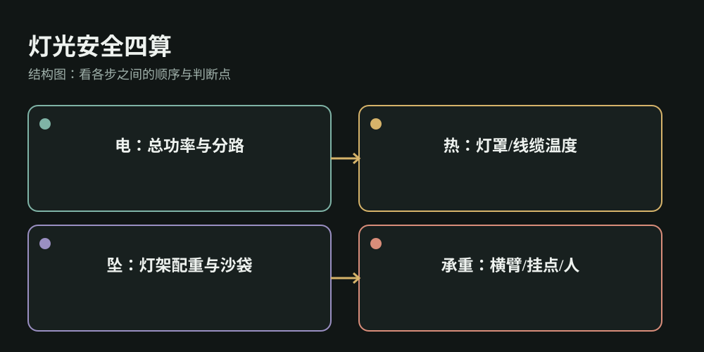

小成本现场最容易省掉安全：一个插排串三盏灯、灯架不挂沙袋、线缆横在过道。片子拍完没事，不代表做法对；只是这一次没有倒。安全不是运气，是把概率降下来。

<!-- DIAGRAM_START -->
<h2 id="diagram">图解</h2>
<figure class="diagram">
  
  <figcaption>看“电、热、坠、承重”四算是否都做过；只算功率不算配重，灯架照样会倒。</figcaption>
</figure>
<!-- DIAGRAM_END -->

<section><h2 id="section-1">现场</h2>
一个小房间，三盏 300W LED，一个插排串在一起，灯架靠门，地上铺着地毯。灯架没有沙袋，横臂伸到 1.2 米，线缆从门口横到窗边。拍摄中途有人绊到线，灯架晃了一下，没有倒；团队笑了一下，继续拍。
</section>
<section><h2 id="section-2">判断</h2><ul><li><strong>总功率与分路：</strong>三盏 300W 加其他设备超过一路 10A/220V 的安全余量；插排发烫就是信号。</li><li><strong>热度：</strong>灯罩、柔光箱、线缆接头摸上去烫手；LED 也会热，不要以为不烫。</li><li><strong>坠：</strong>灯架横臂越长，配重越要够；没有沙袋、地面不平、有人经过，都是坠落条件。</li><li><strong>承重：</strong>横臂标称承重、挂点、灯架脚架是否锁紧；人不要站在横臂下。</li></ul></section>
<section><h2 id="section-3">怎么做</h2><ol><li>先算总功率：每盏灯的额定功率相加，留 20% 余量；超过一路，分到不同回路，不串插排。</li><li>摸温度：开机 10 分钟摸灯罩、柔光箱、线缆接头；烫手就降功率、加距离或换位置。</li><li>配重：每个灯架至少两个沙袋，横臂越长配重越重；沙袋挂在脚架中心，不挂在横臂末端。</li><li>理线：线缆贴墙或压线槽，过道不留线；所有接头朝下，不朝上接水。</li><li>收工断电：先关灯，再拔插排，最后收线；灯还热的时候不要装包。</li></ol></section>
<section><h2 id="section-4">失败</h2><ul><li><strong>一个插排串全部：</strong>插排过载发热，接头熔化；看起来只是“有点烫”。</li><li><strong>灯架不配重：</strong>横臂伸出去，脚架很轻；有人经过碰一下，灯就倒。</li><li><strong>线缆绊人：</strong>过道横线，端着机器的人看不见；人摔，设备也摔。</li></ul></section>
<section><h2 id="section-5">边界</h2>
这套检查适合小型室内外拍摄，不替代持证电工、棚内安全员和大型吊装方案。超过 5kW、需要天幕/高空作业、使用发电机或潮湿环境，必须找专业人员。灯架倒地、线缆破损、插头烧黑，直接停用，不要修一修继续。
</section>
<section><h2 id="section-6">验收</h2><ul><li>总功率算过，且分路，不串插排。</li><li>每个灯架至少两个沙袋，横臂下没有人站。</li><li>线缆不横过道，接头朝下。</li><li>收工断电顺序执行，灯冷却后才装包。</li></ul></section>
<!-- DEEP_DIVE_START -->
## 深读

<strong>约 8 分钟。</strong> 下面把同一套判断放进两个不同条件，再看一个反例和一个可复用模型；不是重复前文，而是决定什么时候该换做法。

### 条件 A：室内小功率

室内小功率最常见的危险不是电击，是过热和绊倒。LED 功率低，但电源适配器和线缆接头会热；把适配器放在通风处，不要压在地毯下。灯架靠墙放，脚架完全打开，沙袋挂在中心；不要为了省空间把脚架收窄。

小房间拍访谈，灯多、线多、人少。把所有线收在一侧，给演员留一条干净的走动路线；地上用胶带标出灯架位置，换机位时不会踢到。收工时先关灯再收线，不要带电拔插。

### 条件 B：户外/大功率

户外大功率的第一问题是电从哪里来。发电机要接地、要离人、要防雨；电缆要用防水接头，不要用家用插排。灯架在风里会变成帆，横臂越长越危险；配重按“风越大、配重越多”算，不要按室内经验。

户外还要算“坠落方向”：灯架倒的时候会往哪边倒，那边有没有人、有没有车、有没有玻璃。提前把灯架放在人流少的一侧，横臂朝向空处，不朝向演员。收工前看天气预报，风速超过 5 级不要挂大柔光箱。

### 反例：灯架倒了，但没人扶

一个灯架在门口，横臂伸到过道，没有沙袋。三个人从旁边走过，灯架晃了三次，没人扶，因为“大家都在忙”。第四次，灯架倒了，砸到监视器，没人受伤，但拍摄停了两个小时。

问题不是最后一次，是前三次没人管。修法是设一个“谁都能停”的规则：任何人看到灯架晃、线缆横、插排烫，都可以喊停，不需要导演批准。安全不是一个人的责任，是一个可以叫停的系统。

### 可复用模型

<strong>电 → 热 → 坠 → 承重。</strong> 电决定能不能开，热决定能开多久，坠决定倒了会砸谁，承重决定挂不挂得住。四算按顺序做，先算电，再挂灯；不要先挂灯再找电。

开机前用 60 秒走一圈：插排、线缆、灯架、沙袋、横臂下的人。看到任何一项不确定，先停，不要“拍完再说”。安全不是效率的反面，是效率的前提。

<!-- DEEP_DIVE_END -->
<!-- SOURCES_START -->
## 参考与延伸阅读

- [S31] [ARRI Cine Systems：ARRI Cine Systems](https://www.arri.com/en/cine-systems) — 2026-11-26 访问。用于核对“判断”一节的术语、方法或规则；不核对本页由经验得出的数字、型号与现场结论，也不替代测试或合同。
- [S52] [ARRI：ALEXA 35](https://www.arri.com/en/camera-systems/cameras/legacy-camera-systems/alexa-35) — 2026-11-26 访问。用于核对“边界”一节的术语、方法或规则；不核对本页由经验得出的数字、型号与现场结论，也不替代测试或合同。
<!-- SOURCES_END -->
