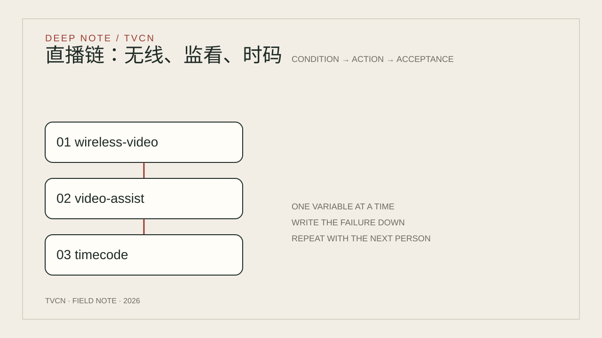

直播不是把相机接上电脑；无线、监看、时码和备份任何一环断了，现场就停。 单看《无线图传：延迟与干扰》只能解决一个局部；把《无线图传：延迟与干扰》《视频助理：现场回放》《时间码：多机同步》接成一条链，才会暴露“条件没写、变量太多、结果无法复现”的真问题。

<!-- DEEP_DIVE_START -->
<!-- DIAGRAM_START -->
<h2>图解</h2>
<figure>
  
  <figcaption>看“无线图传：延迟与干扰”和“视频助理：现场回放”两处，先定条件，再看失败能不能被记录下来。</figcaption>
</figure>
<!-- DIAGRAM_END -->

<section><h2 id="section-1">问题</h2>
这一页的问题不是“方法不够多”，而是三个环节各自成立、合起来却不成立：条件没写、变量太多、结果不能复现。

本页按“先定条件—再做判断—只改一个变量—留下证据”的顺序；每一步都能被下一个人复述，才算完成。
</section>
<section><h2 id="section-2">判断</h2><ul><li>《无线图传：延迟与干扰》的第一道门槛：走遍拍摄点，延迟和断点有记录</li><li>《视频助理：现场回放》的第二道门槛：导演监看和跟焦监看是两路独立信号</li><li>《时间码：多机同步》的第三道门槛：断点位置有应对，比如加天线或换频段</li></ul>
三条里有一条不成立，就先回到对应单页；不要用整条链掩盖一个没解决的单点。
</section>
<section><h2 id="section-3">做法</h2><ol><li>先写条件：把《无线图传：延迟与干扰》里“在拍摄点走一圈，测延迟和断点”落到一张三行表：素材、环境、验收。</li><li>再做一次最小动作：只按《无线图传：延迟与干扰》的步骤做 30 秒，不加入第二页的方法。</li><li>把《视频助理：现场回放》的步骤接上：给导演的信号和跟焦的信号分开。</li><li>用《时间码：多机同步》做对照：断点位置记下来，加天线或换频段。</li><li>每改一次只动一个变量；其他条件写进记录，不靠记忆。</li><li>把失败也拍下来：失败版本和成功版本并排，才知道哪一步不能省。</li><li>让下一个人按记录复现一次；他做不出来，说明记录还不够。</li></ol></section>
<section><h2 id="section-4">现场案例</h2>
可复现实验（不是客户案例）：拿 30 秒素材，先按《无线图传：延迟与干扰》的“走遍拍摄点，延迟和断点有记录”做 A 版；再按《视频助理：现场回放》的“导演监看和跟焦监看是两路独立信号”做 B 版；两版只允许一个变量不同。把两版并排看，记录《时间码：多机同步》里最先崩的是哪一项：条件、动作还是验收。如果一次就成功，说明变量还不够多，再加一个现实限制重做。
</section>
<section><h2 id="section-5">失败表</h2>
<table class="data-table"><thead><tr><th>现象</th><th>原因</th><th>替换动作</th></tr></thead><tbody><tr><td>别让导演和跟焦共用一路图传；一断，两个人都停</td><td>条件没写清</td><td>回到第一页重写三行表</td></tr><tr><td>别只备份不标记；导演要回放时，全场陪你翻卡</td><td>条件没写清</td><td>回到第一页重写三行表</td></tr><tr><td>别只对一次时间码就拍一整天；漂移会在下午出现</td><td>条件没写清</td><td>回到第一页重写三行表</td></tr></tbody></table>
</section>
<section><h2 id="section-6">验收</h2><ul><li>走遍拍摄点，延迟和断点有记录。</li><li>导演监看和跟焦监看是两路独立信号。</li><li>断点位置有应对，比如加天线或换频段。</li><li>每条素材有好坏、场次、镜号标记。</li><li>卡在拍摄间隙完成备份，有校验记录。</li><li>导演点一条，能在 30 秒内放到。</li><li>录音机和摄影机显示同一时间码。</li><li>10 秒测试素材在后期合板偏差小于 1 帧。</li><li>拍摄中途有第二次对码记录，不是只对一次。</li><li>把 无线图传：延迟与干扰 的条件写成一行，能复述给下一个人。</li></ul></section>
<section><h2 id="section-7">替代方案</h2><ul><li>只处理《无线图传：延迟与干扰》里的单点问题：回到<a href="https://tools.tvcn.org/article/wireless-video/">《无线图传：延迟与干扰》</a>，不要用整条链。</li><li>只比较两个动作：看<a href="https://tools.tvcn.org/article/video-assist/">《视频助理：现场回放》</a>，先不改第三页。</li><li>只做验收：看<a href="https://tools.tvcn.org/article/timecode/">《时间码：多机同步》</a>，把判断表拿去做自测。</li></ul></section>

<!-- SOURCES_START -->
## 参考与延伸阅读

- [S23] [SMPTE：标准入口](https://www.smpte.org/standards) — 2026-11-26 访问。用于核对「问题」一节的术语/方法/规则（SMPTE 标准入口，不是具体机型参数）；不核对其中由本页经验得出的数字、型号与现场结论，也不替代测试。
- [S29] [YouTube：上传编码建议](https://support.google.com/youtube/answer/1722171) — 2026-11-26 访问。用于核对「判断」一节的术语/方法/规则（YouTube 上传编码建议，不是创作标准）；不核对其中由本页经验得出的数字、型号与现场结论，也不替代测试。
<!-- SOURCES_END -->

