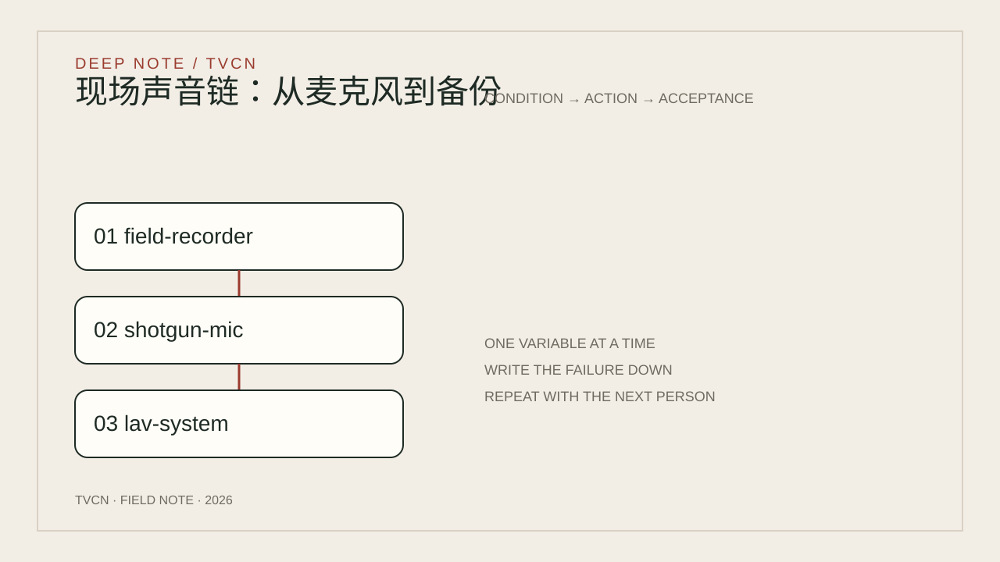

现场声音不是一支麦克风，而是麦克风、无线、录音机、备份和场记的一条链。 单看《录音机：32-bit 浮点》只能解决一个局部；把《录音机：32-bit 浮点》《枪麦：指向性与离轴》《无线领夹系统：频段与备份》接成一条链，才会暴露“条件没写、变量太多、结果无法复现”的真问题。

<!-- DEEP_DIVE_START -->
<!-- DIAGRAM_START -->
<h2>图解</h2>
<figure>
  
  <figcaption>看“录音机：32-bit 浮点”和“枪麦：指向性与离轴”两处，先定条件，再看失败能不能被记录下来。</figcaption>
</figure>
<!-- DIAGRAM_END -->

<section><h2 id="section-1">问题</h2>
这一页的问题不是“方法不够多”，而是三个环节各自成立、合起来却不成立：条件没写、变量太多、结果不能复现。

本页按“先定条件—再做判断—只改一个变量—留下证据”的顺序；每一步都能被下一个人复述，才算完成。
</section>
<section><h2 id="section-2">判断</h2><ul><li>《录音机：32-bit 浮点》的第一道门槛：小声对白峰值在 -12 dB 左右，底噪可听</li><li>《枪麦：指向性与离轴》的第二道门槛：故意削波后 32-bit 能恢复可懂度</li><li>《无线领夹系统：频段与备份》的第三道门槛：风噪测试证明浮点救不回被风吞掉的对白</li></ul>
三条里有一条不成立，就先回到对应单页；不要用整条链掩盖一个没解决的单点。
</section>
<section><h2 id="section-3">做法</h2><ol><li>先写条件：把《录音机：32-bit 浮点》里“录一段小声对白，峰值开到 -12 dB”落到一张三行表：素材、环境、验收。</li><li>再做一次最小动作：只按《录音机：32-bit 浮点》的步骤做 30 秒，不加入第二页的方法。</li><li>把《枪麦：指向性与离轴》的步骤接上：故意削波一次，回放看 32-bit 能否救回。</li><li>用《无线领夹系统：频段与备份》做对照：再试风噪，确认它救不回风。别把浮点当保险。</li><li>每改一次只动一个变量；其他条件写进记录，不靠记忆。</li><li>把失败也拍下来：失败版本和成功版本并排，才知道哪一步不能省。</li><li>让下一个人按记录复现一次；他做不出来，说明记录还不够。</li></ol></section>
<section><h2 id="section-4">现场案例</h2>
可复现实验（不是客户案例）：拿 30 秒素材，先按《录音机：32-bit 浮点》的“小声对白峰值在 -12 dB 左右，底噪可听”做 A 版；再按《枪麦：指向性与离轴》的“故意削波后 32-bit 能恢复可懂度”做 B 版；两版只允许一个变量不同。把两版并排看，记录《无线领夹系统：频段与备份》里最先崩的是哪一项：条件、动作还是验收。如果一次就成功，说明变量还不够多，再加一个现实限制重做。
</section>
<section><h2 id="section-5">失败表</h2>
<table class="data-table"><thead><tr><th>现象</th><th>原因</th><th>替换动作</th></tr></thead><tbody><tr><td>别把 32-bit 当万能保险；风噪和位置错误，它一样救不回来</td><td>条件没写清</td><td>回到第一页重写三行表</td></tr><tr><td>别用后期降噪救远距离枪麦；对白已经被环境盖住了</td><td>条件没写清</td><td>回到第一页重写三行表</td></tr><tr><td>别用出厂频段直接开录；现场干扰一撞，整条对白就废</td><td>条件没写清</td><td>回到第一页重写三行表</td></tr></tbody></table>
</section>
<section><h2 id="section-6">验收</h2><ul><li>小声对白峰值在 -12 dB 左右，底噪可听。</li><li>故意削波后 32-bit 能恢复可懂度。</li><li>风噪测试证明浮点救不回被风吞掉的对白。</li><li>1 米、2 米、3 米各有一条同台词录音。</li><li>回放能听出超过 2 米后对白被环境盖住。</li><li>超过 2 米的镜头准备了领夹或吊杆替代。</li><li>现场做了 2 分钟扫频，干净频段有记录。</li><li>发射器藏在后腰，线没有露在衣外。</li><li>主轨之外有一条 32-bit 备份，能独立使用。</li><li>把 录音机：32-bit 浮点 的条件写成一行，能复述给下一个人。</li></ul></section>
<section><h2 id="section-7">替代方案</h2><ul><li>只处理《录音机：32-bit 浮点》里的单点问题：回到<a href="https://tools.tvcn.org/article/field-recorder/">《录音机：32-bit 浮点》</a>，不要用整条链。</li><li>只比较两个动作：看<a href="https://tools.tvcn.org/article/shotgun-mic/">《枪麦：指向性与离轴》</a>，先不改第三页。</li><li>只做验收：看<a href="https://tools.tvcn.org/article/lav-system/">《无线领夹系统：频段与备份》</a>，把判断表拿去做自测。</li></ul></section>

<!-- SOURCES_START -->
## 参考与延伸阅读

- [S17] [Reuters Trust Principles](https://reutersagency.com/about/our-trust-principles/) — 2026-11-26 访问。用于核对首段“现场声音不是一支麦克风，而是麦克风、无线、录音机、备份和场记的一条链。”中的术语与公开背景（通讯社对独立、准确与不带偏见的公开承诺）；不替代现场测试。
- [S29] [YouTube 上传规格](https://support.google.com/youtube/answer/1722171) — 2026-11-26 访问。用于核对首段“现场声音不是一支麦克风，而是麦克风、无线、录音机、备份和场记的一条链。”中的术语与公开背景（分辨率、码率、帧率与音频编码建议）；不替代现场测试。
- [S23] [SMPTE 标准入口](https://www.smpte.org/standards) — 2026-11-26 访问。用于核对首段“现场声音不是一支麦克风，而是麦克风、无线、录音机、备份和场记的一条链。”中的术语与公开背景（时间码、色彩、影院与信号链标准的机构入口）；不替代现场测试。
- [S30] [DaVinci Resolve 产品与文档](https://www.blackmagicdesign.com/products/davinciresolve) — 2026-11-26 访问。用于核对首段“现场声音不是一支麦克风，而是麦克风、无线、录音机、备份和场记的一条链。”中的术语与公开背景（剪辑、调色、Fusion 与交付的官方产品入口）；不替代现场测试。
- [S70] [FFmpeg：文档](https://ffmpeg.org/documentation.html) — 2026-11-26 访问。用于核对首段“现场声音不是一支麦克风，而是麦克风、无线、录音机、备份和场记的一条链。”中的术语与公开背景（编解码、封装与滤镜文档）；不替代现场测试。
<!-- SOURCES_END -->

