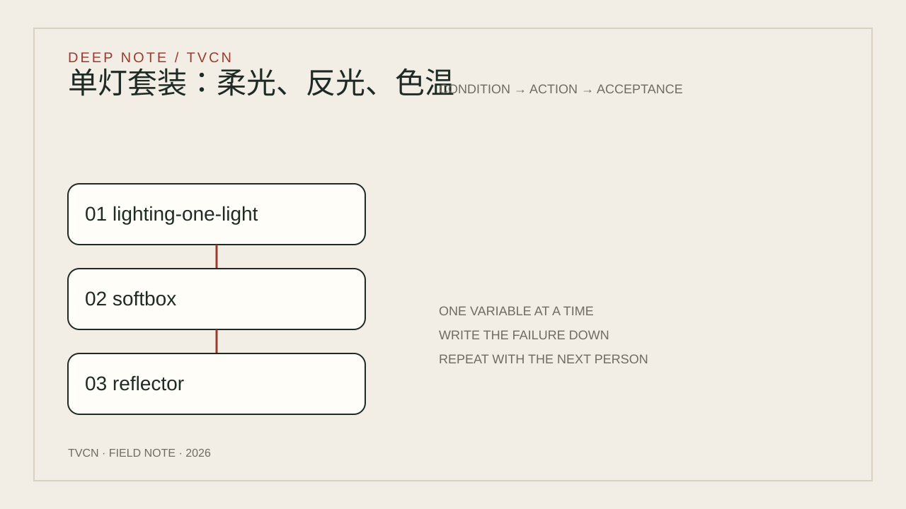

一盏灯够不够，不取决于灯，而取决于柔光面积、反光位置和色温是否统一。 单看《单灯人像：先有方向》只能解决一个局部；把《单灯人像：先有方向》《柔光箱：尺寸决定柔度》《反光板：五合一怎么用》接成一条链，才会暴露“条件没写、变量太多、结果无法复现”的真问题。

<!-- DEEP_DIVE_START -->
<!-- DIAGRAM_START -->
<h2>图解</h2>
<figure>
  
  <figcaption>看“单灯人像：先有方向”和“柔光箱：尺寸决定柔度”两处，先定条件，再看失败能不能被记录下来。</figcaption>
</figure>
<!-- DIAGRAM_END -->

<section><h2 id="section-1">问题</h2>
这一页的问题不是“方法不够多”，而是三个环节各自成立、合起来却不成立：条件没写、变量太多、结果不能复现。

本页按“先定条件—再做判断—只改一个变量—留下证据”的顺序；每一步都能被下一个人复述，才算完成。
</section>
<section><h2 id="section-2">判断</h2><ul><li>《单灯人像：先有方向》的第一道门槛：灯在 45 度、距人脸 1 米，有位置记录</li><li>《柔光箱：尺寸决定柔度》的第二道门槛：鼻子影子方向明确，能看出光从哪来</li><li>《反光板：五合一怎么用》的第三道门槛：柔光箱大小是在方向确认后才决定的</li></ul>
三条里有一条不成立，就先回到对应单页；不要用整条链掩盖一个没解决的单点。
</section>
<section><h2 id="section-3">做法</h2><ol><li>先写条件：把《单灯人像：先有方向》里“灯放 45 度，距人脸 1 米”落到一张三行表：素材、环境、验收。</li><li>再做一次最小动作：只按《单灯人像：先有方向》的步骤做 30 秒，不加入第二页的方法。</li><li>把《柔光箱：尺寸决定柔度》的步骤接上：先拍一张看鼻子影子。</li><li>用《反光板：五合一怎么用》做对照：再决定柔光箱大小。</li><li>每改一次只动一个变量；其他条件写进记录，不靠记忆。</li><li>把失败也拍下来：失败版本和成功版本并排，才知道哪一步不能省。</li><li>让下一个人按记录复现一次；他做不出来，说明记录还不够。</li></ol></section>
<section><h2 id="section-4">现场案例</h2>
可复现实验（不是客户案例）：拿 30 秒素材，先按《单灯人像：先有方向》的“灯在 45 度、距人脸 1 米，有位置记录”做 A 版；再按《柔光箱：尺寸决定柔度》的“鼻子影子方向明确，能看出光从哪来”做 B 版；两版只允许一个变量不同。把两版并排看，记录《反光板：五合一怎么用》里最先崩的是哪一项：条件、动作还是验收。如果一次就成功，说明变量还不够多，再加一个现实限制重做。
</section>
<section><h2 id="section-5">失败表</h2>
<table class="data-table"><thead><tr><th>现象</th><th>原因</th><th>替换动作</th></tr></thead><tbody><tr><td>别先换柔光箱；方向没定，换多大的箱子都只是换一种错</td><td>条件没写清</td><td>回到第一页重写三行表</td></tr><tr><td>别靠换更贵的灯求柔；先把柔光箱靠近，效果更直接</td><td>条件没写清</td><td>回到第一页重写三行表</td></tr><tr><td>别一上来用金面；肤色一暖，后期很难拉回中性</td><td>条件没写清</td><td>回到第一页重写三行表</td></tr></tbody></table>
</section>
<section><h2 id="section-6">验收</h2><ul><li>灯在 45 度、距人脸 1 米，有位置记录。</li><li>鼻子影子方向明确，能看出光从哪来。</li><li>柔光箱大小是在方向确认后才决定的。</li><li>0.8 米和 1.5 米各有一张同灯样张。</li><li>近的那张影子边缘更软，能看出来。</li><li>眼神光大小随距离变化，有对比。</li><li>白面 45 度补光的样张存在。</li><li>银面是在白面不够后才换的，有对比。</li><li>金面没有被默认使用，或使用时说明了暖调理由。</li><li>把 单灯人像：先有方向 的条件写成一行，能复述给下一个人。</li></ul></section>
<section><h2 id="section-7">替代方案</h2><ul><li>只处理《单灯人像：先有方向》里的单点问题：回到<a href="https://tools.tvcn.org/article/lighting-one-light/">《单灯人像：先有方向》</a>，不要用整条链。</li><li>只比较两个动作：看<a href="https://tools.tvcn.org/article/softbox/">《柔光箱：尺寸决定柔度》</a>，先不改第三页。</li><li>只做验收：看<a href="https://tools.tvcn.org/article/reflector/">《反光板：五合一怎么用》</a>，把判断表拿去做自测。</li></ul></section>

<!-- SOURCES_START -->
## 参考与延伸阅读

- [S16] [BBC 编辑准则](https://www.bbc.co.uk/editorialguidelines/) — 2026-11-26 访问。用于核对首段“一盏灯够不够，不取决于灯，而取决于柔光面积、反光位置和色温是否统一。”中的术语与公开背景（准确性、公正、隐私与隐蔽拍摄的编辑标准）；不替代现场测试。
- [S29] [YouTube 上传规格](https://support.google.com/youtube/answer/1722171) — 2026-11-26 访问。用于核对首段“一盏灯够不够，不取决于灯，而取决于柔光面积、反光位置和色温是否统一。”中的术语与公开背景（分辨率、码率、帧率与音频编码建议）；不替代现场测试。
- [S23] [SMPTE 标准入口](https://www.smpte.org/standards) — 2026-11-26 访问。用于核对首段“一盏灯够不够，不取决于灯，而取决于柔光面积、反光位置和色温是否统一。”中的术语与公开背景（时间码、色彩、影院与信号链标准的机构入口）；不替代现场测试。
- [S30] [DaVinci Resolve 产品与文档](https://www.blackmagicdesign.com/products/davinciresolve) — 2026-11-26 访问。用于核对首段“一盏灯够不够，不取决于灯，而取决于柔光面积、反光位置和色温是否统一。”中的术语与公开背景（剪辑、调色、Fusion 与交付的官方产品入口）；不替代现场测试。
- [S70] [FFmpeg：文档](https://ffmpeg.org/documentation.html) — 2026-11-26 访问。用于核对首段“一盏灯够不够，不取决于灯，而取决于柔光面积、反光位置和色温是否统一。”中的术语与公开背景（编解码、封装与滤镜文档）；不替代现场测试。
<!-- SOURCES_END -->

