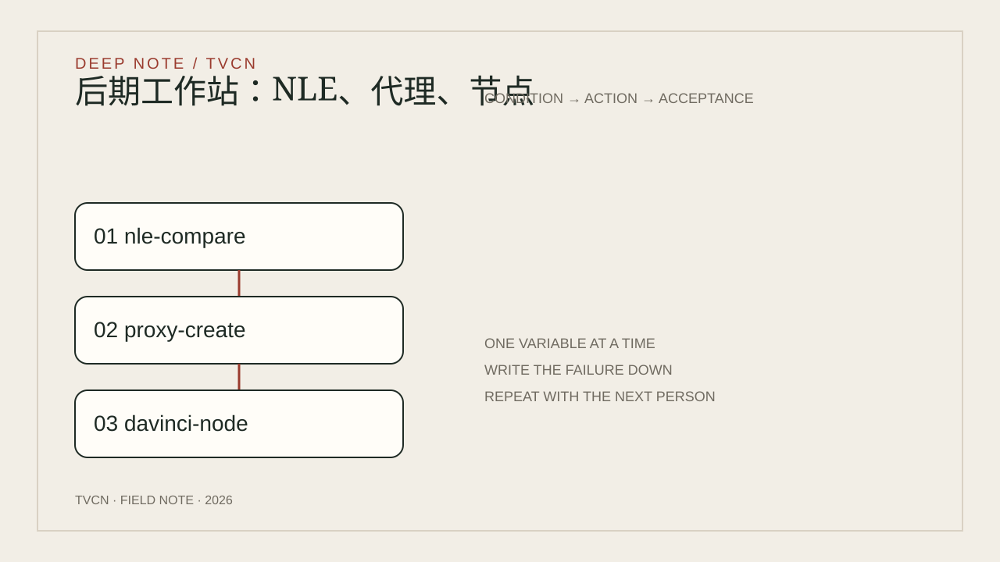

工作站不是配置单，而是 NLE、代理、缓存和节点在同一个项目里不打架。 单看《剪辑软件怎么选：项目先定》只能解决一个局部；把《剪辑软件怎么选：项目先定》《代理生成：剪辑不卡》《达芬奇节点：节点不是滤镜》接成一条链，才会暴露“条件没写、变量太多、结果无法复现”的真问题。

<!-- DEEP_DIVE_START -->
<!-- DIAGRAM_START -->
<h2>图解</h2>
<figure>
  
  <figcaption>看“剪辑软件怎么选：项目先定”和“代理生成：剪辑不卡”两处，先定条件，再看失败能不能被记录下来。</figcaption>
</figure>
<!-- DIAGRAM_END -->

<section><h2 id="section-1">问题</h2>
这一页的问题不是“方法不够多”，而是三个环节各自成立、合起来却不成立：条件没写、变量太多、结果不能复现。

本页按“先定条件—再做判断—只改一个变量—留下证据”的顺序；每一步都能被下一个人复述，才算完成。
</section>
<section><h2 id="section-2">判断</h2><ul><li>《剪辑软件怎么选：项目先定》的第一道门槛：同一段素材在三个软件里各剪了 1 分钟</li><li>《代理生成：剪辑不卡》的第二道门槛：代理、协作、字幕、导出四项有对比记录</li><li>《达芬奇节点：节点不是滤镜》的第三道门槛：选择理由来自项目最缺的一项，不是软件热度</li></ul>
三条里有一条不成立，就先回到对应单页；不要用整条链掩盖一个没解决的单点。
</section>
<section><h2 id="section-3">做法</h2><ol><li>先写条件：把《剪辑软件怎么选：项目先定》里“用同一项目素材在三个软件里各剪 1 分钟”落到一张三行表：素材、环境、验收。</li><li>再做一次最小动作：只按《剪辑软件怎么选：项目先定》的步骤做 30 秒，不加入第二页的方法。</li><li>把《代理生成：剪辑不卡》的步骤接上：比较代理、协作、字幕和导出。</li><li>用《达芬奇节点：节点不是滤镜》做对照：按项目最缺的一项做决定。</li><li>每改一次只动一个变量；其他条件写进记录，不靠记忆。</li><li>把失败也拍下来：失败版本和成功版本并排，才知道哪一步不能省。</li><li>让下一个人按记录复现一次；他做不出来，说明记录还不够。</li></ol></section>
<section><h2 id="section-4">现场案例</h2>
可复现实验（不是客户案例）：拿 30 秒素材，先按《剪辑软件怎么选：项目先定》的“同一段素材在三个软件里各剪了 1 分钟”做 A 版；再按《代理生成：剪辑不卡》的“代理、协作、字幕、导出四项有对比记录”做 B 版；两版只允许一个变量不同。把两版并排看，记录《达芬奇节点：节点不是滤镜》里最先崩的是哪一项：条件、动作还是验收。如果一次就成功，说明变量还不够多，再加一个现实限制重做。
</section>
<section><h2 id="section-5">失败表</h2>
<table class="data-table"><thead><tr><th>现象</th><th>原因</th><th>替换动作</th></tr></thead><tbody><tr><td>别按教程数量选软件；你的项目缺协作，教程再多也补不上</td><td>条件没写清</td><td>回到第一页重写三行表</td></tr><tr><td>别用代理做最终导出；一换回原片，字幕位置全偏</td><td>条件没写清</td><td>回到第一页重写三行表</td></tr><tr><td>别叠二十个节点；出问题时，你不知道该关哪一个</td><td>条件没写清</td><td>回到第一页重写三行表</td></tr></tbody></table>
</section>
<section><h2 id="section-6">验收</h2><ul><li>同一段素材在三个软件里各剪了 1 分钟。</li><li>代理、协作、字幕、导出四项有对比记录。</li><li>选择理由来自项目最缺的一项，不是软件热度。</li><li>代理是四分之一分辨率 ProRes Proxy，放在独立 SSD。</li><li>时间线和代理命名能对应回原片。</li><li>回套后时间码和构图与代理版一致。</li><li>五个节点各自只做一件事，命名清楚。</li><li>逐个关闭时能看到对应变化。</li><li>没有超过十个节点，问题能定位到单个节点。</li><li>把 剪辑软件怎么选：项目先定 的条件写成一行，能复述给下一个人。</li></ul></section>
<section><h2 id="section-7">替代方案</h2><ul><li>只处理《剪辑软件怎么选：项目先定》里的单点问题：回到<a href="https://tools.tvcn.org/article/nle-compare/">《剪辑软件怎么选：项目先定》</a>，不要用整条链。</li><li>只比较两个动作：看<a href="https://tools.tvcn.org/article/proxy-create/">《代理生成：剪辑不卡》</a>，先不改第三页。</li><li>只做验收：看<a href="https://tools.tvcn.org/article/davinci-node/">《达芬奇节点：节点不是滤镜》</a>，把判断表拿去做自测。</li></ul></section>

<!-- SOURCES_START -->
## 参考与延伸阅读

- [S23] [SMPTE：标准入口](https://www.smpte.org/standards) — 2026-11-26 访问。用于核对「问题」一节的术语/方法/规则（SMPTE 标准入口，不是具体机型参数）；不核对其中由本页经验得出的数字、型号与现场结论，也不替代测试。
- [S29] [YouTube：上传编码建议](https://support.google.com/youtube/answer/1722171) — 2026-11-26 访问。用于核对「判断」一节的术语/方法/规则（YouTube 上传编码建议，不是创作标准）；不核对其中由本页经验得出的数字、型号与现场结论，也不替代测试。
<!-- SOURCES_END -->

