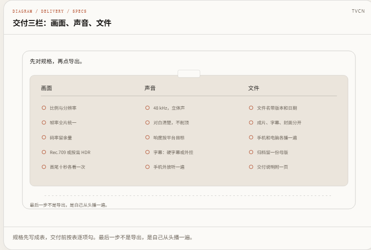

<!-- DIAGRAM_START -->
## 图解

<figure>
  
  <figcaption>规格先写成表，交付前按表逐项勾。最后一步不是导出，是自己从头播一遍。</figcaption>
</figure>
<!-- DIAGRAM_END -->

## 先拿到规格，再开始导出

交付前先问清四个去处：平台、客户、影院或活动、自己的归档。每个去处要的东西不一样：比例、分辨率、帧率、编码、码率、色彩、声道、字幕、文件名。

把这些写进一张表，不要靠记忆。平台说明会变，旧教程不会提醒你。客户说“随便”，就把默认规格写下来让对方确认，不要自己猜。

## 画面：尺寸、帧率、码率

分辨率按项目拍的和交付的要一致，不要最后把 1080p 硬拉成 4K。帧率全片统一；23.976、25、29.97 各有各的用法，混着导会让片头抖一下。

编码优先兼容：H.264 最稳，H.265 体积小但有些老设备打不开，ProRes 适合归档和再调色。码率不要压到最低档；平台还会再压一次，你给少了，暗部和运动先烂。

色彩按交付目标走。大多数网络平台要 Rec.709 SDR；不要把一个没做 HDR 的片子强行标成 HDR。导出前看一眼示波器，黑位和白位有没有被压死。

## 声音和字幕：别让耳朵替画面背锅

音频采样率统一 48 kHz，声道按平台要求：立体声最通用，5.1 只在对方明确要时给。对白要清楚，音乐不要盖住字；响度按平台目标，没有目标就保证不削顶、不忽大忽小。

字幕分两种：压进画面的硬字幕，和单独的外挂字幕。平台要哪种就交哪种，不要两个都塞。外挂字幕检查编码、时间轴、标点；硬字幕检查安全区，别被平台 UI 挡住。

## 交付前，自己从头播一遍

不要只看导出进度条。用手机播一遍，用电脑播一遍，有条件再用电视播一遍。听开头十秒、结尾十秒、每一处转场，确认声音和画面同步，字幕没有提前或滞后。

文件命名写清项目、版本、日期、分辨率，比如“项目名_v3_20261120_1080p”。交付时附一份说明：哪个是成片、哪个是字幕、哪个是封面。不要把十个文件扔进一个压缩包就结束。

## 检查

- 规格表写清了比例、分辨率、帧率、编码、码率、色彩、声道和字幕？
- 全片帧率统一，没有把 1080p 硬拉成 4K？
- 在手机和电脑上各完整播过一遍，声音与字幕都同步？
- 文件名和交付说明能让对方一眼找到成片？

<!-- DEEP_DIVE_START -->
## 深读

<strong>约 7 分钟。</strong> 交付不是“导出一个文件”，是让片子在对的设备上、以对的规格、被对的人打开。

### 先问去处，再问规格

同一条片子有四个去处：平台、客户、影院或活动、自己的归档。每个去处要的东西不同：平台要比例、码率、字幕；客户要能下载的成片和封面；影院要 DCP 或高码率 ProRes；归档要能再调色的原始文件。

不要用一份文件打天下。先列一张“去处—规格—负责人”的表，每个去处一行；客户说“随便”，就把你的默认规格写下来让对方确认。确认过的文字比记忆可靠，也比事后争论便宜。

### 七项规格，一项都不能猜

比例、分辨率、帧率、编码、码率、色彩、声道，七项写全。比例按平台安全区，不要只写 16:9；分辨率按拍摄和交付一致，不要把 1080p 硬拉成 4K；帧率全片统一，混帧会让片头抖一下。

编码优先兼容：H.264 最稳，H.265 体积小但老设备可能打不开，ProRes 适合归档和再调色。码率不要压到最低档，平台还会再压一次；你给少了，暗部和运动先烂。色彩按目标走：网络平台通常 Rec.709 SDR，不要把一个没做 HDR 的片子标成 HDR。

### 文件名和版本，让三个月后的人找得到

文件名写四件事：项目、版本、日期、规格。例如“江边_v3_20261120_1080p_zh-sub”。不要用“最终版”“最终版2”“真的最终版”；版本号只递增，不解释。封面、字幕、成片用同一个前缀，交付时一眼能配对。

目录也写清：01_master、02_subs、03_covers、04_vertical。客户不需要理解你的剪辑工程，但需要知道先点哪一个。文件名不是给你看的，是给三个月后接手的人看的；那个人可能是客户，也可能是你自己。

### 声音和字幕，别让耳朵替画面背锅

音频采样率统一 48 kHz，声道按平台要求：立体声最通用，5.1 只在对方明确要时给。对白清楚，音乐不盖字；响度按平台目标，没有目标就保证不削顶、不忽大忽小。导出前听开头十秒、结尾十秒和每一处转场。

字幕分硬字幕和外挂字幕，平台要哪种交哪种，不要两个都塞。外挂检查编码、时间轴、标点；硬字幕检查安全区，别被平台 UI 挡住。字幕不是装饰，是第二条声音轨道；观众听不清时，它必须能独立讲清。

### 交付前，用三种设备播一遍

不要只看进度条。用手机播一遍，用电脑播一遍，有条件再用电视播一遍；听声音和画面是否同步，字幕是否提前或滞后，暗部有没有死黑，高光有没有死白。手机外放最容易暴露对白不清，电视最容易暴露压缩块。

把问题记在纸上：第几分几秒、什么设备、什么现象。能改就改，不能改就在交付说明里写清。交付不是“文件发出去了”，是“对方打开后看到的东西，和你看到的一样”。

### 交付包和回执

交付包只放对方现在需要的东西：成片、字幕、封面、竖版切条、一份说明。说明写清每个文件是什么、哪个是主文件、字幕怎么挂、封面比例是多少。不要把工程文件、原始素材、旧版本一起塞进去；那不是交付，是搬家。

发送后要回执：对方能不能打开、声音有没有、字幕有没有对上。没有回执，就等于没交付。回执不是客套，是验收的最后一步；它让“我以为”变成“确认过”。

### 交付规格，十项检查
<ul><li>四个去处各一行</li><li>比例分辨率帧率写清</li><li>编码与码率写清</li><li>色彩标 Rec.709 或 HDR</li><li>声道与响度写清</li><li>文件名含项目版本日期规格</li><li>字幕硬软只交一种</li><li>手机电脑电视各播一遍</li><li>交付包只放现在需要的东西</li><li>拿到对方回执才算交付</li></ul>
交付的终点不是文件传上去，是对方打开后，看见你看见的那条片子。

<!-- DEEP_DIVE_END -->
