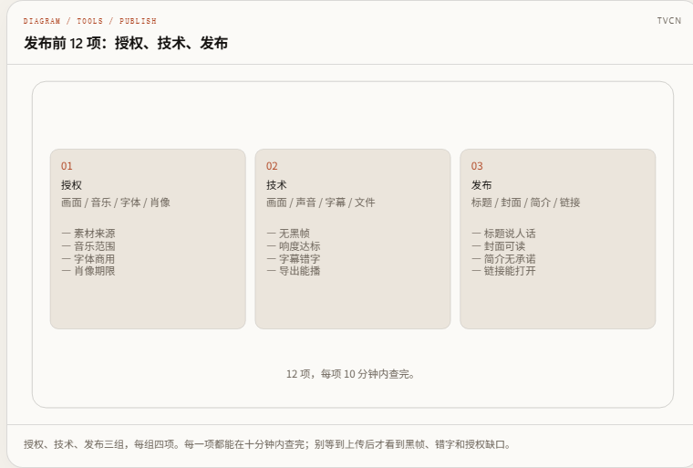

<!-- DIAGRAM_START -->
## 图解

<figure>
  
  <figcaption>授权、技术、发布三组，每组四项。每一项都能在十分钟内查完；别等到上传后才看到黑帧、错字和授权缺口。</figcaption>
</figure>
<!-- DIAGRAM_END -->

## 先查授权

音乐、字体、肖像、场地、AI 标注，五项分别看。平台曲库不等于商用授权；口头答应不等于肖像授权。

把授权文件放进一个文件夹，文件名写上项目名和日期。发布后有人投诉，你能在十分钟内找出来，就不用下架整条片子。

## 再查技术

比例、码率、响度、字幕、黑帧、文件名。把片子从头到尾放一遍，不要在时间线上看；时间线不会告诉你手机外放听不清台词。

字幕校对用“读出来”的方式，不要只看屏幕。名字、数字、地名，三个最容易错的地方单独查。

## 最后查发布

标题、封面、平台规则、备份、定时。封面在缩略图大小下能不能看清人脸；标题有没有承诺片子没给的东西。

上传后先别关页面。自己用手机打开一遍，确认比例、字幕、声音都正常，再关电脑。

## 3 条验收

- 五项授权都能在十分钟内找到文件。
- 片子在手机外放上完整看过一遍。
- 封面在缩略图大小下能看清主体。

<!-- DEEP_DIVE_START -->
## 深读

<strong>约 6 分钟。</strong> 发布不是点上传，是把授权、字幕、封面、备份和版本在同一天收口。

### 授权先过一遍

音乐、字体、素材、肖像、场地，一项一项对；没有书面授权的，不用。免费下载不等于可商用。

AI 生成素材要标注；平台规则和当地法律都要看，别只信一个教程。

把授权文件放进项目归档，文件名写素材名和期限；半年后你还会被问一次。

### 技术交付

导出后自己播放一遍：片头、片尾、字幕、声音、黑帧；不要只看进度条。文件名写日期、项目、版本、平台。

字幕错一个字，观众会记住；封面错一个比例，平台会裁掉。

码率、分辨率、响度按平台最新说明，不按三年前的博客；平台会改规格。

### 发布后 24 小时

先看平台有没有压缩、裁切、音画不同步；再看评论里有没有人误解。把问题记下来，下一版改。

备份原始工程和导出；发布版本不要 overwrite，留一个只读归档。

把这次的实际规格写进项目 README，下一次不用重新试。

### 发布前最后一页

把平台、分辨率、码率、响度、封面比例、字幕语言写成一张表，发布时逐项打勾。

发完把这张表存档；下一次同平台发布先看表，不再重新试。

如果平台改规格，先在表上改一行，再改导出预设；不要只改一个文件，下一版又忘。表在，预设才不会漂；预设漂了，平台就会替你裁。表比记忆可靠。

### 发布前，十项检查
<ul><li>音乐、字体、素材有书面授权</li><li>肖像和场地授权齐全</li><li>AI 素材已标注</li><li>字幕逐字校对</li><li>片头片尾完整</li><li>响度和码率符合平台</li><li>封面三种比例都不裁主体</li><li>文件名写日期、项目、版本、平台</li><li>原始工程和导出已备份</li><li>发布版本留只读归档</li></ul>
发布不是结束，是把这一版变成下一版的地基。

<!-- DEEP_DIVE_END -->
