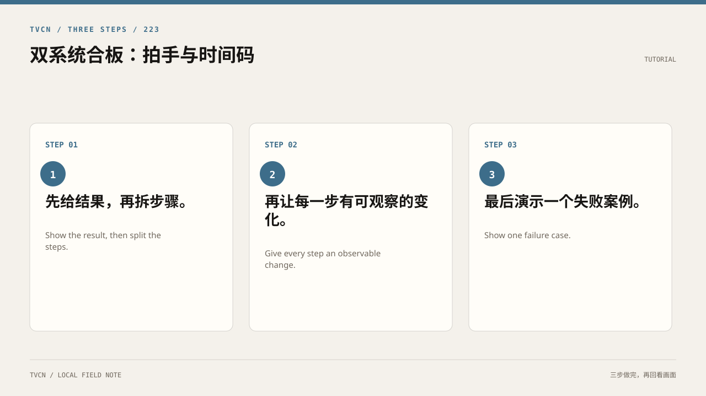

别只拍一次手；一次没对上，就没有第二次可查。

<!-- DIAGRAM_START -->
<h2>图解</h2>
<figure>
  
  <figcaption>看“拍手 3 次，录机也录”和“后期先对波形，再对时间码”两处，判断这个参数能不能对应到一个具体的拍摄问题。</figcaption>
</figure>
<!-- DIAGRAM_END -->
<section><h2 id="section-1">现场</h2>
拍手 3 次，录机也录；后期对波形，再对时间码，偏差小于 1 帧。
</section><section><h2 id="section-2">怎么做</h2><ol><li>拍手 3 次，录机也录。</li><li>后期先对波形，再对时间码。</li><li>偏差小于 1 帧才放行。</li></ol></section><section><h2 id="section-3">别踩</h2></section><section><h2 id="section-4">三种原因</h2>
针对“双系统合板：拍手与时间码”，先按三个方向排查；每次只改一个变量，改完录 30 秒对比，看变化跟着哪个环节走。

<table class="data-table"><thead><tr><th>原因</th><th>现场信号</th><th>5 分钟验证</th></tr></thead><tbody><tr><td>没拍手</td><td>机内和录音机没有共同标记，只能靠猜</td><td>开机前拍手，画面和声音都拍到</td></tr><tr><td>时间码不同步</td><td>时码器没对、帧率不一致，越走越偏</td><td>开拍前对一次时码</td></tr><tr><td>采样率错</td><td>48kHz 和 44.1kHz 混用，合板后音调不对</td><td>统一 48kHz</td></tr></tbody></table>
</section><section><h2 id="section-5">现场诊断</h2><ol><li>在 NLE 里对齐拍手点，看波形峰值是否和画面合上。</li><li>检查两个文件的帧率和采样率，先统一再对齐。</li><li>看最后一段是否漂移；漂移说明时码或时钟有问题。</li></ol></section><section><h2 id="section-6">修法</h2>
双系统合板不靠耳朵，靠一个共同的标记。拍手是最便宜的时间码；时码器是更稳的版本。
<ol><li>每条开机前拍手 3 秒，画面和录音都保留。</li><li>使用时码器时，开拍前对一次，收工前再对一次。</li><li>统一 48kHz/24-bit，机内也录一条参考音。</li><li>合板后从头到尾检查，重点看最后一段。</li></ol></section><section><h2 id="section-7">失败案例</h2>
处理“双系统合板：拍手与时间码”时，下面三种做法会更糟；先选一个替换动作，别同时改三个变量。

<table class="data-table"><thead><tr><th>失败做法</th><th>为什么会更糟</th><th>替换动作</th></tr></thead><tbody><tr><td>靠耳朵对齐</td><td>差 2–3 帧，观众觉得嘴型不对</td><td>拍手/时码</td></tr><tr><td>只看开头</td><td>开头对齐，结尾漂移</td><td>检查最后一段</td></tr><tr><td>忽略采样率</td><td>音调变高/变低</td><td>统一 48kHz</td></tr></tbody></table>
</section><section><h2 id="section-8">验收表</h2>
验收不是“感觉好了”，是这四项都能指认、能回放、能记录。

<table class="data-table"><thead><tr><th>验收项</th><th>通过线</th><th>记录</th></tr></thead><tbody><tr><td>拍手</td><td>每条有共同标记</td><td>素材检查</td></tr><tr><td>时码</td><td>起止误差在 1 帧内</td><td>时码器读数</td></tr><tr><td>采样率</td><td>全部 48kHz/24-bit</td><td>MediaInfo</td></tr><tr><td>全长</td><td>最后一段仍同步</td><td>回放结尾</td></tr></tbody></table>
</section><section><h2 id="section-9">现场一句话</h2>
没有拍手就没有证据；没有时码就没有把握。
</section><section><h2>判断</h2>
现场只认三个信号：
<ul><li>每一项参数都能对应一个具体的拍摄问题</li><li>重量、供电和接口在真实机位上成立</li><li>60 秒测试能留下一个可比较的数字</li></ul></section><section><h2>失败</h2>
下面三种做法会让页面上的细节白做：
<ul><li>只看参数，不看接口、供电和重量</li><li>买回来才发现电池、存储或机身不匹配</li><li>没有 60 秒测试，问题被带到正式拍摄</li></ul></section><section><h2>延伸</h2>
<strong>10 分钟练习：</strong>用现有器材做 60 秒测试，只测“拍手 3 次，录机也录”；记下两个数字：一个是你需要的，一个是器材实际给出的。
</section>
<h2>验收</h2><ul><li>现场拍了 3 次手，录机和摄影机都录到。</li><li>后期波形对齐和时间码对齐都做过。</li><li>两条素材偏差小于 1 帧。</li></ul>
